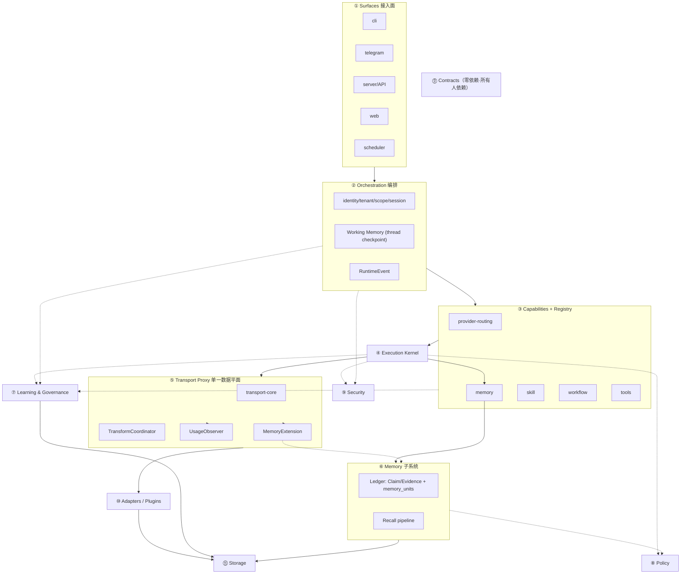
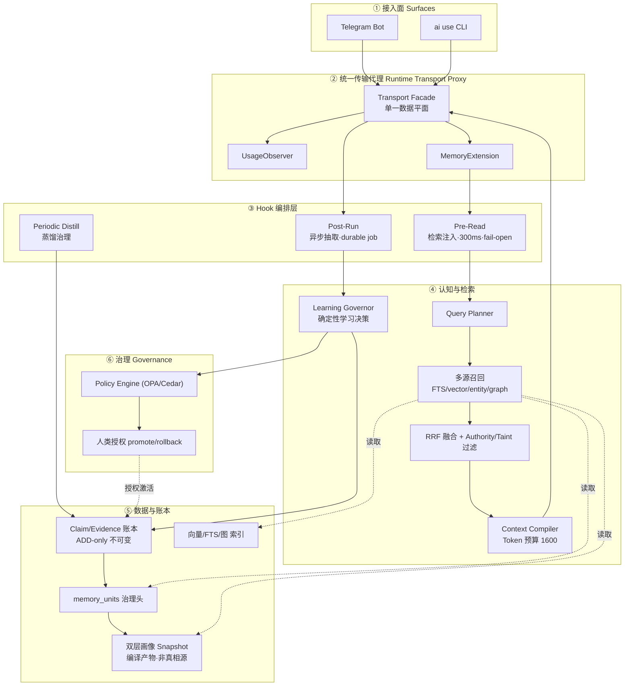
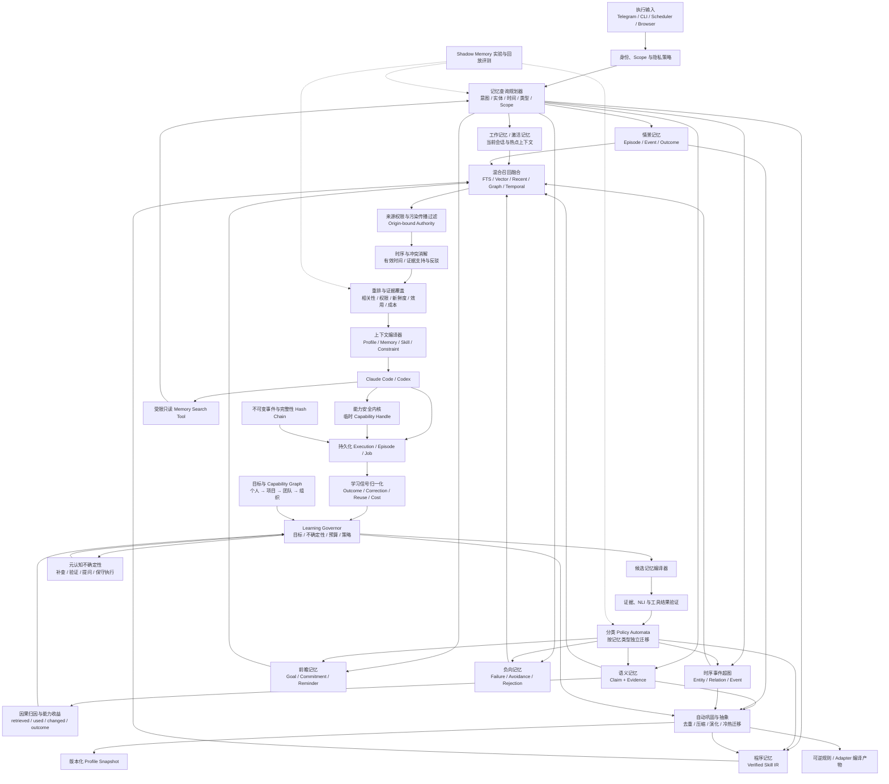
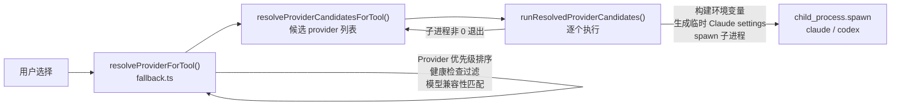
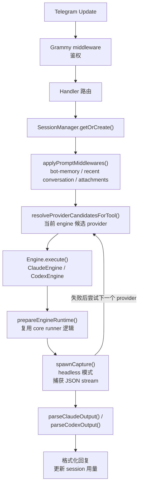
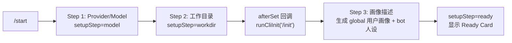

# AI Runtime 整体架构（doc_2.0）

> 受众：AI 与维护者。语言模式：**中英混合** —— 叙述用中文，标识符（类型/端口/字段/路径/规则号）保持英文原样，杜绝译名分叉。
> 权威顺序：`AI_RUNTIME_ARCHITECTURE.md`（英文正典）> `CONVENTIONS.md` > 本 2.0 文档层 > 中文评审文档。（原 `PROJECT_CONSTITUTION.md`、`SPEC.md` 内容已迁入本 2.0 文档层，见下方附录。）
> 本文是 doc_2.0 的**项目整体文档**；每个独立模块另有单独文档，见 [README](README.md)。

## 1. 产品定位（一句话）

本项目是**企业级 AI Runtime**：Runtime 才是产品，Model / Provider / Memory / Agent / Skill / Tool / Workflow 都是**可替换能力**。North Star：`每次交互让 Runtime 更强`。

### 1.1 首个产品切入点（不改变长期定位）

首个可销售、可验收的产品形态是 **Governed Coding/Agent Runtime**：在一个组织内统一承载开发者与知识工作者使用 Claude Code、Codex 及后续 Agent 的执行、记忆、学习与治理。它不是把 Runtime 缩减为 coding assistant，而是选择已有高频执行链路作为企业能力沉淀的第一条闭环。

首批核心用户与运营者：

| 角色 | 首要任务 | Runtime 提供的结果 |
|---|---|---|
| Developer / Knowledge Worker | 跨模型完成复杂任务并复用上下文与经验 | 可恢复执行、受治理记忆、可验证 Skill |
| Platform Admin | 管理 tenant、identity、policy、plugin 与数据边界 | 统一控制面、可审计发布、可回滚配置 |
| AI Ops / Security | 控制质量、成本、风险与合规 | SLO/成本归属、证据链、审计导出、kill switch |

首批必须闭环的三条产品工作流：

1. **Reliable Execution**：同一 `RuntimeRequest` 经统一身份、策略、路由、执行、用量与审计链路完成，失败可解释、可恢复、可切换。
2. **Governed Memory**：交互自动形成受 scope、authority、retention 与 purge 约束的 Claim/Evidence；用户可查看、纠正、固定、遗忘。
3. **Verified Skill**：重复成功过程自动形成 Skill candidate，经 replay/sandbox/shadow/evaluation 后由策略或人批准激活，失败可回滚。

首个发布周期的非目标仅表示**不作为首发阻塞项**，不删除长期能力：不自研通用 ANN/图数据库/队列/密码学/策略语言；不以完整桌面端、多模态组织复制、Parametric Promotion 或全自动高风险执行作为首发门槛。这些能力按 [roadmap.md](roadmap.md) 的后续 Release/Phase 继续交付。

## 2. 三条硬不变量（决定"可插拔 + 高内聚低耦合"）

这三条不落实，分多少层都会退化成 god-module。它们是所有模块文档的共同前提。

1. **契约层零依赖，所有人指向它（依赖倒置）**
   `L0 Contracts` 只放接口与类型，不依赖任何模块。其余每层只 import 契约，**绝不 import 兄弟模块的具体实现**。这一条单独决定"低耦合"。
2. **端口-适配器（Ports & Adapters / 六边形）**
   每个能力对外暴露一个 **Port 接口**，具体实现是 **Adapter**，启动期注入。换 Provider / 存储 / 检索后端 = 换 Adapter，上层零改动。这一条决定"可插拔"。
3. **发现 ≠ 激活（Discovery ≠ Activation）**
   插件靠 `CapabilityDescriptor`（id / semver / permissions / configSchema / health / lifecycle）被**发现**，由 `PolicyEngine` 决定**激活**。模型与插件都不能自我激活。

## 3. 规范动词约定（全 2.0 文档统一）

- **必须** = must（违反即不合规）
- **禁止** = must not（硬约束）
- **应当** = should（强建议，偏离需说明）
- **可** = may（可选）

## 4. 分层全景



依赖方向铁律：`surfaces → orchestration → capabilities → kernel → adapters → storage`，**只能向内、只 import 契约**；Policy / Security 是横切，在 recall / execution **之前**被调用。

## 5. 模块清单（每个模块一份独立文档）

| 层 | 模块 | 单一职责 | 独立文档 |
|---|---|---|---|
| ⓪ | Contracts | 端口与类型（零依赖） | [contracts.md](contracts.md) |
| ① | Surfaces | 意图 → `RuntimeRequest` | [modules/01-surfaces.md](modules/01-surfaces.md) |
| ② | Orchestration | 身份/租户/scope/session 归一化 + 事件 | [modules/02-orchestration.md](modules/02-orchestration.md) |
| ③ | Capabilities | 版本化能力契约 + 注册表 | [modules/03-capabilities.md](modules/03-capabilities.md) |
| ④ | Execution Kernel | 权限/幂等/重试/取消/隔离 | [modules/04-execution-kernel.md](modules/04-execution-kernel.md) |
| ⑤ | Transport Proxy | 单一数据平面转发+计量+注入 | [modules/05-transport-proxy.md](modules/05-transport-proxy.md) |
| ⑥ | Memory | 账本唯一真相源 + 检索流水线 | [modules/06-memory.md](modules/06-memory.md) |
| ⑦ | Learning & Governance | 确定性学习决策 + 晋升/回滚 | [modules/07-learning-governance.md](modules/07-learning-governance.md) |
| ⑧ | Policy | 无副作用确定性求值 | [modules/08-policy.md](modules/08-policy.md) |
| ⑨ | Security | 凭证/脱敏/隔离/执行期权限 | [modules/09-security.md](modules/09-security.md) |
| ⑩ | Adapters/Plugins | 供应商细节 | [modules/10-adapters-plugins.md](modules/10-adapters-plugins.md) |
| ⑪ | Storage | per-contract 可替换后端 | [modules/11-storage.md](modules/11-storage.md) |

## 6. 现状映射（当前 `src/` → 目标层）

| 当前位置 | 目标层 | 方向 |
|---|---|---|
| `src/core/runner/openai-usage-*.ts` | ⑤ Transport | 按职责拆 core / TransformCoordinator / UsageObserver / MemoryExtension |
| `src/core/context/`,`sessions/` | ② Orchestration | 合并上移 |
| `src/core/providers/`,`models/` | ③ Capabilities | 暴露稳定契约 |
| `src/telegram/memory/` | ⑥ Memory | 升级为账本初始实现 |
| CLI/engine/handler registries | ③ Registry | 收敛为单一 `CapabilityRegistry` |

## 7. 相关文档

- 产品架构全景图与中文解释：[architecture-map.md](architecture-map.md)
- 术语一致性：[glossary.md](glossary.md)
- 模块产品化就绪度判据：[extraction-readiness.md](extraction-readiness.md)
- 权威目标架构（英文）：[AI_RUNTIME_ARCHITECTURE.md](AI_RUNTIME_ARCHITECTURE.md)
- 服务等级与恢复目标：[service-level-objectives.md](service-level-objectives.md)

---

# 附：当前实现快照（Gateway 基础层）

> **Appendix Status: CURRENT SNAPSHOT** — 只描述记录时点的实现，不得覆盖目标架构或作为新增设计依据。
>
> 从旧 `ARCHITECTURE.md` 迁入，描述**当前 `src/` 实际实现**（非目标态）。目标态见各模块文档。标识符英文原样。

## A. 模块分层现状

```
src/
├── cli/                 表现层：commands/ output/ prompts/ registry.ts index.ts
├── core/                核心领域层
│   ├── config/          JSON/SQLite 持久化：cache/json/paths/providers/schema/session/usage-store
│   ├── context/         项目上下文注入
│   ├── integrations/    集成状态（provider revision / sync registry）
│   ├── logs/            结构化日志
│   ├── models/          model-discovery.ts / model-filter.ts（引擎兼容性）
│   ├── providers/       Provider 健康检查与刷新
│   ├── reports/         会话报告
│   ├── runner/          执行引擎（核心，见 §C）
│   ├── sessions/        CLI 会话管理
│   ├── status/          doctor/status 诊断
│   ├── usage/           usage-service.ts / pricing.ts
│   └── types.ts
└── telegram/            Telegram Bot 子系统
    ├── engine/          claude-engine / codex-engine / engine-utils / process-utils / registry / types
    ├── handlers/        callback/command/document/memory/message/setup/usage
    ├── interaction/     approval/command-menu/formatter/keyboards/prompt-middleware/
    │                    progress-reporter/token-budget/tool-name
    ├── session/         manager.ts（SQLite）/ store.ts / types.ts
    ├── memory/          memory-store/service/inject/types（中央 Bot Memory，global/bot scope）
    ├── templates/ bot.ts config.ts handler-registry.ts lifecycle-registry.ts log.ts network.ts
```

## B. 关键设计决策（现状）

| 决策 | 方案 | 理由 |
|---|---|---|
| 配置存储 | JSON (`~/.ai-gateway/`) + `proper-lockfile` | 可手编 + 文件锁/atomic rename 防 CLI/Telegram 并发覆盖 |
| Telegram 会话 | SQLite (`better-sqlite3`) | 需查询、索引、并发安全 |
| 工具执行 | `child_process.spawn` | 完整 TTY 继承（CLI）或 JSON stream 捕获（headless） |
| 用量追踪 | 本地 HTTP 代理 (`openai-usage-proxy`) | 透明拦截 Codex 请求，不改工具本身 |
| **目标传输代理** | OpenAI Usage Proxy 原位演进为**单一** Runtime Transport Proxy；UsageObserver 与 MemoryExtension 共用 listener/upstream | 保留 usage/compat 能力，避免双代理、环境变量回环、重复解析、协议适配器漂移 |
| **成熟能力复用** | 自研 Runtime/Evidence/Policy/Capability 控制面；抽取/混合检索/向量/时序图/checkpoint/队列/序列挖掘/策略求值/密码学/telemetry 走可替换 adapter | 保留产品差异化，避免重建通用问题 |
| 模型路由 | 优先级 + 健康检查 + 兼容性过滤 + 运行时 fallback | 选择阶段与执行失败后都能试下一个可用 provider |
| Bot Memory | 中央 SQLite + scope 逻辑隔离 | 用户画像跨 bot 共享，Bot 人设/领域知识仅当前 bot |

## C. Runner 引擎现状（→ 目标 ④ Execution Kernel + ⑤ Transport）

`src/core/runner/`：`command-resolver`（CLI 二进制查找）、`engine-registry`（Claude/Codex 策略注册；`ai use codex` 通过 process-scoped provider override 固定本次注入 Key，不改全局 Codex auth/config）、`tool-runner`（运行环境+密钥注入+临时文件）、`fallback`（候选排序：健康→兼容→优先级+覆盖）。`openai-usage-*` 系列（server/http/responses/recording/types）是本地 HTTP 代理，**目标态剥离到 ⑤ Transport Proxy**。

## D. 双路径用量采集（→ 目标 ⑤ UsageObserver）

- Claude 路径：JSON stream 的 `cost_usd/total_cost_usd` → `ExecutionResult.cost`。
- Codex 路径：`openai-usage-proxy` 拦截 → 解析 Response headers/body → `ExecutionResult.usage`。
- 两路径 → `SessionManager.recordProviderUsage()` → SQLite `session.providerUsage[]` + `pricing.ts` 成本估算。

## E. 进度流式现状（→ 目标 ①/② 呈现与事件）

底层管道本就是流式（Claude `--output-format stream-json`；Codex `codex exec --json`）。`spawnCapture({onStdout})` 通过跨 chunk JSONL accumulator 实时解析 `tool_calling/writing` 等 `ProgressUpdate`；`ProgressReporter`（节流默认 1500ms，编辑**同一条**状态消息）展示阶段、工具和有界响应预览，任务结束时短结果直接覆盖该消息。**不采用 token 级逐 token 编辑**：Telegram `editMessageText` 有频率限制；当前按完整 JSON stream event 合并预览，避免 429 和重复执行。

---

# 附：项目宪法（从 PROJECT_CONSTITUTION.md 迁入）

> **Appendix Status: CONSTITUTION SUMMARY** — 仅使命、North Star 与硬不变量具有人类批准的稳定权威；实现细节仍服从英文正典和 L0。
>
> doc_2.0 三条硬不变量的**上游依据**。宪法本身是英文 normative 文档，此处保留其核心主张的中文摘要，标识符/口号英文原样。

## A. 产品定位

不是又一个 AI 助手 / 记忆系统 / agent 框架。**The Runtime is the product.** 记忆、知识、技能、工作流、工具调用、执行、学习、推理都是 Runtime 的**模块**，不是产品本身。

## B. North Star

**Every interaction makes the Runtime more capable.** 对话结束时 Runtime **不重置**；随使用变得更强、更可靠、更可运营。演进路径：

```text
Individual Experience → Knowledge → Skill → Capability
→ Organizational Intelligence → Collective Intelligence
```

## C. 核心原则（→ 映射到本文 §2 三不变量）

| 宪法原则 | 本文不变量对应 |
|---|---|
| **Runtime First** | 一切可复用能力归 Runtime，memory 只是子系统之一 |
| **High Decoupling** | 不变量①：模块单一职责 + 显式边界 + 可独立替换；无 ADR 不得增加耦合 |
| **Stable Interfaces** | 不变量②：跨模块契约稳定、版本化、迁移感知 |
| **Provider Agnostic** | Runtime **绝不**依赖单一模型/厂商；每个模型都是可替换 provider capability |
| **Plugin First** | 能力支持发现/替换/组合/版本化/**策略治理下的激活** |
| **Learning by Default** | 不变量③：成功产出可复用经验，失败产出可复用教训；但**激活 ≠ 免审**，晋升受 trust/evidence/policy/human authority 治理 |
| **Enhance Before Expand** | 新模块须先证明现有边界无法合理容纳它 |
| **Organization First** | 为组织长期智能与可靠性优化，非单次回答或单用户局部便利 |

## D. 开发哲学与成功判据

**Architecture first · Documentation driven · AI accelerated · Human governed.** 架构是真相源，代码是架构的实现而非替代。成功判据是**组织知识累积、验证过的 skill 跨 scope 复用、能力在证据与治理下演进、Runtime 越用越可靠**——功能数/模型数/记忆存量**本身不是**成功指标。人类操作者对 security/policy/promotion/不可逆动作保留最终权限。

---

# 附：目标架构总览（从 memory-system-spec 迁入）

> **Appendix Status: DESIGN SOURCE** — 保留迁移前的架构推理；当前 ownership 以英文正典与本文正文为准。

> 从 `memory-system-spec.md` 迁入，聚焦**记忆/学习子系统的终局架构（Phase 13）**与其在整体 Runtime 中的位置。当前代码只落地到 Telegram Memory Phase 1，与本节存在数量级落差；引用任何组件前请先按「当前状态」核对实现状态。规范性强制条款见 [enforcement-decisions.md](enforcement-decisions.md)（R1–R36）。标识符英文原样。

## A. 记忆/学习子系统目标

Memory 不是独立产品，而是 AI Runtime 的**学习与知识子系统**。目标是重新设计一套顶层记忆系统，使记忆能力不再依赖手动记忆命令，而是通过统一 hook **自动参与每一次对话、执行、总结和上下文注入**。

该系统必须同时服务：

- Telegram Bot 中的 Claude Code / Codex 对话
- 终端 `ai use claude ...` / `ai use codex ...`
- Browser 自动化、计划任务等 AI Gateway Core 执行入口

核心原则：

> 大模型负责理解、操作和生成；AI CLI 服务层负责记忆筛选、登录态、敏感信息隔离和安全边界。

账号、密码、cookie、token、session storage 等敏感信息不进入大模型上下文。需要登录的网站由本地服务层维护登录状态，大模型只获得"已登录能力"，不能读取凭证本身。

## B. 当前状态

现有实现是 Telegram Bot Memory Phase 1：

| 能力 | 当前状态 | 说明 |
|------|----------|------|
| 中央 SQLite 记忆库 | 已实现 | `~/.ai-gateway/memory.sqlite` |
| global / bot scope | 已实现 | `global` 跨 bot，`bot` 仅当前 bot |
| Telegram prompt 注入 | 已实现 | Telegram 调 Claude Code / Codex 前注入 `<user_memory>` |
| setup 画像写入 | 已实现 | Telegram 初始化时生成 profile/persona |
| 短期记忆 TTL | 已实现 | `short_term` 到期清理 |
| 记忆检索向量模型配置 | 已实现 | `ai memory embedding` 交互配置，保存到 `~/.ai-gateway/memory.json` |
| 自动记忆 | 未实现 | 普通聊天不会自动写入 |
| 终端 `ai use` 接入 | 未实现 | 当前只接 Telegram |
| 向量检索 | 未实现 | 当前是轻量关键词匹配；embedding provider 配置和探测已先行完成 |
| 凭证/登录态隔离 | 未实现 | 目前 credential 类明文保存被拒绝 |

新的设计方向：

- 记忆建立默认由 hook 自动完成；旧的底层手动命令在统一审计界面和显式 `pin/correct/forget` 能力完整替代后再移除，不允许先移除用户纠错入口。
- 记忆核心迁移到 `src/core/memory`，Telegram 和 CLI 只是调用方。
- 所有执行入口统一经过 memory hook。
- 敏感登录态由独立 `auth session` 服务管理，不属于普通 prompt memory。

> **规格与实现的边界（重要，勿误读）**
>
> 本节描述的是 Runtime 记忆子系统的**终局架构（Phase 13）**。当前代码只落地到 Telegram Memory Phase 1，二者存在数量级落差。引用任何组件前，请先按下表核对实现状态，避免误以为账本、Governor、Transport Proxy 已存在：
>
> | 规格组件 | 代码现状 | 位置 |
> |---|---|---|
> | 单表 `memories` | 已实现 | `src/telegram/memory/memory-store.ts` |
> | `memory_units` 治理头 + Claim/Evidence 账本 | 未实现 | 无 |
> | scope 分级 | 仅 `global` / `bot` 两级（终局为 5 级） | `src/telegram/memory/types.ts` |
> | 多源召回 + RRF 融合 + 向量检索 | 未实现，当前为关键词打分 `scoreMemory` | `memory-service.ts` |
> | Learning Governor / confidence 状态机 / 自动抽取 | 未实现，记忆全靠显式 `remember()` | 无 |
> | Runtime Transport Proxy 单一数据平面 | 未实现 | `src/core/transport-proxy/` 目录不存在 |
> | 版本化 migrations | 未实现，`create table if not exists` 直建 | 无 migrations 目录 |
> | 凭证加密 | 未启用，credential 类直接抛错 | `memory-service.ts` |

## C. 非目标

以下能力不在记忆模块里实现：

- 不保存用户账号密码明文。
- 不把 cookie、token、localStorage、sessionStorage 注入 prompt。
- 不让大模型直接填写密码输入框。
- 不把网页登录态当作普通 memory 文本保存。
- 不改写 Claude Code / Codex 的原生记忆文件作为主存储。

Claude Code 的 `CLAUDE.md`、Codex 的 `AGENTS.md` 仍然由各自 `/init` 管理；AI Gateway Memory 是更上层的动态注入与自动治理系统。

## D. 分层总架构图（俯瞰）

下图是终局架构的六层俯瞰，每个节点的中文职责见图后说明。它与 [02-orchestration.md](modules/02-orchestration.md) 附录的"执行流程图"互补：这张看**分层与治理**，那张看**请求时序**。



**节点中文职责：**

- **① 接入面**：Telegram / `ai use` 两个入口共用同一数据平面，不各自维护记忆逻辑。
- **② Transport Facade**：唯一请求/响应通道；禁止双代理链与 usage 双写。现有 OpenAI Usage Proxy 应拆为 Facade + Transport 核心 + Observer。
- **② MemoryExtension**：记忆作为传输层扩展挂载，保证所有流量可被观测与注入。
- **③ Pre-Read**：发请求前检索注入，300ms 硬截止，超时放行不阻塞主链路（fail-open）。
- **③ Post-Run**：响应后异步抽取候选，写 durable job；身份相关失败 fail-closed（宁可不记也不记错人）。
- **③ Periodic Distill**：周期性蒸馏、巩固、遗忘，维护账本健康。
- **④ Query Planner → 多源召回**：把 prompt 编译成检索计划，并行走 FTS/向量/实体/最近/时序/图/情节/技能。
- **④ RRF 融合 + 过滤**：`rrf = Σ sourceWeight/(60+rank)` 融合，再按 Authority/Taint 过滤挡投毒。
- **④ Context Compiler**：1600 token 预算内按 policy/profile/skills 分配，预留 20% 给主 prompt。
- **④ Learning Governor**：确定性状态机决定候选 create/verify/ask/consolidate/promote/rollback；模型只提候选，不自行激活（见 [enforcement-decisions.md](enforcement-decisions.md) R32）。
- **⑤ memory_units + Claim/Evidence 账本**：治理头统一生命周期；事实拆成可变 Claim + 不可变 Evidence，ADD-only，可追溯可回滚（R9/R18）。
- **⑤ 双层画像 Snapshot**：从 active Claim 编译的版本化产物，非真相源；真相源永远是账本。
- **⑥ Policy Engine + 人类授权**：策略引擎 + 人类保留对安全、晋升、不可逆动作的最终授权。

## E. 最终增强架构

下面是系统完成全部阶段后的目标架构。它不是替换前述基础链路，而是在统一 Hook、Runtime Transport Proxy 和 SQLite 主存储之上，增加类型化记忆、证据账本、来源权限、规划式检索、时序事件图、可验证 Skill、未来意图、负向经验和能力安全内核。Memory Injection/Capture 与 Usage Metering 共用传输数据平面，但保持独立扩展状态、指标和故障边界。



### 中文链路说明

1. **身份与安全先行**：所有入口先解析 canonical account、bot、project、会话类型和 privacy policy。身份不明确或 scope 校验失败时禁止记忆读写，不能靠模型猜测用户或项目。
2. **查询规划而非固定关键词搜索**：`MemoryQueryPlanner` 将当前任务拆成意图、实体、时间范围、所需记忆类型和检索路线；简单请求走快速路径，复杂问题可以组合语义、情景、图谱、Skill、未来承诺和负向经验。
3. **多层记忆并行召回**：工作记忆负责当前会话热点；语义记忆保存可验证 Claim；情景记忆保存执行经过；程序记忆保存可验证 Skill；前瞻记忆保存未来触发条件；负向记忆保存失败和禁忌。
4. **先过滤权限，再判断事实**：所有候选先经过 origin-bound authority 和污染传播过滤。模型摘要、蒸馏或工具转述不能把 external 来源洗白成可信用户事实。
5. **冲突和时间是检索主流程的一部分**：系统在注入前判断事实当前是否有效、是否已被新版本取代、支持与反驳证据各有多少；不能把互相冲突的记忆不加说明地同时交给主模型。
6. **上下文是编译产物**：Profile、普通记忆、约束、Skill 和 auth capability 由 `ContextCompiler` 按 audience、token budget 和任务目的生成；Profile Snapshot 不是事实源，随底层 Claim 更新而重新编译。
7. **允许一次受限的主动回忆**：初始 Pre-Read 后，如果主模型发现信息不足，可以调用只读 `memory.search` 补查；该工具继续执行相同的 user/scope/privacy/authority 过滤，并受调用次数和 token 上限约束。
8. **工具能力与记忆完全解耦**：模型只能获得当前 execution 临时签发的 capability handle；记忆正文、Skill 或网页内容都不能创建、扩权或延长 capability。
9. **写入采用证据驱动状态机**：Post-Run 先持久化 execution、episode 和 durable job，再异步抽取 Claim、Evidence、Event、Skill 候选；本地 Policy Automata 按类别决定 active、pending、验证、归档或拒绝。
10. **长期记忆自动巩固而非只做追加**：事件量、重复率、检索干扰、目标变化和周期调度均可触发 Consolidation；系统自动生成多粒度摘要、Profile、Skill、失败模式和冷热分层，但压缩产物只能作为可回源投影，不能覆盖 Claim/Evidence 真相源。
11. **学习由统一目标闭环控制**：Learning Governor 根据任务成功、人工纠正、复用、成本、陈旧错误、安全和隐私指标选择"生成何种候选、是否验证、是否提问、是否压缩、是否提升或不学习"；模型只提出候选，确定性 Policy 和人类权限决定激活。
12. **系统知道何时不知道**：Runtime 同时估计事实、检索覆盖、冲突、Skill 适用性和目标风险的不确定性；按策略选择继续检索、调用验证器、向用户提出最小澄清问题或保守执行，禁止用高语气置信度掩盖证据缺口。
13. **所有演化均可回放和审计**：写入、合并、压缩、取代、权限变化、Skill 升级、Profile 编译和组织级提升均写不可变事件；事件建立 hash chain，Shadow Memory 使用真实脱敏轨迹回放候选策略而不影响生产回答。

### 设计目标

- **不阉割能力**：FTS、向量、时序、图谱、蒸馏、Skill、Auth、主动检索和多 Agent 共享均保留，低可行性环节通过结构化验证和回放机制增强，而不是删除。
- **记忆是一等系统资源**：记忆具有类型、来源权限、证据、有效时间、版本、生命周期、检索成本和可迁移表示，不等同于一段可搜索文本。
- **模型负责理解，内核负责裁决**：模型可以提出候选、查询计划和 Skill 草案，但数据库状态迁移、权限提升、冲突取代和工具授权必须由本地确定性组件执行。
- **完整性优先于召回率**：禁止泄漏、错误自动激活、来源洗白和过期事实误用的优先级高于多召回几条相关记忆。
- **演化必须可验证**：任何声称"更聪明"的检索、蒸馏或 Skill 策略都必须通过离线黄金集、历史回放、shadow mode 和线上匿名质量指标证明。
- **能力收益而非记忆数量**：memory count、召回次数和模型自评都不是智能增长证明；每个学习产物必须关联 Runtime 目标，并以任务成功、纠正减少、有效复用、成本或风险改善中的至少一项衡量。
- **自动化不等于自动扩权**：自动提取、自动压缩、自动验证和低风险自动激活是默认体验；跨 scope 提升、高风险 Skill、不可逆动作和安全策略变化仍由 Policy Kernel 与人类权限控制。

## F. 模块边界

| 模块 | 职责 |
|------|------|
| `core/memory` | 记忆存储、分类、检索、注入、自动提取、Learning Governor、因果评估、巩固压缩与遗忘；它实现 Runtime Learning and Governance 契约，不拥有工具授权 |
| `core/memory/adapters` | 成熟 extractor、vector、reranker、temporal graph、checkpoint、queue、protected payload、procedure mining、policy、evaluation 后端适配；只返回候选、决策或可重建投影，不拥有权威状态 |
| `core/auth-session` | 登录态维护、cookie/storage state、凭证隔离、人工登录流程 |
| `core/execution` | 统一执行编排、hook 生命周期、trace、入口能力校验、持久化 Post-Run 入队 |
| `core/transport-proxy` | 唯一本地 HTTP 数据平面：监听、上游路由、协议兼容转换、流式转发、背压和扩展隔离；承载 Usage Observer 与 Memory Extension，不拥有 Memory 真相或学习策略 |
| `telegram/*` | Telegram UI、session、消息收发、spawn CLI（headless stream-json 模式） |
| `cli/*` | `ai use` 执行入口、spawn CLI（原生 TUI 模式） |

## G. 关键结论

> 规范性强制条款编号见 [enforcement-decisions.md](enforcement-decisions.md)（R1–R36）。

1. 记忆系统是 AI Runtime 的学习与知识能力，不属于 Telegram、某个 Agent、某个模型或独立 Memory 产品。
2. 默认依靠 hook 自动记忆，但显式 pin/correct/forget/purge 是用户控制面；旧命令只能在等价 UI/CLI 上线后移除。
3. 长期记忆、短期记忆、项目记忆必须分层；会话上下文由 conversation buffer 承载，不落库。
4. 用户画像和 bot 画像是由 Claim 编译的版本化 Snapshot，不是真相源；按 audience/purpose 注入并受 privacy policy 与 token cap 约束。
5. SQLite 继续作为主存储，Markdown 只用于导出和人工审计。
6. 向量搜索可以扩展；当前已完成 embedding provider 配置，真正的向量入库、召回和 rerank 应在 FTS5 和事件审计稳定后再做。
7. 账号密码不属于 memory，登录态由 Auth Session Broker 维护。
8. 大模型只使用服务层提供的登录能力，不接触 secret。
9. 跨源身份绑定（R1）和自动抽取的异步/成本模型（R2）是地基，必须前置到 Phase 1-2，不是后期增强。
10. 自动记忆的信任边界不止凭证：不可信来源的候选（R3）永不自动 active，遗忘/彻底清除/导入导出（R10）是一等命令。
11. Auth Session Broker 是并行 track，其进度不阻塞记忆分层与检索增强。
12. 检索评测 harness（R11）在 Phase 0 建立，先于 FTS/向量/时序/图谱/回流，之后每次检索改动都以它把关。
13. 时序正确性（R12/R13）与证据强度（R4/R19）是正交两轴：前者管"何时成立"，后者管"哪些独立来源支持或反驳"，冲突消解同时用两者。
14. Skill 是程序性记忆，由"情景层→蒸馏→Skill IR→回放/Shadow 验证"沉淀；沉淀主链是确定性算法（相似度聚类→anti-unification 参数化→trace alignment 防幻觉→失败自动重挖或 deprecate，坏经验不污染后续挖掘，R36），模型只提候选。高危步骤、external 来源和环境变化必须进入确认或重验证路径。
15. 记忆与 Skill 是隐式自动能力，必须可观测：R17 通过统一 `CapabilityObservation`、非阻塞 `ObservabilitySinkPort` 和授权 `ObservabilityQueryPort` 展示逐 route 检索、过滤、排名、预算、注入、Skill step 与实际 Capability 调用；JSONL/OTel/dashboard 只投影同一次 emission，并显式标记 sampling/drop completeness。R18 复用 `ProgressReporter` 展示中间态且不泄内容。两者从每个节点落地时同步建设，不作事后补丁。
16. 所有入口统一通过 spawn CLI + 单一 Runtime Transport Proxy 执行；现有 Usage Proxy 按职责拆分为稳定 facade、Transport 核心和唯一 UsageObserver，Memory Proxy 是同一数据平面内的 MemoryExtension。协议层实现 OpenAI Responses/Chat、Anthropic Messages、streaming state machine、tool assembler 和 fixture replay；禁止双代理链与 usage 双写。
17. Post-Run 的"异步"必须是 SQLite durable job，不是进程内 Promise；operation id、lease、重试和 dead-letter 保证进程退出后仍可完成且不重复。
18. canonical schema 使用统一 Memory Unit + 类型化 Payload + Claim/Evidence Ledger；Phase 只启用能力，不再向万能 memories 单表叠加类别专用字段。
19. prompt 注入清洗不是安全边界；provenance、结构化类型、scope SQL 过滤、独立 tool permission 和用户确认共同构成边界。
20. 来源权限必须绑定原始 origin 并随派生传播，模型摘要、蒸馏、Profile 编译、图谱抽取和 Skill 归纳都不能洗白 external 来源。
21. 检索由 Query Planner、多源融合、authority/时态冲突过滤和 Context Compiler 组成；主模型可以进行受限只读的迭代式补查。
22. 系统同时管理语义、情景、程序、前瞻、约束和负向记忆；失败经验与禁忌是一等记忆，不是日志附属品。
23. capability 是 execution-bound 的安全对象，不是 prompt 文本；任何记忆都不能授予或扩展工具权限。
24. 所有策略演化先经过 replay/shadow；事件 hash chain 和可逆 parametric promotion 保证系统可审计、可验证、可回退。
25. Evidence 的可信度传播依赖可遍历 Derivation DAG，`origin_set_hash` 不能替代来源图；用户确认必须绑定具体 Claim 和展示值。
26. Runtime Transport Proxy 是协议交换状态机和唯一数据平面，不是普通 HTTP 中间件；retry、continuation、compaction、cancel、compatibility translation 和 unknown event 必须通过 fixture replay 证明不重不漏。
27. Pre-Read 使用 L0-L2 分层延迟预算；远程规划、复杂图推理和反事实属于 L3 主动补查，不能阻塞首次请求。
28. 模糊时间和相对时间是一等数据类型；Temporal Event Hypergraph 是 `TemporalGraphProjection` 上可从 Claim/Evidence/Episode 重建的逻辑投影，不要求自研图引擎。
29. Skill 的自动化可行性由受限 DSL、Historical Replay、Sandbox 和 Shadow Validation 保证，不以重复成功次数单独决定 active。
30. Memory Utility 使用多维信号和异步采样反事实；反馈只能改变排序效用，不能自我强化事实 confidence。
31. 自动记忆、自动沉淀、自动学习和自动压缩由同一个可度量闭环驱动：Execution→Signal→Decision→Candidate→Evaluation→Promotion/Rollback，不以存储数量代替能力增长。
32. Learning Governor 属于 Runtime Learning and Governance 在 `core/memory` 内的实现，不是新产品或可扩权 Agent；模型提出候选，确定性策略和人类权限决定激活。
33. Runtime 必须显式表示检索覆盖、事实冲突、Skill 适用性和策略歧义，并在继续、补查、验证、提问和保守执行之间做可解释选择。
34. 自动压缩只替换可回源投影，不能覆盖 Claim/Evidence；智能遗忘优先降温和失效，物理删除仍由 TTL、用户命令和组织保留策略控制。
35. MemoryExtension 必须按可替换扩展治理，通过兼容矩阵、fixture/canary、独立模式、熔断、资源上限和 kill switch 把风险限制在记忆增强链路内；Memory 降级不得关闭 Usage 或拖垮 forwarder。
36. 多设备/Team Memory 使用签名事件复制、因果顺序和密钥轮换；Artifact 生命周期必须沿派生链完整撤回。
37. Parametric Promotion 分为 rule、classifier、context adapter 和 opt-in model adapter；完整能力保留，但每一级都有独立评测与撤销门槛。
38. 长期 Memory Simulation Harness 是 learned ranking、自动 Skill、复制和 promotion 的生产闸门，短期 retrieval 指标不能替代长期演化验证。
39. 原始传输数据与持久化学习证据必须类型隔离；只有 SanitizedTurnEnvelope、hash 和 TTL 加密 provenance refs 能越过 RedactionGateway。
40. 项目只自研体现 Runtime 产品定位的控制面和权威语义；抽取、混合检索、向量索引、时序图、checkpoint、队列、序列挖掘、策略求值、评测、密码学和 telemetry 优先复用成熟实现，并以 adapter、contract test、local fallback 和供应链治理避免厂商锁定。

# 附：当前实现补充（数据流 / 类型体系 / 用户场景）（从 ARCHITECTURE/SPEC 迁入）

> **Appendix Status: CURRENT SNAPSHOT** — 用于理解 legacy 行为和 migration 输入，不定义目标 contract。

## A. 核心数据流

**CLI 使用流程 (`ai use`)：**



**Telegram 执行流程：**



**Telegram Setup 引导流程：**



## B. 核心类型体系

```typescript
// === Core 全局类型 ===
Provider          // 服务商配置 (name, baseUrl, apiKeyRef, model, mode, level)
ProviderCache     // 缓存状态 (status: HealthStatus, models[], lastCheckedAt, lastError)
UsageEvent        // 用量事件 (tokens, provider, model, source)
TokenUsage        // Token 统计 (inputTokens, outputTokens, totalTokens, cacheReadInputTokens)
SessionRecord     // CLI 会话记录
LogEvent          // 结构化日志 (level, category, action, message, metadata)

// === Telegram 类型 ===
TelegramSession   // SQLite 持久化会话
  - id, chatId, engine, engineSessionId
  - cwd, permissionMode, setupStep, status
  - messageCount, attachments[], conversation[], pinnedTurns[], providerUsage[]

TelegramConfig    // JSON 配置 (12 个字段)
  - token, allowAllUsers, allowedUserIds
  - defaultEngine, defaultCwd, defaultPermissionMode
  - sessionTimeoutHours, maxOutputLength
  - provider?, model?, proxyUrl?, dbPath

MemoryEntry       // 中央 Bot Memory 条目
  - chatId, scope(global|bot), botId?
  - category(profile|persona|credential|fact|preference|note|skill)
  - title, content, tags[], priority, duration, encrypted, expiresAt

ExecutionResult   // 引擎执行结果
  - sessionId?, response, toolCalls[], filesChanged[]
  - diff?, cost?, usage?, duration?, provider?, model?

PermissionRequest // 危险操作审批请求
  - id, tool, description, command?, filePath?, params

```

## C. 核心用户场景

> 以下场景来自 SPEC.md §2 Core User Scenarios，原文为英文，保持不变。

Users should be able to run one command:

```bash
ai
```

Then enter the interactive workflow and complete common tasks:

- Choose Claude Code or Codex CLI.
- Add providers.
- Edit provider configuration.
- View provider health and token usage.
- Select a default provider by priority.
- Automatically fall back to the next available provider when the current provider is unavailable.
- Execute work through one governed Runtime context across CLI and Telegram.
- Accumulate auditable knowledge and skills without allowing model output to bypass policy.
- Promote validated capabilities to the appropriate user, project, team, or organization scope.

The latter scenarios are target Runtime behavior and must be delivered incrementally without breaking the current Gateway workflows documented below.
