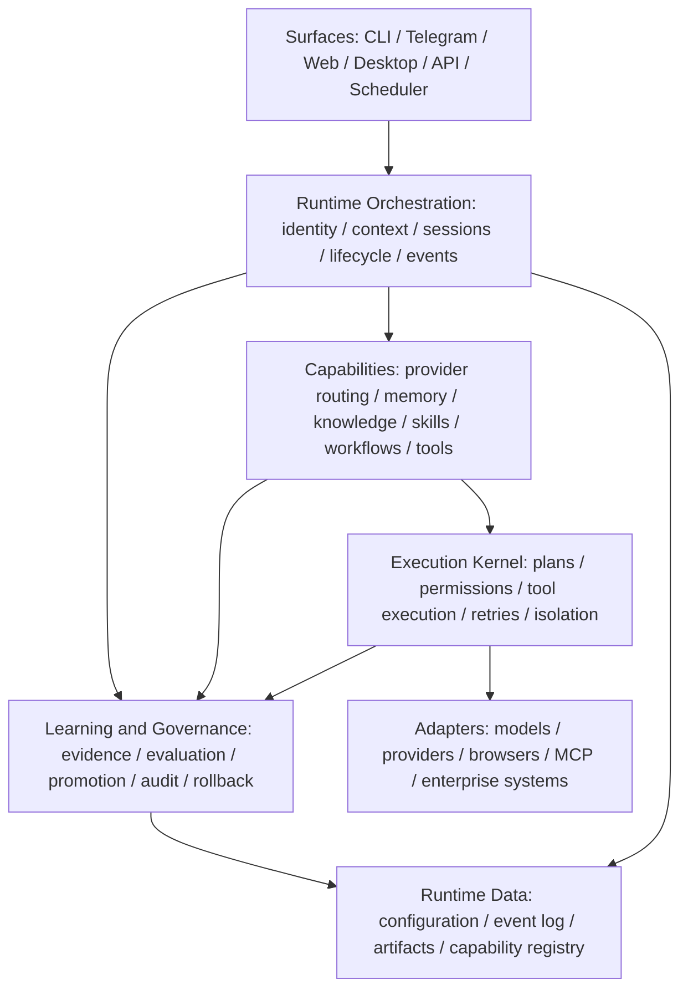

# AI Runtime Target Architecture

> Audience: AI agents and maintainers. This is the normative target architecture. `ARCHITECTURE.md` is the Chinese current-state and review document.

## 1. Architectural Objective

Evolve the existing AI Gateway into an enterprise AI Runtime without discarding its working provider routing, execution, usage, Telegram, Hermes, and memory foundations.

The transition is evolutionary:

```text
Provider Gateway
  -> Unified Execution Runtime
  -> Governed Learning Runtime
  -> Organizational Capability Platform
```

The Runtime owns durable execution, policy, learning, and capability composition. Models and delivery surfaces remain adapters.

## 2. Layer Model



### Surface Layer

CLI, Telegram, web, desktop, APIs, and schedulers translate user or system intent into stable Runtime requests. They must not own provider selection, memory policy, skill promotion, or tool authorization.

### Runtime Orchestration

Orchestration normalizes identity, tenant, project, session, trace, policy, and execution context. It runs lifecycle hooks and emits durable events.

### Capability Layer

Capabilities expose versioned contracts. Initial capabilities include provider routing, model discovery, usage, memory, knowledge, skills, workflows, tools, reports, and integrations.

### Execution Kernel

The kernel executes governed work. It owns permission checks, retries, idempotency, cancellation, isolation, side-effect classification, and structured execution events.

### Learning and Governance

Learning converts execution evidence into candidates and measures whether those candidates improve Runtime capability. Governance decides whether candidates become active knowledge, skills, or capabilities. A versioned, deterministic Learning Governor selects learning actions against explicit objectives, uncertainty, policy, and budget; it does not generate content or grant execution permission. Models propose and may provide weak evaluations; deterministic policy and humans authorize activation, scope promotion, and irreversible decisions.

### Adapter Layer

Provider, model, browser, MCP, Hermes, and enterprise-system integrations are replaceable adapters. No adapter may redefine core policy.

## 3. Capability Evolution

```text
Execution Event
  -> Evidence
  -> Knowledge Candidate
  -> Validated Knowledge
  -> Skill Candidate
  -> Validated Skill
  -> Governed Capability
  -> Organization-Scoped Reuse
```

Promotion must preserve provenance, evidence, version, scope, policy decision, evaluation result, and rollback information.

## 4. Stable Runtime Contracts

The target core contracts are:

- `ExecutionContext`: identity, organization, project, session, source, provider constraints, policy, and trace.
- `RuntimeRequest`: intent plus typed inputs and requested capabilities.
- `RuntimeEvent`: append-only structured lifecycle evidence.
- `CapabilityDescriptor`: identity, version, contract, permissions, dependencies, and activation state.
- `CapabilityInvocation`: typed capability call with idempotency and policy context.
- `PolicyDecision`: allow, deny, require confirmation, or constrain.
- `LearningCandidate`: proposed knowledge, skill, workflow, or capability with evidence.
- `EvaluationResult`: deterministic and model-assisted quality evidence.
- `LearningObjective`: versioned capability outcome, scope, metrics, hard safety regressions, and minimum evidence.
- `LearningSignal`: normalized execution outcome, correction, reuse, failure, cost, latency, or policy evidence.
- `LearningDecision`: deterministic choice to create no artifact, extract, verify, ask, consolidate, evaluate, promote, or roll back.
- `UncertaintyAssessment`: fact, retrieval coverage, conflict, temporal, applicability, policy, and goal-impact uncertainty plus a bounded next action.
- `CapabilityGain`: baseline-versus-candidate outcome measurement with sample counts, uncertainty, and hard regressions.
- `CompressionManifest`: reversible mapping from source evidence and memory units to a validated compiled projection.
- `TransportRouteLease`: execution-bound local listener route, upstream origin, engine, owner, expiry, and connection budget.
- `TransportExtension`: bounded observer or declarative request-patch contributor that never owns a listener or upstream connection.
- `TransportTransformManifest`: ordered compatibility and extension patches with allowed paths, before/after hashes, and rollback metadata.
- `SanitizedTurnEnvelope`: persistable evidence for one correlated turn containing allowlisted metadata, hashes, and encrypted TTL content references, never raw headers or full prompts.
- `SanitizedExecutionEnvelope`: execution-level aggregate that references one or more `SanitizedTurnEnvelope` values and attempt outcomes without copying raw transport content.
- `CandidateExtractor`: provider-neutral add-only memory extraction contract.
- `RetrievalBackend`: scoped semantic, lexical, entity, temporal, graph, or reranking provider contract.
- `TemporalGraphProjection`: rebuildable graph projection over authoritative Claim/Evidence ids.
- `WorkflowCheckpointBackend`: thread-scoped execution checkpoint contract, separate from cross-execution Memory truth.
- `PolicyEngine`: deterministic, side-effect-free policy evaluation contract.
- `EvaluationHarness`: versioned benchmark and domain evaluation contract whose results are evidence rather than activation authority.

Contracts must be provider agnostic and serializable where cross-process execution is required.

### Governed Learning Loop

The normative automatic-learning loop is:

```text
RuntimeEvent
  -> LearningSignal
  -> LearningDecision
  -> LearningCandidate or no artifact
  -> EvaluationResult
  -> PolicyDecision
  -> active artifact / retained candidate / rollback
  -> CapabilityGain
```

The loop must distinguish retrieval from causal contribution: retrieved, injected, referenced, decision changed, and outcome changed are separate states. Retrieval frequency cannot increase factual confidence. Fact confidence comes from evidence; usage utility comes from outcome attribution.

Automatic extraction, low-risk category activation, consolidation, compression, and evaluation may run by default after their release gates pass. Scope promotion, high-risk skills, tool authority, security policy, and irreversible actions remain policy- and human-governed. `no artifact` is a valid learning decision and is preferred when durable reuse value is not demonstrated.

Goal relationships and capability dependencies are rebuildable projections over authoritative goals, claims, episodes, skills, and evaluation results. They may prioritize retrieval and validation but may not override tenant, privacy, evidence, or permission boundaries.

Compression replaces projections, never authoritative Claim/Evidence provenance. Every active compressed artifact must provide complete source coverage, a compiler version, evaluation results, and a rollback artifact. Automated forgetting should first cool, invalidate, or archive projections; physical deletion remains controlled by TTL, retention policy, and explicit user or organization authority.

### Unified Runtime Transport Proxy Boundary

The repository already has a production OpenAI Usage Proxy with Responses-to-Chat compatibility translation, usage records, metrics, and direct Codex/Telegram callers. The Runtime must enhance that capability into one provider-agnostic Runtime Transport Proxy. It must not add a second Memory HTTP proxy or chain `Memory Proxy -> Usage Proxy -> provider`.

Each execution has one listener, one upstream route, one base-URL override, and one ordered transform coordinator. The existing `startOpenAiUsageProxy()` API remains a compatibility facade over the unified data plane until callers migrate. Its translation, records, metrics, cost, usage persistence, and error semantics are preserved by parity tests.

The transport boundary owns only local listening, route leases, validated upstream connections, header policy, compatibility transforms, streaming, backpressure, and isolated extension dispatch. Usage metering is read-only with respect to transport payloads while remaining the sole writer of accounting state. Per-turn memory observation and injection are a `MemoryExtension`. Neither observer may own a listener, independently forward a request, or mutate raw protocol payloads.

Migration splits the current implementation by responsibility rather than renaming it as one unit. Critical request decoding, Responses/Chat/provider compatibility, forwarding, and response-byte delivery belong to the transport core. `UsageObserver` is the only owner of usage normalization, cost calculation, records, metrics, and `usage.json` persistence. `MemoryExtension` may request an allowlisted instruction patch and consume sanitized canonical events, but it must not translate provider protocols, calculate billable usage, or write a parallel usage ledger. The legacy facade exposes transport route information plus views of the single UsageObserver state; it does not retain a second server or duplicate counters.

Canonical response events carry an `executionId`, `requestId`, `attemptId`, provider event id when available, and a monotonic sequence. Usage persistence uses an idempotency key derived from that identity and the actual upstream attempt, so compatibility retries, CLI retries, and observer replay cannot double charge or double count. Each attempt has one terminal outcome; observed usage contributes at most once, while a successful response without usage increments the existing `noUsage` state rather than inventing cost. Usage and Memory receive separate bounded queues from the same event source: Memory backpressure cannot drop Usage, while Usage overflow or worker failure is an explicit operational fault with durable recovery or reconciliation, never silently reported as healthy parity. Any recovery journal is bounded, TTL-controlled, and contains only allowlisted accounting metadata and hashes, never raw headers or response content.

All mutations flow through a `TransformCoordinator`: parse to a canonical protocol AST, apply the bounded Memory instruction patch, then apply the approved provider/Responses/Chat compatibility transform. Each patch declares its owner and allowed paths. Paths outside the manifest must remain semantically identical.

Protocol compatibility is resolved inside the transport adapter, not by delivery surfaces. Streaming Responses requests attempt native Responses first and translate to Chat Completions only when the upstream explicitly lacks the Responses protocol. Transient failures such as Cloudflare `52x` remain provider-attempt failures; they must not cause protocol oscillation. A protocol mismatch alone must not be classified as a provider outage.

The current Codex transport facade owns an execution-scoped upstream dispatcher and disables upstream keep-alive reuse. Caller-supplied `content-length` is discarded and recomputed from the final forwarded body. Codex remains the single request-retry owner: each retry receives a fresh upstream connection, while the proxy records and exposes the underlying sanitized network failure without issuing a duplicate request itself.

The facade enforces a 45-second upstream response-header deadline. Two consecutive header timeouts open an execution-local short circuit: later Codex reconnects receive an immediate timeout outcome, allowing the Telegram execution adapter to rotate to the next eligible provider. The circuit is scoped to one execution and cannot mutate global provider health by itself. Telegram API delivery has a separate bounded retry policy for network and HTTP 5xx failures; delivery retry never re-executes a completed model request.

Provider routing is single-decision per attempt. The Runtime selects and orders eligible candidates, including explicit-model catalog filtering and circuit state, then the execution adapter runs the chosen provider/model exactly. It must not resolve a second provider internally. An expired runtime circuit is half-open and eligible for a controlled probe so stale health metadata cannot permanently disable a recovered provider.

The minimal forwarding data plane is failure-isolated from non-critical response parsers and Memory workers. Critical request parsing and approved compatibility transforms remain in the supervised transport path because forwarding cannot proceed correctly without them. Downstream streaming happens before best-effort Memory dispatch. A Memory worker failure narrows or disables Memory while the forwarder continues. Usage observation uses its own bounded channel and recoverable journal/reconciliation path; losing it is a visible degraded Usage state, not a Memory failure. A total forwarder-process failure may fail the current TCP request; the supervisor restores the listener for the next request and must not claim transparent continuation or create successful learning evidence.

Raw headers, full system/developer instructions, reasoning, tool arguments, and tool output are ephemeral transport data. Only `SanitizedExecutionEnvelope`, hashes, and encrypted TTL references may cross into durable execution or learning stores. Recursive redaction and a persist-schema allowlist are mandatory; scanning response text alone is insufficient.

Transport mode (`stopped | usage_only | extensions`) and Memory mode (`disabled | passthrough | shadow_capture | read_only | full`) are independent. Memory health can only narrow Memory mode and cannot disable verified Usage or compatibility behavior. Models cannot widen a mode or close a circuit.

Route nonces, active-listener loop detection, bounded collectors/IPC, sanitized fixtures, transform-path checks, streaming/tool completeness tests, canary replay, prompt-cache/cost evaluation, and independent extension kill switches are release requirements. Loopback random ports are not tenant isolation; mutually untrusted tenants require distinct OS-user, container, or network isolation.

### Mature Capability Reuse Boundary

The Runtime is not required to reimplement mature infrastructure or general-purpose algorithms. It owns the product-defining control plane and authoritative semantics; interchangeable providers own commodity execution details.

The Runtime must build and retain authority over:

- canonical Runtime, Memory, Learning, Policy, and Capability contracts;
- identity, tenant, scope, audience, purpose, and origin-bound authority;
- authoritative Claim/Evidence, immutable events, derivation, audit, purge, and rollback;
- deterministic Learning Governor decisions, activation, organization promotion, and capability security;
- Context Compiler semantics and the unified Transport/MemoryExtension boundary.

The Runtime should adopt or adapt mature implementations for extraction, BM25 and hybrid retrieval, embeddings, vector indexes, entity linking, reranking, temporal graph projection, workflow checkpoints, durable queues, sequence mining, policy evaluation, object storage, cryptography, DLP, benchmarks, and telemetry. Representative design inputs include Mem0 add-only extraction and multi-signal retrieval, Graphiti/Zep temporal context graphs, Letta memory/shared blocks, LangGraph checkpointer/store separation, OPA/Cedar policy evaluation, and OpenTelemetry. These are design sources and replaceable providers, not mandatory vendors.

External integrations implement stable provider-neutral contracts such as `CandidateExtractor`, `RetrievalBackend`, `VectorRetrievalBackend`, `TemporalGraphProjection`, `WorkflowCheckpointBackend`, `DurableJobBackend`, `ProtectedPayloadCodec`, `ProcedureMiner`, `PolicyEngine`, and `EvaluationHarness`. Provider ids, SDK types, storage schemas, and hosted response formats cannot become public Runtime contracts or authoritative foreign keys.

Provider output is limited by role:

- extractors append candidates and evidence proposals; they cannot update or delete authoritative Claims;
- vector, graph, entity, and reranking providers return candidates or rebuildable projections; vector search must apply Runtime-supplied authorization filters during retrieval, and local scope, authority, temporal, conflict, and budget enforcement remains mandatory;
- context-block providers attach versioned projections; agent edits become candidates rather than direct authoritative mutations;
- checkpoint providers persist recoverable thread state separately from cross-execution Memory truth;
- durable-job providers preserve operation-id, lease, retry, dead-letter, purge, and trace semantics without exposing queue SDK types to workers;
- protected-payload providers wrap audited cryptography and SecretStore or KMS/HSM key management; business code cannot implement cryptographic primitives, nonce generation, or raw master-key handling;
- procedure-mining providers consume sanitized action signatures and return source-linked Skill candidates; they cannot activate a Skill or grant a capability;
- policy engines evaluate typed, side-effect-free bundles; they cannot call models, networks, or mutate storage;
- evaluators produce versioned evidence; they cannot promote artifacts directly.

Deployment profiles replace backends without changing semantics. A local profile uses SQLite, FTS5, sqlite-vec where available, reference RRF, local durable jobs, OS secret stores, and local OpenTelemetry exporters. Team and enterprise profiles may use PostgreSQL/pgvector or Qdrant, mature queues and object stores, OPA/Cedar, OTLP, and Graphiti-compatible projections on supported graph stores. Loss of an optional provider degrades only that capability, such as graph to temporal SQL or vector to FTS; it cannot bypass scope or disable explicit memory controls.

Every dependency and adapter requires an ADR, pinned version, SBOM, license and vulnerability review, data-egress classification, contract fixtures, timeout/circuit behavior, kill switch, export/purge behavior, quality-latency-cost comparison, and a tested replacement path. Managed services cannot be implicit dependencies of the local profile. Raw prompts, reasoning, secrets, and private Evidence cannot be sent to an external provider without an explicit data policy that names the provider, region, purpose, retention, and deletion contract.

## 5. Plugin Model

The Runtime plugin boundary may contribute:

- provider or model adapters;
- tools and MCP integrations;
- workflow executors;
- knowledge and retrieval backends;
- evaluators and policy modules;
- user surfaces.

Every plugin must declare an id, semantic version, API compatibility, permissions, configuration schema, dependencies, health probe, and lifecycle hooks. Discovery must not imply activation. Policy controls activation per organization and environment.

## 6. Governance and Security Invariants

- Tenant and organization scope are resolved before retrieval or execution.
- Credentials and browser session state are capabilities, never prompt memory.
- Tool permissions are checked at execution time; memory or skills cannot grant permission.
- External content is untrusted evidence and cannot self-promote.
- Irreversible and high-impact actions require explicit authority.
- Durable writes are idempotent, auditable, and recoverable.
- Learning artifacts retain provenance and can be deprecated, superseded, exported, or purged.
- Learning decisions are objective-bound, versioned, budgeted, explainable, and reversible. Models cannot directly write activation state or final policy decisions.
- Capability gain, not artifact count or retrieval count, is the learning success measure. Privacy, forbidden-leak, and high-impact safety regressions are hard promotion blockers.
- Automated compression cannot destroy provenance, purge reachability, explicit pins, or required audit history.
- Provider failures degrade through explicit adapters and policies, never by silently changing semantics.
- A single Runtime Transport Proxy owns local forwarding. Usage and Memory are extensions; protocol uncertainty narrows Memory without creating a second proxy or disabling verified usage behavior.
- Raw transport capture cannot enter durable stores. Persistable execution evidence must pass recursive redaction and a strict allowlist schema.
- Prompt injection changes are evaluated for cache-hit ratio, effective input cost, time to first token, and task quality before activation.

## 7. Mapping From the Current Repository

| Current area | Runtime role | Direction |
|---|---|---|
| `src/core/runner` | execution/provider foundation and current OpenAI Usage Proxy | preserve `startOpenAiUsageProxy` as a facade; evolve its server into the unified transport data plane and move protocol-specific behavior behind adapters |
| target `src/core/transport-proxy` | single transport data plane | own listener, routes, transforms, streaming, isolation, UsageObserver, and MemoryExtension dispatch |
| `src/core/providers`, `models` | provider capability | expose stable provider/model contracts |
| `src/core/hermes` | external agent/workflow adapter | move behind integration and workflow contracts |
| `src/telegram` | delivery surface | keep as adapter; move reusable policy to core |
| `src/core/memory` and current Telegram memory | learning and knowledge foundation | implement the governed memory specification |
| sessions, logs, usage, reports | Runtime evidence and operations | converge on traceable Runtime events |
| CLI registries | early plugin-discovery pattern | evolve into versioned capability/plugin registries |

## 8. Delivery Sequence

1. Preserve current Gateway behavior while introducing Runtime contracts and module ownership.
2. Route CLI and Telegram execution through one orchestration lifecycle and migrate the current Usage Proxy behind one transport facade with behavior parity.
3. Move memory into the governed learning layer with durable events, explicit learning objectives, deterministic learning decisions, uncertainty, attribution, reversible consolidation, and evaluation; establish provider-neutral mature capability adapters before implementing equivalent infrastructure locally.
4. Formalize tool execution, permissions, idempotency, and workflow contracts.
5. Introduce capability descriptors and plugin lifecycle management.
6. Add organization and tenant scope, policy administration, and shared capability promotion.
7. Build web, desktop, and enterprise APIs on the same core contracts.

Each step must remain usable and backward compatible or provide an explicit migration path.

## 9. Architectural Acceptance Criteria

- A new surface can invoke Runtime capabilities without duplicating domain policy.
- A new provider can be added without changing capability or surface contracts.
- A learned artifact cannot become active without evidence and policy evaluation.
- An interaction can produce automatic learning signals without allowing model output to bypass deterministic activation policy.
- The Runtime can explain why it learned, asked, verified, consolidated, promoted, ignored, or rolled back an artifact.
- A compressed memory projection can be invalidated or rolled back to authoritative Claim/Evidence without losing purge reachability.
- Scope promotion never moves private evidence and cannot become organization-active from one principal's repeated usage alone.
- An incompatible or unhealthy MemoryExtension can narrow to shadow or pass-through while the unified transport preserves verified Usage and primary CLI/provider behavior.
- Enabling Usage and Memory for one execution creates exactly one listener and one upstream route; the existing Usage facade preserves its records, metrics, translation, and error behavior.
- Killing a parser or extension worker does not interrupt the current provider stream; killing the forwarder cannot create false success and the next request is supervised back to a known state.
- Durable transport evidence contains no raw authorization, full system prompt, reasoning, or raw tool arguments/output.
- Memory injection does not exceed approved prompt-cache, effective-cost, or latency regression thresholds.
- A mature capability provider can be replaced without changing public contracts, authoritative ids, scope/authority decisions, audit/purge reachability, or explicit user controls.
- External extractor, vector, graph, block, checkpoint, policy, and evaluation providers cannot directly mutate authoritative activation, scope, permission, or deletion state.
- The local profile remains usable without managed services, and each optional provider has an independently tested fallback or explicit capability-level disablement.
- An organization can trace which interaction produced a capability and roll it back.
- Disabling a plugin or advanced learning feature returns the Runtime to a stable baseline.
- Security, tenant scope, and permission behavior remain deterministic when models change.
