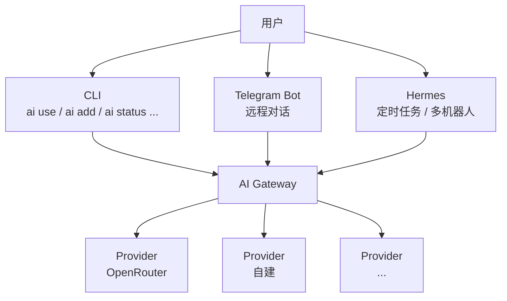
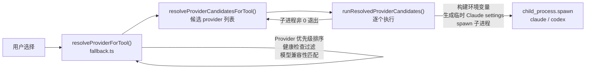
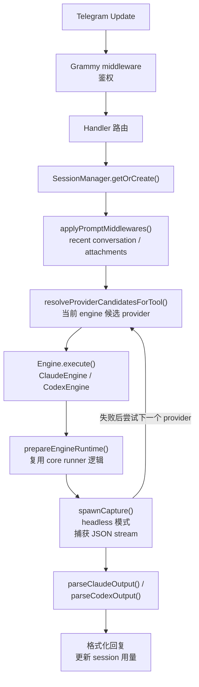
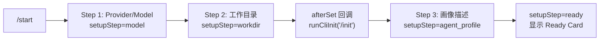
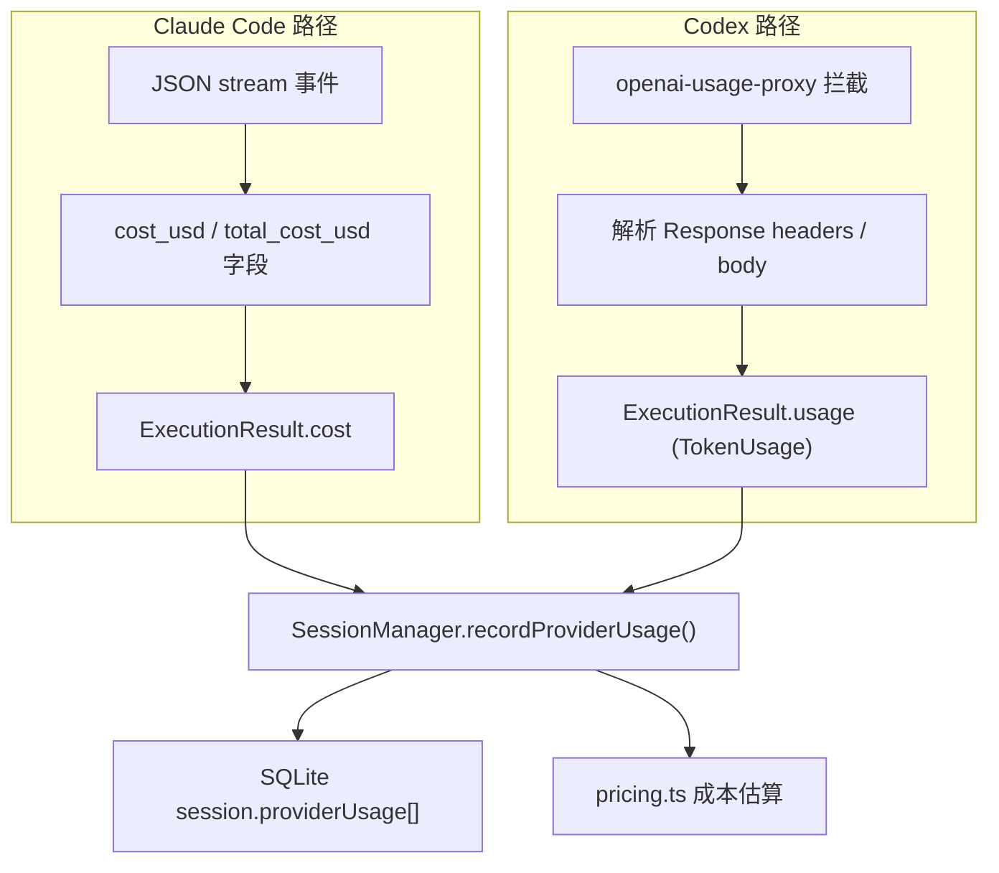

# AI Gateway 技术架构文档

## 1. 项目概览

AI Gateway (`ai-gateway`) 是一个本地 AI Provider 网关，统一管理多个 AI 服务提供商（OpenAI 兼容 API），为 Claude Code 和 Codex CLI 提供透明的路由、故障转移和用量追踪能力。同时集成了 Hermes（另一个 AI 网关）和 Telegram Bot 作为远程交互入口。

### 1.1 本轮 P0 稳态重构状态

| 状态 | 范围 | 说明 |
|------|------|------|
| 已完成 | 配置并发安全 | JSON 配置写入已通过 `proper-lockfile` 加锁，并使用 atomic rename 与 `updateJsonFile()` 处理 read-modify-write，降低 CLI 与 Telegram 并发覆盖风险 |
| 已完成 | 运行时 provider fallback | CLI `ai use` 和 Telegram `executePrompt()` 都已支持 provider 候选列表，首选 provider 执行失败后会尝试下一个可用 provider |
| 已完成 | Provider 健康检查增强 | 模型发现和模型探测请求已支持临时错误 retry/backoff，并记录 attempts、duration、retryErrors；深度 callable 检查已改为有限并发 |
| 已完成 | Provider 熔断与 health score | Provider cache 已记录 consecutiveFailures、lastFailureAt、circuitOpenUntil、healthScore；CLI/Telegram 运行时失败会累计健康状态，fallback 会跳过熔断中的 provider |
| 已完成 | Telegram 会话并发控制 | `SessionManager.runExclusive()` 为同一 chat 建立内存队列，避免同一会话同时启动多个 engine 进程 |
| 已完成 | 注册表解耦 | 已新增 CLI 命令注册表、core runner 引擎注册表、Telegram engine registry、Telegram handler registry、integration registry；外部命令和类型保持兼容 |
| 部分完成 | Prompt 中间件链 | recent conversation 和 attachments 已改为 Prompt middleware；上下文预算使用字符预算近似，未引入 tokenizer |
| 已完成 | 大文件拆分 | `openai-usage-proxy.ts` 和 `hermes-service.ts` 已保留 facade，并拆分出协议适配、usage 记录、HTTP 工具、Hermes YAML、本地文件、导入导出、provider sync 等模块 |
| 已完成 | 配置 schema validation | 新增 `src/core/config/schema.ts`；Provider 配置会校验对象形态、非空 name/baseUrl/apiKey；Telegram config 复用 schema helper 保持宽松归一化 |
| 已完成 | 共享工具与测试 | 重复的 `isRecord()` 已抽到 `src/core/utils/is-record.ts`；已补 JSON store 并发、CLI fallback、Telegram fallback、Hermes provider 解析、Prompt middleware、注册表、熔断、proxy metrics 等回归测试 |
| 已完成 | 代理可观测性 | OpenAI usage proxy 已暴露 `getMetrics()`，统计 request/success/failure/noUsage/usageRecord、总耗时、平均耗时、上游状态码分布；fallback/usage 事件保留结构化日志 |
| 部分完成 | 插件化解耦 | CLI 命令注册表、runner 引擎注册表、Telegram engine/handler registry、integration registry、Prompt middleware、生命周期钩子已落地；类型联合和子命令参数解析仍偏静态 |
| 未完成 | Bot Memory | 本轮没有实现 Bot Memory，相关设计仍以 `docs/memory-system-spec.md` 为准 |



## 2. 系统架构

### 2.1 模块分层

```
src/
├── cli/                    # 表现层 - CLI 命令与交互
│   ├── commands/           # 各子命令实现 (add/context/doctor/edit/help/hermes/list/log/report/session/status/telegram/use)
│   ├── output/             # 输出格式化 (table)
│   ├── prompts/            # 交互式选择器
│   ├── registry.ts         # CLI 命令注册表
│   └── index.ts            # 命令路由入口
├── core/                   # 核心领域层
│   ├── config/             # 配置持久化 (JSON/SQLite)
│   │   ├── cache-store.ts  # Provider 缓存（健康状态、模型列表）
│   │   ├── json-store.ts   # 通用 JSON 文件读写（文件锁 + atomic rename + read-modify-write）
│   │   ├── paths.ts        # 配置路径常量 (~/.ai-gateway/)
│   │   ├── providers-store.ts  # Provider 列表持久化
│   │   ├── schema.ts           # 轻量配置 schema helper
│   │   ├── session-store.ts    # CLI 会话记录
│   │   └── usage-store.ts      # Token 用量存储
│   ├── context/            # 项目上下文注入
│   ├── hermes/             # Hermes 集成
│   │   ├── hermes-service.ts       # 兼容 facade，保持原导出入口
│   │   ├── hermes-service-core.ts  # Hermes Robot CRUD、同步/修复编排
│   │   ├── hermes-yaml.ts          # YAML/env 构建与解析
│   │   ├── hermes-local-files.ts   # 本地 Hermes 文件读写与 provider 解析
│   │   ├── hermes-import-export.ts # Robot 导入/导出与本地导入
│   │   ├── hermes-provider-sync.ts # Provider rename/missing fallback 修复
│   │   ├── hermes-compat.ts    # 兼容性适配
│   │   ├── hermes-runner.ts    # 执行器
│   │   ├── hermes-store.ts     # 配置存储
│   │   └── hermes-types.ts     # 类型定义
│   ├── integrations/       # 集成状态管理（provider revision / sync registry）
│   ├── logs/               # 结构化日志服务
│   ├── models/             # 模型发现与兼容性过滤
│   │   ├── model-discovery.ts  # 模型列表发现
│   │   └── model-filter.ts     # 引擎兼容性匹配
│   ├── providers/          # Provider 健康检查与刷新
│   ├── reports/            # 会话报告生成
│   ├── runner/             # 工具执行引擎 (核心)
│   │   ├── command-resolver.ts     # CLI 二进制路径查找
│   │   ├── engine-registry.ts      # Claude/Codex runner 策略注册表
│   │   ├── fallback.ts             # Provider 优先级排序 + 故障转移
│   │   ├── openai-usage-proxy.ts       # 本地 HTTP 代理 facade
│   │   ├── openai-usage-server.ts      # HTTP 代理服务
│   │   ├── openai-usage-http.ts        # HTTP/header 工具
│   │   ├── openai-usage-responses.ts   # Responses/Chat 协议适配
│   │   ├── openai-usage-recording.ts   # usage 提取与记录
│   │   ├── openai-usage-types.ts       # proxy 类型与 metrics
│   │   └── tool-runner.ts          # 构建运行环境、注入 API 密钥
│   ├── sessions/           # CLI 会话管理
│   ├── status/             # 状态诊断 (doctor/status)
│   ├── usage/              # Token 用量追踪与计费
│   │   ├── usage-service.ts    # 用量聚合
│   │   └── pricing.ts          # 模型定价与成本估算
│   ├── utils/              # 通用工具
│   │   └── is-record.ts    # Record 类型守卫
│   └── types.ts            # 全局类型定义
└── telegram/               # Telegram Bot 子系统
    ├── engine/             # Claude/Codex 执行引擎
    │   ├── claude-engine.ts    # Claude Code headless 执行
    │   ├── codex-engine.ts     # Codex CLI headless 执行
    │   ├── engine-utils.ts     # 共享运行时准备（环境变量、临时文件）
    │   ├── process-utils.ts    # 进程管理（spawn、JSON stream 解析）
    │   ├── registry.ts         # Telegram engine factory/registry
    │   └── types.ts            # Engine/ExecutionResult/PermissionRequest 类型
    ├── handlers/           # 消息/命令/回调处理
    │   ├── callback.ts     # Inline button 回调路由
    │   ├── command.ts      # Bot 命令 (/start /reset /fresh /config /cwd /claude /codex /usage /help)
    │   ├── document.ts     # 文件上传处理（附件缓存）
    │   ├── message.ts      # 文本消息路由 + executePrompt 核心调用链
    │   ├── setup.ts        # 引导设置流程 (model → workdir → agent_profile → ready)
    │   └── usage.ts        # 用量面板 + 模型定价输入
    ├── interaction/        # UI 交互
    │   ├── approval.ts     # 危险命令审批机制
    │   ├── command-menu.ts # Telegram 命令菜单管理 + 引擎命令映射
    │   ├── formatter.ts    # HTML 消息格式化
    │   ├── keyboards.ts    # InlineKeyboard 构建器
    │   └── prompt-middleware.ts # Prompt 注入中间件链（recent conversation / attachments）
    ├── session/            # SQLite 会话管理
    │   ├── manager.ts      # SessionManager（CRUD、对话轮次、用量记录）
    │   ├── store.ts        # SQLite 建表与迁移
    │   └── types.ts        # TelegramSession/Attachment/ProviderUsage 类型
    ├── templates/          # 消息模板
    ├── bot.ts              # Bot 初始化入口 (createBot)
    ├── config.ts           # Telegram 配置 (JSON 持久化，支持 12 个可配置项)
    ├── handler-registry.ts # Telegram handler 注册表
    ├── index.ts            # Telegram 子系统导出
    ├── lifecycle-registry.ts # Telegram task 生命周期钩子
    ├── log.ts              # Telegram 专用日志
    └── network.ts          # 代理配置 (HTTPS_PROXY/自定义 proxyUrl)
```

### 2.2 核心数据流

**CLI 使用流程 (`ai use`)：**



**Telegram 执行流程：**



**Telegram Setup 引导流程：**



### 2.3 关键设计决策

| 决策 | 方案 | 理由 |
|------|------|------|
| 配置存储 | JSON 文件 (`~/.ai-gateway/`) + `proper-lockfile` | 保留可手动编辑特性，同时用文件锁 + atomic rename 避免 CLI/Telegram 并发覆盖 |
| Telegram 会话 | SQLite (`better-sqlite3`) | 需要查询、索引、并发安全 |
| 工具执行 | `child_process.spawn` | 需要完整 TTY 继承（CLI 模式）或 JSON stream 捕获（headless） |
| 用量追踪 | 本地 HTTP 代理 (`openai-usage-proxy`) | 透明拦截 Codex 请求，无需修改工具本身 |
| Hermes 集成 | YAML 配置同步 + launchd 重启 | 适配 Hermes 原生配置格式 |
| 模型路由 | 优先级 + 健康检查 + 兼容性过滤 + 运行时 fallback | 选择阶段和执行失败后都能尝试下一个可用 provider |
| Telegram 代理 | `undici.ProxyAgent` + `https-proxy-agent` | 支持 `HTTPS_PROXY` 环境变量和自定义 `proxyUrl` 配置 |
| 引擎初始化 | Bot 通过引擎执行 `/init` | Bot 不直接写 CLAUDE.md/AGENTS.md，由引擎自身生成 |
| 权限模式 | `default` / `acceptEdits` / `bypassPermissions` | 按用户信任级别控制引擎操作权限 |

### 2.4 核心类型体系

```typescript
// === Core 全局类型 ===
Provider          // 服务商配置 (name, baseUrl, apiKey, model, mode, level)
ProviderCache     // 缓存状态 (status: HealthStatus, models[], lastCheckedAt, lastError)
UsageEvent        // 用量事件 (tokens, provider, model, source)
TokenUsage        // Token 统计 (inputTokens, outputTokens, totalTokens, cacheReadInputTokens)
SessionRecord     // CLI 会话记录
LogEvent          // 结构化日志 (level, category, action, message, metadata)

// === Telegram 类型 ===
TelegramSession   // SQLite 持久化会话
  - id, chatId, engine, engineSessionId
  - cwd, permissionMode, setupStep, status
  - messageCount, attachments[], conversation[], providerUsage[]

TelegramConfig    // JSON 配置 (12 个字段)
  - token, allowAllUsers, allowedUserIds
  - defaultEngine, defaultCwd, defaultPermissionMode
  - sessionTimeoutHours, maxOutputLength
  - provider?, model?, proxyUrl?, dbPath

ExecutionResult   // 引擎执行结果
  - sessionId?, response, toolCalls[], filesChanged[]
  - diff?, cost?, usage?, duration?, provider?, model?

PermissionRequest // 危险操作审批请求
  - id, tool, description, command?, filePath?, params

// === Hermes 类型 ===
HermesRobot       // Hermes 机器人配置 (provider, model, tasks[], telegram)
```

## 3. 子系统详解

### 3.1 Runner 引擎

`src/core/runner/` 是核心执行层：

- **command-resolver.ts** (83 行) — 查找本地 CLI 二进制路径 (`which` + 已知候选路径)
- **engine-registry.ts** — Claude/Codex runner 策略注册表，集中管理 baseUrl 规范化、环境变量注入和启动参数
- **tool-runner.ts** (162 行) — 构建运行环境、注入 API 密钥、管理临时文件生命周期
- **fallback.ts** (100 行) — Provider 候选排序：健康检查 → 模型兼容性 → 优先级；支持指定 provider/model 覆盖，并可返回候选列表
- **openai-usage-proxy.ts** (6 行) — 兼容 facade，保持原导出入口
- **openai-usage-server.ts** (175 行) — 本地 HTTP 代理服务，拦截 Codex/OpenAI 协议请求
- **openai-usage-http.ts** (91 行) — HTTP/header 辅助工具
- **openai-usage-responses.ts** (466 行) — Responses API ↔ Chat Completions 协议适配
- **openai-usage-recording.ts** (192 行) — usage 提取、定价估算和结构化记录
- **openai-usage-types.ts** (22 行) — proxy 公共类型

### 3.2 Telegram Bot

基于 `grammy` 框架，核心特性：

**双引擎架构**
- ClaudeEngine (229 行): `claude -p --output-format stream-json --verbose`，解析 JSON stream 事件
- CodexEngine (439 行): Codex CLI headless 模式，捕获结构化输出
- Telegram engine registry: `createTelegramEngines()` 统一创建内置引擎，消息执行通过 engine map 查找
- 共享 engine-utils.ts: `prepareEngineRuntime()` 复用 core runner 的 Provider 解析和环境变量构建
- 进度回调: thinking → tool_calling → writing → done

**Setup 引导流程**
```
/start → model(Provider/Model 选择) → workdir(工作目录选择 + /init) → agent_profile(画像描述) → ready
```
- 支持从 Ready 状态重新配置（切换 Provider/Model/权限模式/工作目录）
- `/cwd <path>` 切换工作目录后自动触发 `runCliInit()` 重新初始化

**会话管理**
- SQLite 持久化，支持多 chat 并发
- 同一 chat 的任务通过 `SessionManager.runExclusive()` 串行执行，避免重复 engine 进程并发写同一 session
- 对话轮次记录（通过 Prompt middleware 注入最近 4 轮，并使用字符预算控制长度）
- 文件附件缓存（document handler 接收上传文件并暂存）
- Provider 用量独立统计（每个 session per-provider 记录 token/cost）
- 运行时 provider fallback：当前 provider 执行失败后尝试同 engine 的下一个候选；fallback 成功不改默认 provider/model
- fallback provider 成功时不保留错误 provider 的 `engineSessionId`，后续依靠 recent conversation 续上下文，避免跨 provider resume 错乱

**交互特性**
- 权限审批机制 (dangerous command confirmation)
- `/fresh` 命令清空当前会话历史消息
- `/usage` 用量面板 + 模型定价输入（支持自定义 input/output/cache 单价）
- 引擎命令映射：`/compact` `/init` `/model` 等映射为引擎原生命令
- Proxy 支持：`proxyUrl` 配置或 `HTTPS_PROXY` 环境变量

**Bot Memory 系统（规划中）**
- 详见 `docs/memory-system-spec.md`
- 用户层记忆：per-botId + per-chatId，跨引擎、跨会话、跨项目持久化
- 分类：profile（画像）/ fact / preference / credential / note / skill（规划）
- 注入方式：prompt 前缀拼接，3000 字符预算
- 演进方向：Skill Learning → 记忆蒸馏 → 分层存储 → 向量检索

### 3.3 Hermes 集成

与本地 Hermes 实例的双向同步：

- AI Gateway providers → Hermes config.yaml
- 本地 Hermes 配置 → AI Gateway 导入
- 支持 launchd / CLI 两种重启方式
- Robot 管理（CRUD、导入导出、Provider 切换联动）

模块结构：
- **hermes-service.ts** (2 行) — 兼容 facade，继续导出既有 public API
- **hermes-service-core.ts** (742 行) — Robot CRUD、同步、修复、状态查询等编排逻辑
- **hermes-yaml.ts** (254 行) — YAML/env 构建、provider block 替换、模型块修复
- **hermes-local-files.ts** (357 行) — 本地 Hermes 文件读写、config/telegram/cron/provider 解析
- **hermes-import-export.ts** (447 行) — Robot 导入导出、本地 Hermes 导入、provider/cache 导入
- **hermes-provider-sync.ts** (59 行) — 延迟 provider rename/missing fallback 修复
- **hermes-compat.ts** (383 行) — 兼容性适配
- **hermes-runner.ts** (176 行) — 执行器
- **hermes-store.ts** (277 行) — 配置存储
- **hermes-types.ts** (117 行) — 类型定义

### 3.4 用量追踪

双路径用量采集：



## 4. 技术栈

| 层级 | 技术 |
|------|------|
| 语言 | TypeScript (ESM, Node.js ≥ 22) |
| 构建 | tsc (零打包器) |
| 运行时 | Node.js 22+ |
| Telegram | grammy ^1.44 |
| 数据库 | better-sqlite3 ^12.11 (Telegram 会话) |
| HTTP | undici ^8.7 (provider 健康检查 + Telegram 代理), node:http (usage proxy) |
| 网络代理 | https-proxy-agent ^9.1 (Telegram API 代理) |
| 文件锁 | proper-lockfile (JSON 配置并发写入保护) |
| Claude SDK | @anthropic-ai/claude-code ^2.1 (Telegram headless) |
| 测试 | node:test (内置) |

## 5. 优化建议

### 5.1 架构层面

**P0 - 高优先级**

| 状态 | 项目 | 当前结果 | 剩余事项 |
|------|------|----------|----------|
| 已完成 | 配置并发安全 | `json-store.ts` 已新增 `withJsonFileLock()`、`updateJsonFile()`；公共写入走文件锁 + atomic rename；providers/cache/usage/session/integration/telegram config/pricing/hermes state 等更新路径已迁移 | 未把所有配置迁移到 SQLite；当前仍保持 JSON 文件方案 |
| 已完成 | CLI 运行时 provider fallback | `ai use` 已改为候选列表执行；子进程非 0 退出时尝试下一个 provider；CLI 不存在、用户取消、无候选不 fallback；fallback 事件写结构化日志 | 无 |
| 已完成 | Telegram 运行时 provider fallback | `executePrompt()` 已按当前 engine 获取候选 provider；失败后尝试下一个；fallback 成功不修改默认 provider/model；fallback 成功时清空跨 provider resume，依靠 recent conversation 续上下文 | 无 |
| 已完成 | Provider 健康检查 retry/backoff + 熔断 | `checkProvider()`、`runDeepCheck()`、模型 probe 已对临时错误做 retry/backoff；日志记录 attempts/duration/retryErrors；深度 callable 检查使用有限并发；运行时失败会累计 health score 并在连续失败后打开 circuit breaker | 熔断阈值目前是固定常量，后续可配置化 |
| 已完成 | `openai-usage-proxy.ts` 大文件拆分 | 原文件变为 facade；已拆为 `openai-usage-server.ts`、`openai-usage-http.ts`、`openai-usage-responses.ts`、`openai-usage-recording.ts`、`openai-usage-types.ts`；proxy 暴露 `getMetrics()` 统计请求、失败、usage/noUsage、耗时和上游状态码 | 可后续把 metrics 持久化或接入 dashboard |
| 已完成 | `hermes-service.ts` 大文件拆分 | 原文件变为 facade；已拆为 core/yaml/local-files/import-export/provider-sync 等模块，外部导出保持兼容 | 还可以继续把 sync/repair 编排再拆得更细，但 P0 小步重构目标已完成 |
| 已完成 | 共享 `isRecord()` | 已新增 `src/core/utils/is-record.ts`，替换 usage/pricing、runner、Hermes、Telegram config/engine 等重复定义 | 其它通用小工具可后续按需抽取 |
| 已完成 | 回归覆盖 | 已新增 JSON store 并发更新、CLI fallback、Telegram fallback、Hermes provider 解析、Provider retry、Prompt middleware、注册表、Telegram 串行队列、Provider 熔断、proxy metrics、schema validation 等测试；当前 `npm test` 为 87 项通过 | 可继续补更多异常路径和持久化 metrics 测试 |

**P1 - 中优先级**

5. **已完成：OpenAI Usage Proxy 可观测性基础**
   - 已完成：usage 记录职责拆到 `openai-usage-recording.ts`
   - 已完成：`OpenAiUsageProxy.getMetrics()` 提供请求量、成功/失败量、usage/noUsage、总耗时、平均耗时和上游状态码分布
   - 已完成：usage/no-usage、Responses fallback/translation 继续写结构化日志
   - 后续可选：metrics 持久化、按 provider/model 维度聚合、接入 CLI `ai status` 或 dashboard

6. **部分完成：命令解析缺少框架**
   - 已完成：`cli/index.ts` 顶层命令路由已改为 `src/cli/registry.ts` 注册表，不再使用 raw `switch`
   - 未完成：子命令参数仍靠手动解析 `args[]`
   - 如果命令继续增长，可继续引入轻量 CLI 框架（如 `citty` 或 `clerc`）

7. **已完成：Telegram Session 并发控制**
   - 已新增 `SessionManager.runExclusive()`，同一 chat 的 `executePrompt()` 会按内存队列串行执行
   - 不同 chat 仍可并行执行
   - `status` 字段继续用于 UI 状态和恢复逻辑，但不再单独承担并发互斥

8. **未完成：Bot Memory 系统待实现**
   - `completeAgentProfile()` 中 `void description;`（画像描述被忽略）
   - `buildPromptWithMemory()` 未实现
   - 旧 BOT.md 文件读写逻辑待移除
   - 详见 `docs/memory-system-spec.md` Phase 1 计划

### 5.2 代码质量

9. **已完成：`isRecord` 辅助函数重复定义**
   - 已抽为 `src/core/utils/is-record.ts`
   - 已替换 `claude-engine.ts`、`codex-engine.ts`、`telegram/config.ts`、`tool-runner.ts`、`hermes-store.ts`、`hermes-service-core.ts`、`pricing.ts` 等重复定义

10. **部分完成：类型安全改进**
    - 已完成：新增轻量 `src/core/config/schema.ts`，Provider 配置读取不再用裸 `as Partial<Provider>`，并校验非空 name/baseUrl/apiKey
    - 已完成：Telegram config 字段读取复用 schema helper，同时保留原有宽松归一化行为
    - 未完成：可继续引入 `zod` 或 `valibot` 做更完整的 schema validation
    - Hermes 导入导出也是手动校验，缺乏 schema validation

11. **部分完成：测试覆盖**
    - 当前 `test/` 目录在 build 后用 `node --test` 运行
    - 已补：JSON store 并发更新、CLI runtime fallback、Telegram runtime fallback、Hermes provider 解析、Provider retry、Prompt middleware、注册表、Telegram 串行队列、熔断策略、usage proxy metrics、schema validation
    - 未完成：长期指标持久化、更多异常路径仍可继续补

### 5.3 性能

12. **已完成：Provider 健康检查串行执行**
    - 普通 `refreshAllProviders` 已并发刷新
    - `verifyCallableModels` 深度检查已从逐个 provider 串行改为有限并发，避免大量 provider 时阻塞过久

13. **部分完成：Usage 文件追加写入**
    - `usage.json` 用 readAll → append → writeAll 模式，事件增多后 I/O 开销线性增长
    - 已完成：写入路径已通过 `updateJsonFile()` 加锁，解决并发覆盖风险
    - 建议改为 append-only JSONL 格式或迁移到 SQLite

14. **未完成：Telegram Bot 启动时同步刷新所有 chat 菜单**
    - `refreshStoredChatCommandMenus` 对大量活跃 session 是 O(n) 的 API 调用，应限流或延迟

15. **部分完成：对话上下文注入效率**
    - recent conversation 和 attachments 已迁移到 `prompt-middleware.ts`
    - recent conversation 仍最多取最近 4 轮，但增加了字符预算，避免长上下文无限膨胀
    - 未完成：没有引入 tokenizer，当前是字符预算近似 token 预算

### 5.4 安全

16. **部分完成：临时 Claude settings 文件权限**
    - 已正确设置 `0o600`，配置文件也做了 `chmod`
    - 但 `os.tmpdir()` 在共享主机环境下仍有被枚举风险，建议用 `mkdtemp` 创建私有目录

17. **未完成：Telegram 鉴权粒度**
    - 当前只支持 userId allowlist 或 allowAll
    - 建议增加命令级别权限控制（如只允许查询不允许执行）

18. **未完成：Telegram Token 明文存储**
    - `telegram.json` 中 token 明文存储，仅靠文件权限 `0o600` 保护
    - Bot Memory 的 credential 加密方案（AES-256-GCM + PIN）可考虑复用于配置文件中的敏感字段

### 5.5 插件化架构 — 高解耦 · 热插拔

**当前状态：部分完成 / 继续小步推进。** 当前已完成 CLI 命令注册表、runner 引擎注册表、Telegram engine registry、Telegram handler registry、integration registry、Prompt 中间件链和 Telegram lifecycle hooks；Bot Memory 业务和类型联合动态化仍未落地。

当前代码的核心耦合问题是**所有模块通过硬编码 import + switch/if 分支连接**，新增或删除一个功能需要修改多处入口文件。以下是系统性解耦方案：

#### 问题 1：CLI 命令硬编码（`cli/index.ts`）

**现状**：每新增一个命令需要修改 3 处 — import 语句、switch case、interactive 菜单列表。删除 hermes 也需要同时改这 3 处。

**方案：命令注册表**

```typescript
// cli/registry.ts
export type CliCommand = {
  name: string;
  aliases?: string[];
  description: string;
  interactive?: boolean;  // 是否出现在交互式菜单中
  run(args: string[]): Promise<void>;
};

const commands = new Map<string, CliCommand>();

export function registerCommand(cmd: CliCommand): void {
  commands.set(cmd.name, cmd);
  cmd.aliases?.forEach(alias => commands.set(alias, cmd));
}

export function getCommand(name: string): CliCommand | undefined {
  return commands.get(name);
}

export function getInteractiveCommands(): CliCommand[] {
  return [...new Set(commands.values())].filter(c => c.interactive !== false);
}
```

```typescript
// cli/commands/hermes.ts — 自注册
import { registerCommand } from "../registry.js";
registerCommand({
  name: "hermes",
  description: "Hermes 集成管理",
  async run(args) { /* ... */ }
});
```

```typescript
// cli/index.ts — 不再 import 具体命令
import "./commands/add.js";       // side-effect: 自注册
import "./commands/hermes.js";    // 删除此行 = 移除 hermes 命令
// ...
const cmd = getCommand(command);
if (cmd) await cmd.run(args);
```

效果：新增命令 = 新建文件 + 加一行 import；删除命令 = 删文件 + 删 import 行。

#### 问题 2：Engine 硬编码（`bot.ts` + `tool-runner.ts`）

**现状**：
- `bot.ts` 硬编码 `new ClaudeEngine()` + `new CodexEngine()`，`TelegramRuntime.engines` 类型写死两个引擎
- `tool-runner.ts` 中 `if (tool === "claude")` / `if (tool === "codex")` 分支构建不同的环境变量和参数
- `types.ts` 中 `CliToolType = "claude" | "codex"` 硬编码

**方案：引擎注册表 + 策略模式**

```typescript
// core/runner/engine-registry.ts
export type EngineDescriptor = {
  name: string;
  buildEnv(provider: Provider, model: string): Record<string, string>;
  buildArgs(provider: Provider, model: string, settingsPath?: string): string[];
  normalizeBaseUrl(baseUrl: string): string;
};

const engines = new Map<string, EngineDescriptor>();

export function registerEngine(desc: EngineDescriptor): void {
  engines.set(desc.name, desc);
}

export function getEngine(name: string): EngineDescriptor {
  const engine = engines.get(name);
  if (!engine) throw new Error(`Unknown engine: ${name}`);
  return engine;
}
```

```typescript
// core/runner/engines/claude.ts — 自注册
registerEngine({
  name: "claude",
  buildEnv: (provider, model) => ({
    ANTHROPIC_API_KEY: provider.apiKey,
    ANTHROPIC_BASE_URL: provider.baseUrl.replace(/\/v1$/i, ""),
    ANTHROPIC_MODEL: model
  }),
  buildArgs: (provider, model, settingsPath) => {
    const args = ["--model", model];
    if (settingsPath) args.push("--settings", settingsPath);
    if (provider.mode === "auto") args.push("--dangerously-skip-permissions");
    return args;
  },
  normalizeBaseUrl: (url) => url.replace(/\/+$/, "").replace(/\/v1$/i, "")
});
```

```typescript
// tool-runner.ts — 不再有 if/else 分支
const engine = getEngine(tool);
const env = { ...process.env, ...engine.buildEnv(provider, model) };
const args = engine.buildArgs(provider, model, settingsPath);
```

效果：新增引擎 = 新建文件自注册；`tool-runner.ts` 零修改。

#### 问题 3：Telegram Handler 硬编码（`bot.ts`）

**已完成**：`bot.ts` 不再手动调用 4 个 `registerXxxHandler()`，而是通过 `src/telegram/handler-registry.ts` 安装已注册 handler。

**当前实现：Handler 注册表**

```typescript
// telegram/handler-registry.ts
export type HandlerRegistrar = (bot: Bot, deps: TelegramDeps) => void;

const handlers = new Map<string, HandlerRegistrar>();

export function registerTelegramHandler(name: string, registrar: HandlerRegistrar): void {
  handlers.set(name, registrar);
}

export function installTelegramHandlers(bot: Bot, deps: TelegramDeps): void {
  for (const registrar of handlers.values()) registrar(bot, deps);
}
```

```typescript
// telegram/bot.ts
registerTelegramHandler("commands", registerCommands);
registerTelegramHandler("callbacks", registerCallbackHandler);
registerTelegramHandler("documents", registerDocumentHandler);
registerTelegramHandler("messages", registerMessageHandler);
installTelegramHandlers(bot, deps);
```

效果：新增 handler 只需要注册到 registry；安装顺序可测试，`bot.ts` 不再直接编排每个 handler 的安装细节。

#### 问题 4：集成状态硬编码（`integration-state.ts`）

**已完成**：`IntegrationState` 新增通用 `integrations` map，同时保留 `hermes` 字段作为向后兼容镜像。

**当前实现：通用集成状态注册**

```typescript
// core/integrations/integration-state.ts
export type IntegrationRegistration = {
  name: string;
};

const registeredIntegrations = new Set<string>(["hermes"]);

export function registerIntegration(registration: IntegrationRegistration): void {
  registeredIntegrations.add(registration.name);
}

export type IntegrationState = {
  providerRevision: number;
  hermes: IntegrationProviderSyncState; // backward-compatible mirror
  integrations: Record<string, {
    syncedProviderRevision: number;
    pendingProviderChanges: ProviderChange[];
  }>;
};
```

效果：Provider 变更会写入已注册集成的 pending changes；Hermes 继续通过兼容 wrapper 工作，新集成不需要再修改状态文件结构。

#### 问题 5：类型联合硬编码（`types.ts`）

**现状**：
```typescript
export type CliToolType = "claude" | "codex";                         // 硬编码引擎
export type RunToolType = CliToolType | "hermes" | "telegram";        // 硬编码所有工具
```

**方案**：改为 string + 运行时注册校验，或使用 branded string

```typescript
export type CliToolType = string & { readonly __brand?: "CliTool" };
// 注册时校验：
const validTools = new Set<string>();
export function registerToolType(name: string): void { validTools.add(name); }
export function isValidTool(name: string): boolean { return validTools.has(name); }
```

#### 问题 6：记忆系统预留接口（暂不实现）

Bot Memory 系统（`docs/memory-system-spec.md`）未来需要接入 prompt 构建链、Handler 路由、Session 生命周期等多个环节。在插件化重构时预留接口，后续实现时零侵入接入。

**预留接口设计**：

```typescript
// telegram/middleware-registry.ts — prompt 中间件链
export type PromptMiddleware = {
  name: string;
  priority: number;  // 数字越小越先执行
  transform(ctx: PromptContext): Promise<string>;
};

export type PromptContext = {
  chatId: number;
  prompt: string;
  session: TelegramSession;
  engine: TelegramEngineName;
};

const middlewares: PromptMiddleware[] = [];

export function registerPromptMiddleware(mw: PromptMiddleware): void {
  middlewares.push(mw);
  middlewares.sort((a, b) => a.priority - b.priority);
}

export async function applyPromptMiddlewares(ctx: PromptContext): Promise<string> {
  let prompt = ctx.prompt;
  for (const mw of middlewares) {
    prompt = await mw.transform({ ...ctx, prompt });
  }
  return prompt;
}
```

```typescript
// 未来 memory 模块自注册（暂不实现）
// telegram/memory/memory-inject.ts
registerPromptMiddleware({
  name: "bot-memory",
  priority: 10,  // 在 recentConversation(20) 和 attachments(30) 之前
  async transform(ctx) {
    const memories = await memoryService.retrieve(ctx.chatId, ctx.prompt);
    return buildMemoryPrefix(memories) + "\n" + ctx.prompt;
  }
});
```

```typescript
// 已落地：当前 recent conversation 和 attachments 已改为中间件
registerPromptMiddleware({
  name: "recent-conversation",
  priority: 20,
  async transform(ctx) {
    return buildPromptWithRecentConversation(ctx.prompt, ctx.session, ctx.resume, ctx.includeAgentContext);
  }
});

registerPromptMiddleware({
  name: "attachments",
  priority: 30,
  async transform(ctx) {
    return buildPromptWithAttachments(ctx.prompt, ctx.session);
  }
});
```

```typescript
// message.ts — executePrompt 中已替换硬编码构建链
const finalPrompt = await applyPromptMiddlewares({
  chatId,
  prompt: text,
  session,
  engine,
  resume,
  includeAgentContext: options.includeAgentContext !== false
});
```

**同时预留的扩展点**：

| 扩展点 | 接口 | 未来用途 |
|--------|------|----------|
| Prompt 中间件 | `PromptMiddleware` | Bot Memory 注入、Skill 加载 |
| Session 生命周期钩子 | `TelegramTaskLifecycleHook`（已有） | 记忆蒸馏触发（每 N 次对话）、usage 统计 |
| 命令注册表 | `CliCommand`（已有） | `/remember` `/forget` `/memories` 命令 |
| Handler 注册表 | `HandlerRegistrar`（已有） | memory callback handler |
| 引擎结果后处理 | `ResultPostProcessor` | Skill Learning 提炼（分析 toolCalls 数量） |

```typescript
// telegram/lifecycle-registry.ts — 已落地的 task 生命周期钩子
export type TelegramTaskLifecycleHook = {
  onTaskCompleted?(event: TelegramTaskCompletedEvent): void | Promise<void>;
  onTaskFailed?(event: TelegramTaskFailedEvent): void | Promise<void>;
};

// 未来 skill learning 自注册
registerTelegramTaskLifecycleHook({
  async onTaskCompleted({ session, result }) {
    if ((result.toolCalls?.length ?? 0) >= 5) {
      await skillService.extractSkill(session, result);
    }
  }
});
```

**实施原则**：
- 重构阶段只建注册表骨架 + 将现有 `buildPromptWithXxx` 改为中间件注册
- 不实现任何 memory 业务逻辑
- 注册表为空时行为等价于当前代码（零开销）

#### 总结：注册表模式的统一骨架

```mermaid
graph TD
  subgraph Registry["注册表层（运行时组装）"]
    CR["CLI 命令注册表"]
    ER["引擎注册表"]
    HR["Handler 注册表"]
    IR["集成注册表"]
    PM["Prompt 中间件链"]
    LH["生命周期钩子"]
  end

  subgraph Plugins["插件（自注册模块）"]
    P1["commands/hermes.ts"]
    P2["commands/telegram.ts"]
    P3["engines/claude.ts"]
    P4["engines/codex.ts"]
    P5["handlers/command.ts"]
    P6["handlers/memory.ts ⬡"]
    P7["integrations/hermes.ts"]
    P8["memory/memory-inject.ts ⬡"]
    P9["memory/skill-learning.ts ⬡"]
  end

  subgraph Core["核心（不知道插件存在）"]
    CLI["cli/index.ts"]
    Bot["telegram/bot.ts"]
    Runner["core/runner/tool-runner.ts"]
    IntState["core/integrations/state.ts"]
    Exec["executePrompt()"]
  end

  P1 --> CR
  P2 --> CR
  P3 --> ER
  P4 --> ER
  P5 --> HR
  P6 --> HR
  P7 --> IR
  P8 --> PM
  P9 --> LH

  CLI --> CR
  Bot --> HR
  Runner --> ER
  IntState --> IR
  Exec --> PM
  Exec --> LH

  style Registry fill:#e1f5fe,stroke:#0288d1
  style Plugins fill:#e8f5e9,stroke:#388e3c
  style Core fill:#fff3e0,stroke:#f57c00
```



#### 实施优先级

| 优先级 | 改造项 | 状态 | 影响范围 | 工作量 |
|--------|--------|------|----------|--------|
| P0 | CLI 命令注册表 | 已完成 | `cli/index.ts` + `src/cli/registry.ts` | 中（纯重构，无功能变更） |
| P0 | 引擎注册表 | 已完成 | `tool-runner.ts` + `bot.ts` + `core/runner/engine-registry.ts` + `telegram/engine/registry.ts` | 中 |
| P1 | Handler 注册表 | 已完成 | `bot.ts` + `telegram/handler-registry.ts` + handlers/ | 小 |
| P1 | 集成注册表 | 已完成 | `integration-state.ts` + hermes/ | 小 |
| P1 | Prompt 中间件链 | 已完成 | `message.ts` executePrompt + `telegram/interaction/prompt-middleware.ts` | 小（将现有 buildPromptWithXxx 改为中间件） |
| P1 | 生命周期钩子 | 已完成 | `message.ts` + `telegram/lifecycle-registry.ts` | 小 |
| P2 | 类型联合改造 | 未完成 | `types.ts` + 全局引用 | 小（但需全量回归测试） |
| P2 | 共享 util 抽取 | 已完成 | `isRecord` 等重复函数 | 小 |

> ⬡ 标记的模块为 Bot Memory 未来接入点，重构阶段只建骨架不实现业务逻辑。
