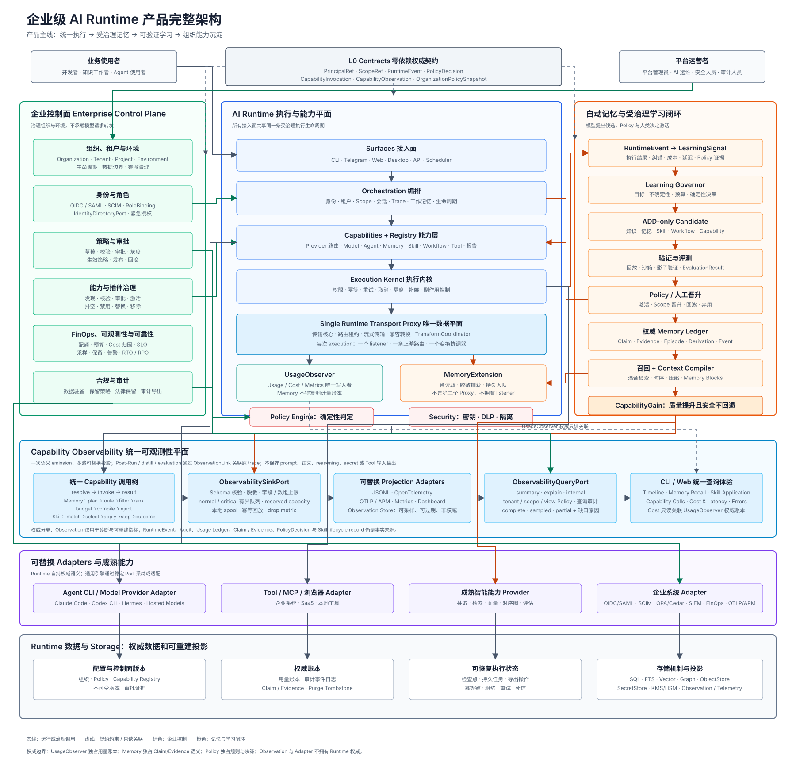

# AI Runtime 产品架构全景图

> 本文面向用户与中文评审者，解释目标产品全貌。架构 ownership 以 [AI_RUNTIME_ARCHITECTURE.md](AI_RUNTIME_ARCHITECTURE.md) 为准，identifier/schema 以 [contracts.md](contracts.md) 为准。

## 1. 如何阅读

图从上到下分为五个横向区域：角色与权威契约；企业控制面、Runtime 执行平面与自动学习闭环；统一 Capability Observability；可替换 Adapters；权威数据与 Storage。中间蓝色执行区域是每次任务必经的主链；左侧绿色区域负责组织治理；右侧橙色区域负责把交互转成经过验证的组织能力；下方浅蓝区域统一承接调用链诊断与授权查询。

## 2. 产品主链

业务使用者从 CLI、Telegram、Web、Desktop、API 或 Scheduler 发起 `RuntimeRequest`。Orchestration 先固定 identity、tenant、`ScopeRef`、session、trace 与 `OrganizationPolicySnapshot`，Capabilities 解析已激活能力，Execution Kernel 再执行权限、幂等、重试、取消、隔离和副作用控制。

所有模型请求只经过一个 Runtime Transport Proxy。Transport Core 拥有 listener、route、streaming 和兼容转换；`UsageObserver` 是 usage/cost/metrics 的唯一写入者；`MemoryExtension` 只做有界 Pre-Read 与脱敏 Post-Run，不是第二个代理。

## 3. 自动沉淀与学习

执行产生 `RuntimeEvent`，Learning Governor 根据 objective、uncertainty、policy 与 budget 生成确定性 `LearningDecision`。模型只能提出 ADD-only candidate；Knowledge、Memory、Skill、Workflow 或 Capability 经过 replay、sandbox、shadow 和 evaluation 后，才由 Policy 或人类决定激活、scope promotion、rollback 或 deprecation。

Memory Ledger 中的 Claim/Evidence 是权威真相。向量、图、摘要、Profile 和 Memory Block 都是可重建投影；自动压缩不能破坏 provenance、purge reachability、legal hold、pin 或 rollback。

## 4. 企业控制面

Enterprise Control Plane 管理 organization、tenant、environment、federated identity、delegated admin、policy revision、plugin lifecycle、quota、FinOps、residency、retention、legal hold、audit 与 disaster recovery。Web、CLI 和 API 只是相同 core contract 的不同 Surface，不能各自实现一套治理逻辑。

## 5. 权威所有权

| 权威数据或决策 | 唯一所有者 | 禁止事项 |
|---|---|---|
| Identity / membership | Identity Directory + Orchestration canonical mapping | 外部 subject/group id 不得成为 Runtime 权威外键 |
| Policy rule / decision | Policy Engine | Surface、Memory、Skill、Adapter 不得自行授权 |
| Usage / cost | `UsageObserver` | Memory、Web、FinOps exporter 不得创建第二账本 |
| Claim / Evidence | Memory Ledger | extractor/vector/graph 不得直接改 active/superseded/deleted |
| Credential / capability handle | Security | 不得进入 prompt memory、普通配置或普通 export |
| Persistence mechanism | Storage | 不得重定义 retention、purge、authority 或 audit 语义 |

## 6. 可替换能力

Model、Provider、Agent、Tool、MCP、Workflow Executor、Extractor、Retriever、Vector、Temporal Graph、Policy backend、Queue、ObjectStore、SecretStore 和 Telemetry 都经稳定 Port 接入。Runtime 自研契约、权威语义、治理、审计和回滚；成熟通用引擎优先 Adopt/Adapt，而不是重复实现。

## 7. Claude Code、Codex CLI 与 Telegram 的位置

Telegram Bot 是 ① Surface，只负责远程入口、边缘鉴权、交互呈现与确认回传。Claude Code 和 Codex CLI 在 ③ 是可选择、可版本化的 `agent` Capability，在 ④ 由 Execution Kernel 监管运行，在 ⑩ 则分别由 `ClaudeCodeCliAgentAdapter` / `CodexCliAgentAdapter` 封装本机 CLI。它们不是单纯的 Model/Provider Adapter，也不等于整个 Runtime。

完整链路是 `Telegram Surface → Orchestration → Agent Capability → Execution Kernel → AgentAdapterPort → Runtime Transport Proxy → ModelProvider Adapter`。CLI 内部提出的 tool call 只是 proposal，必须回到 Kernel 做执行期权限检查；Telegram button 只回传 confirmation decision，不直接执行工具。现有 Telegram `Engine` 接口是兼容 facade，目标态委托统一 Orchestration 与 Agent contract，避免形成第二条执行和授权路径。

## 8. Memory / Skill 调用链可观测性

Orchestration 生成唯一 `traceId`，Capability、Memory、Skill 与 Learning 在同一调用树中产生 `CapabilityObservation`：通用能力显示 resolve/invoke/result，Memory 显示 plan、逐 route 检索、过滤、排序、预算、编译与注入，Skill 显示 match、select、apply、step、outcome 与 lifecycle。Post-Run、distill 和 evaluation 通过 span link 连接原执行，不伪装成同步耗时。

JSONL、OpenTelemetry、企业 OTLP/APM 和 Web dashboard 都通过同一 `ObservabilitySinkPort` 投影，禁止业务代码重复埋点。Observation 可采样且非权威；`RuntimeEvent`、Usage Ledger、Claim/Evidence、PolicyDecision 和 Skill lifecycle record 仍是事实来源。查询必须标记 `complete|sampled|partial` 及具体缺口，按 tenant/scope/view 授权，并且不显示 prompt、记忆/Skill 正文、步骤、reasoning、secret 或 tool 输入输出。Cost 面板只在查询时关联 `UsageObserver` 权威数据，不复制 usage/cost。
