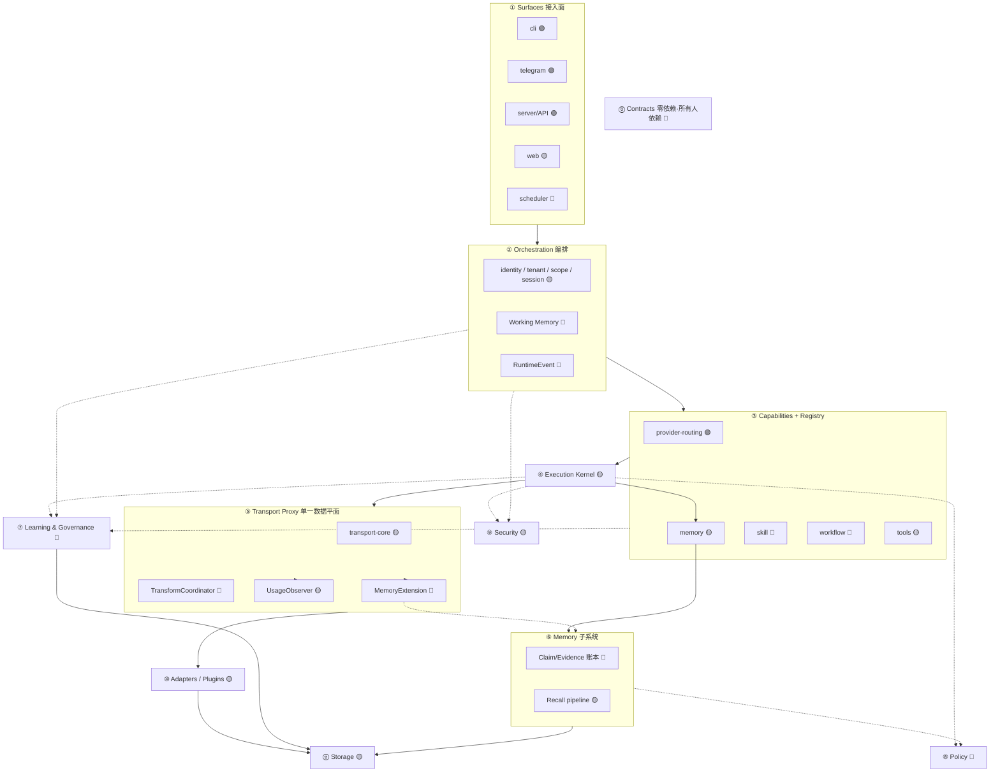
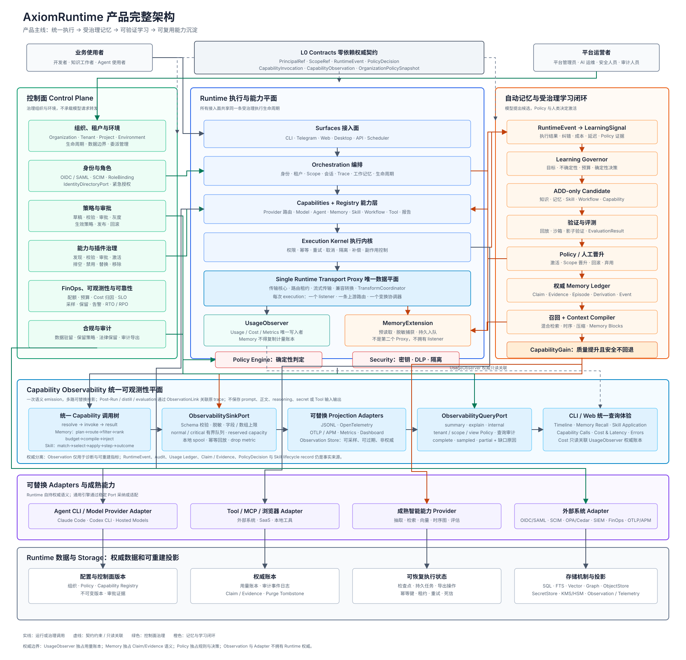
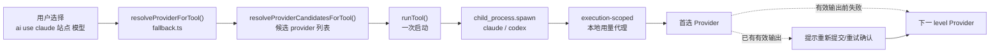
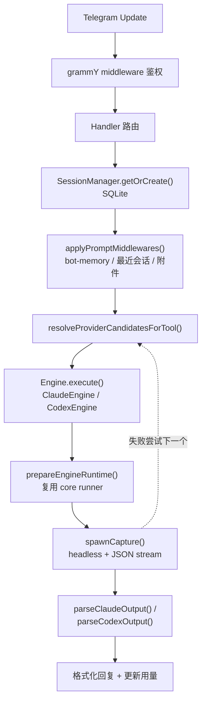
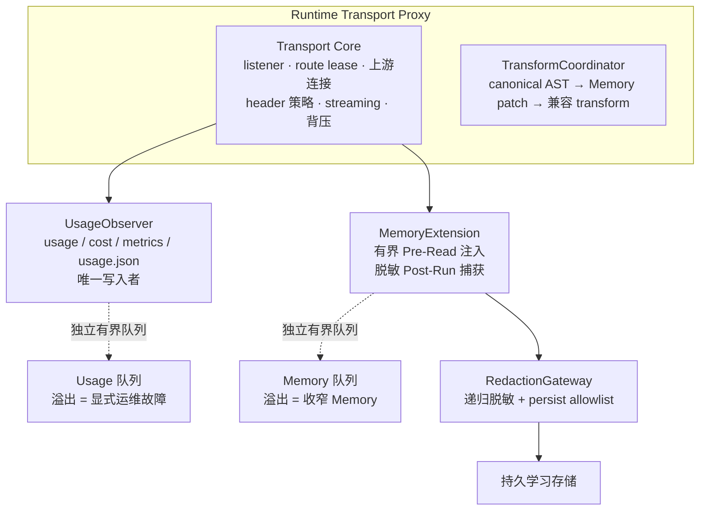
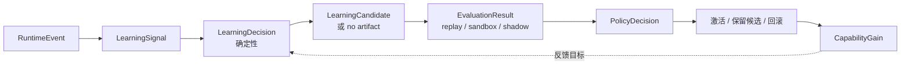
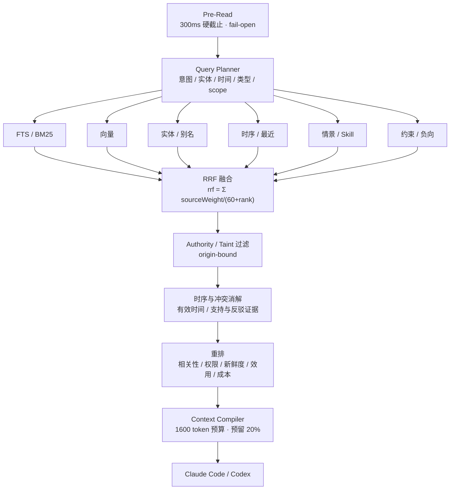

# AxiomRuntime 技术架构

面向开发者与维护者。记录当前实现与目标架构的设计。

- 使用方法 → [使用指南](usage.md)
- 产品规划与验收 → [产品需求文档](prd.md)

**语言约定**：叙述用中文，标识符（类型名、端口名、字段名、路径、配置键）保持英文原样，不翻译。这条约定是为了避免同一个概念出现译名分叉。

**阅读须知**：本文用标记严格区分实现状态。看到 🟢 才表示代码里已经有了。

| 标记 | 含义 |
|---|---|
| 🟢 已实现 | 代码已落地，可在 `src/` 找到 |
| 🟡 部分实现 | 有雏形，但未达目标形态 |
| 🔴 目标设计 | **尚未实现**，仅为设计约束 |

---

## 1. 一句话定位

Runtime 才是产品；Model、Provider、Memory、Agent、Skill、Tool、Workflow 都是**可替换能力**。

北极星：**每次交互让 Runtime 更强**（Every interaction makes the Runtime more capable）。会话结束时 Runtime 不重置。

演进路线：

```text
Provider Gateway            ← 当前位置
  → Unified Execution Runtime
  → Governed Learning Runtime
  → Organizational Capability Platform
```

当前代码处于第一阶段：一个可用的 Provider Gateway，以及为后续阶段准备的传输代理雏形。

---

## 2. 三条硬不变量

这三条是所有模块设计的共同前提。不落实它们，分多少层都会退化成 god-module。修改需要明确的人工决策。

**① 契约层零依赖，所有人指向它（依赖倒置）**

`L0 Contracts` 只放接口与类型，不依赖任何模块。其余每层只 import 契约，**绝不 import 兄弟模块的具体实现**。这一条单独决定「低耦合」。

**② 端口-适配器（Ports & Adapters）**

每个能力对外暴露一个 **Port 接口**，具体实现是 **Adapter**，启动期注入。换 Provider / 存储 / 检索后端 = 换 Adapter，上层零改动。这一条决定「可插拔」。

**③ 发现 ≠ 激活（Discovery ≠ Activation）**

插件靠 `CapabilityDescriptor`（id / semver / permissions / configSchema / health / lifecycle）被**发现**，由 `PolicyEngine` 决定**激活**。模型与插件都不能自我激活。

> 规范动词：**必须** = must，**禁止** = must not，**应当** = should（偏离需说明），**可** = may。

---

## 3. 当前代码结构 🟢

```text
src/
├── cli/                    CLI 接入面
│   ├── commands/           17 个命令：use/image/set/add/status/doctor/telegram/session/...
│   ├── output/  prompts/   终端渲染与交互
│   └── registry.ts         命令注册表
├── core/                   核心逻辑
│   ├── config/             JSON/SQLite 持久化（原子写 + 文件锁）
│   ├── context/            项目上下文生成
│   ├── integrations/       Codex 持久配置、集成状态注册
│   ├── logs/               结构化日志
│   ├── memory/             embedding 配置（仅配置，非检索）
│   ├── models/             模型发现与兼容性过滤
│   ├── network/            出站代理规范化与进程网络策略
│   ├── providers/          Provider 健康检查与刷新
│   ├── reports/            会话报告
│   ├── runner/             执行引擎 + 用量代理（详见 §5）
│   ├── sessions/           CLI 会话管理
│   ├── status/             doctor / status 诊断
│   └── usage/              用量服务与定价
├── server/                 常驻内网 API（Bearer 鉴权）
└── telegram/               Telegram 接入面
    ├── engine/             claude-engine / codex-engine / registry
    ├── handlers/           callback/command/document/memory/message/provider/setup/usage
    ├── interaction/        审批、菜单、格式化、进度上报、token 预算
    ├── session/            SQLite 会话
    ├── memory/             Bot Memory（单表 + 关键词打分）
    └── templates/
```

**关键原则：接入面是适配器。** CLI、Telegram、server 调用稳定的 core API，**不得**自行实现 Provider 路由、记忆策略或工具授权。

### 目录状态一览

| 目录 | 状态 |
|---|---|
| `core/config`、`core/providers`、`core/models`、`core/runner`、`core/images`、`core/usage`、`core/sessions` | 🟢 |
| `core/memory` | 🟡 仅 embedding 配置 |
| `telegram/memory` | 🟡 单表 + 关键词匹配 |
| `core/contracts`、`core/transport-proxy`、`core/policy`、`core/learning`、`core/auth-session`、`core/skills`、`plugins/` | 🔴 目录不存在 |
| 本机 Web adapter（`src/web`、`src/core/web`） | 🟡 `ai web` 已实现基础控制面；企业治理与完整实时 trace 仍规划中 |

本机控制面由 `src/core/web/dashboard-service.ts` 和 `src/core/web/local-settings.ts` 从现有 usage ledger、配置服务和 `service-exposure.json` 投影数据，不创建第二份 usage ledger。Web 现在提供六个一级页面：运行总览、用量统计、本地配置、调用追踪、对外服务、帮助中心。用量统计支持 7/30/70 个 UTC 自然日筛选、Provider 分日成本、成本卡片内按 Provider/模型编辑 `model-pricing.json`；价格配置通过完整下拉列表选择 Provider，合并现有配置、usage 历史和价格键，模型下拉合并缓存目录、默认模型、usage 历史模型和已有价格键并支持手动输入；切换 Provider 会刷新模型和价格，空目录清除上一个 Provider 的模型；占比图使用无间隔分段、圆角和轻量涂鸦纹理，调用活动按 GitHub 式周列 × 7 天排列并使用固定小方格，短区间补充浅色日历上下文但只统计当前筛选区间；调用追踪按 `traceId` 聚合事件、会话和日志；本地配置通过 core API 编辑 Provider、路由、Codex、出站代理、Telegram、embedding，并提供受限权限的配置备份与恢复。敏感值只在表单提交时接收，状态接口不回显。

`service-exposure.json` 是对外能力授权的控制面配置。它维护公网入口、Runtime 上游地址、能力白名单和一次性显示的调用凭证摘要；反向代理与 TLS 仍属于部署环境。Runtime server 可启用该配置，逐请求同时检查凭证能力和全局开放能力，能力关闭或凭证撤销立即拒绝请求。Web 只生成 Nginx 片段和接入示例，不自动写远程服务器。

公网门户是独立静态构建，不打包进入 npm，也不访问本地控制面 API。生产环境与 `app.offerpilot.life` 共用 Nginx 的 `stream` SNI 入口；`axiom.offerpilot.life` 在 `443` 被分流到独立的 `8450` TLS 站点，静态文件放在 `/srv/axiomruntime-portal/current`，由不可变 release 目录和原子 symlink 切换部署。CI 负责构建、上传、健康检查和失败回滚；证书签发和 Nginx 分流属于服务器预配置。

门户呈现遵循 `docs/AxiomRuntime.pen` 的 Web Landing：终端示例、能力卡片、执行流程、安装、命令参考、Telegram 与实现状态。示例用量和对话不是实时数据；版本从 `package.json` 获取。响应式布局、键盘导航和安装命令复制仅属于静态 UI，不引入新的 core API 或配置写入。

---

## 4. 目标分层架构



**依赖方向铁律**：`surfaces → orchestration → capabilities → kernel → adapters → storage`，**只能向内、只 import 契约**。Policy / Security 是横切关注点，在 recall / execution **之前**被调用。

### 模块职责与状态

| 层 | 模块 | 单一职责 | 状态 |
|---|---|---|---|
| ⓪ | Contracts | 端口与类型（零依赖） | 🔴 |
| ① | Surfaces | 意图 → `RuntimeRequest` | 🟢 CLI/TG/API |
| ② | Orchestration | 身份/租户/scope/session 归一化 + 事件 | 🟡 |
| ③ | Capabilities | 版本化能力契约 + 注册表 | 🟡 Provider 已稳定 |
| ④ | Execution Kernel | 权限/幂等/重试/取消/隔离 | 🟡 |
| ⑤ | Transport Proxy | 单一数据平面：转发 + 计量 + 注入 | 🟡 |
| ⑥ | Memory | 账本唯一真相源 + 检索流水线 | 🟡 |
| ⑦ | Learning & Governance | 确定性学习决策 + 晋升/回滚 | 🔴 |
| ⑧ | Policy | 无副作用确定性求值 | 🔴 |
| ⑨ | Security | 凭证/脱敏/隔离/执行期权限 | 🟡 |
| ⑩ | Adapters/Plugins | 供应商细节 | 🟡 |
| ⑪ | Storage | per-contract 可替换后端 | 🟡 |

### 完整架构图



---

## 5. 执行主链（当前实现）🟢

### CLI 执行流程



候选排序规则在 `src/core/runner/fallback.ts`：**健康状态 → 引擎兼容性 → level 优先级 + 显式覆盖**。正整数 `level` 组成自动候选链；`level: 0` 可重复存在，只在显式指定时返回，而且不追加其他候选。新增 Provider 的正整数等级范围为 `1..activeCount+1`；占用已有等级时，新 Provider 与队尾位置交换，原 Provider 移到队尾。

纯图片 Provider（目录中只有 `image` / `dall-e` 类模型，没有任何 Claude 或 Codex 兼容模型）在添加时**强制落到 `level: 0`**，无论交互选择了哪个等级。它没有可用于对话的模型，留在自动链上只会在轮转到它时返回 `403`/`404` 白占一跳；`ai image` 仍然可以显式使用它。判定在 `models/model-filter.ts` 的 `isImageOnlyModelSet()`。

CLI `ai use` 的 fallback 由唯一 Transport Proxy 在请求级完成，不重启原生 CLI。每个候选携带自己的 `Provider`、`model`、认证 profile 和规范化 Base URL；切换时必须改写 JSON 请求中的 `model`，用实际候选凭证构造上游 header，并把 usage 归属到实际成功的 Provider。连接错误以及 `401`、`403`、`404`、`408`、`409`、`425`、`429`、`5xx` 可在尚未产生有效输出时安全重试；`400`、`413`、`422` 不跨 Provider 重试。

Streaming 响应在首个文字、推理或工具参数增量前由代理暂存协议前导事件；此前中断可丢弃并无感切换。首个有效增量写给客户端后即越过不可自动重放边界：中断时只记录待切换候选并显示提示，不重放请求；当前 CLI 发起下一次请求视为用户通过“重新提交/重试”确认，随后激活候选 Provider。父进程禁止与原生 TUI 争抢 stdin 弹出并行 `y/n` 提示。

### Provider 配置探测 🟢

`core/providers` 拥有 Provider 配置探测与持久化事务。CLI、Telegram 和后续 Surface 只能调用同一个 core API，不得各自拼接 `/v1`、猜测认证 header 或在探测失败后写入半成品配置。

探测分为两层：先以不消耗 token 的 `GET /models` 在“原始 Base URL / 切换末尾 `/v1`”与受限认证配置（`Bearer`、`x-api-key`、`api-key`）之间按最小变更顺序寻找可用组合；发现非空模型列表后，针对列表中实际存在的 OpenAI/Anthropic 模型族各选择一个代表模型，以 `max_tokens` / `max_output_tokens = 1` 做真实协议验证。若模型目录不可用，只有调用方明确提供 `provider.model` 时才允许进入手工模型回退：按模型族直接验证 Responses 或 Messages 协议，成功后只缓存该模型；禁止自动猜测模型名或跳过真实验证。确定性的 `4xx` 不重试，只有超时、`429` 和 `5xx` 使用有界短重试；找到更低变更成本的可用配置后立即停止，不做任意 header 名和值的暴力枚举。

成功结果写入可序列化的 `ProviderRequestProfile`，记录模型发现、OpenAI 和 Anthropic 各自采用的认证方式。API Key 始终单独保存，profile 只保存 header 策略枚举，禁止复制 secret。Transport Proxy、模型发现和模型探测共同消费该 profile；旧 Provider 缺少 profile 时使用向后兼容默认值。新增或修改 `baseUrl` / `apiKey` 时必须先完成探测，再分别以原子文件写入 Provider 与缓存；探测失败时原配置、模型缓存和集成 revision 均保持不变。

`ai status` 的“可用”语义是实时协议验证，不是模型名称推断。每个 Provider 先执行零 Token 模型发现，再从每个实际存在的工具模型族中确定性选择一个代表模型；Claude 与 Codex 各最多选择一个模型做 1-token 调用，Codex 必须优先验证 Responses API，只有明确不支持时才回退 Chat Completions。产生 Token 的请求不自动重试，并将 `toolChecks` 独立写入健康缓存。完整模型目录继续保留，不因只验证代表模型而被裁剪。对于具备 `verifiedProtocols` 且已有缓存模型的 Provider，模型目录失败时必须使用已验证缓存模型完成实时协议检查；实时检查成功可覆盖目录失败结论，普通模型刷新也不得因此破坏原健康状态。某工具没有兼容模型时记为 `not_applicable`；收到明确失败响应才记为 `error`。代表模型调用最多等待 30 秒，超时属于不确定结果：工具和 Provider 记为 `unknown`，保留运行候选资格，因为上游可能已经完成请求但响应晚于本地中止。

`ai check [provider]` 是同一 core 状态能力的单 Provider 适配器：CLI 只负责显式名称解析或交互选择，`core/status` 负责精确查找并调用 `refreshProvider(..., { verifyRepresentativeModels: true })`。它不得退化为先刷新全部 Provider 再过滤结果，否则会引入不必要的等待和 Token 消耗。

`ai models [provider]` 是模型目录发现适配器，只允许通过 `checkProvider` 发起 `GET /models`，不得调用任何模型推理端点。成功后只替换目标 Provider 的 `models` 缓存，必须保留 `status`、`lastError`、`toolChecks`、熔断状态和健康分数；模型发现失败时不得清空旧目录或改变真实可用性结论。

显式 Provider / Runtime 代理的模型探测使用与 `Dispatcher` 同一依赖版本的 Undici `fetch`，避免 Node 内置 `fetch` 与外部 Undici handler contract 不兼容导致 `invalid onRequestStart method`；无显式代理的探测仍使用默认 `fetch`。

### Telegram 执行流程



### Runner 模块构成

`src/core/runner/` 当前 12 个文件，职责如下：

| 文件 | 职责 | 目标归属 |
|---|---|---|
| `command-resolver.ts` | CLI 二进制查找 | ⑩ Adapters |
| `engine-registry.ts` | Claude/Codex 策略注册 | ③ Capabilities |
| `claude-permission-policy.ts` | UID 0 下约束 `bypassPermissions` 为 `default` | ⑨ Security |
| `tool-runner.ts` | 运行环境 + 密钥注入 + 临时文件 | ④ Kernel |
| `fallback.ts` | 候选排序、`level: 0` 排除、显式覆盖、全局 failover 开关与 Claude/Codex 模型族隔离 | ③ + ④ |
| `openai-usage-*.ts`（7 个） | 本地 HTTP 代理、协议翻译、用量记录 | ⑤ Transport |
| `images/image-generation-service.ts` | 图片模型解析、请求、响应校验和安全落盘 | ③ Capability + ⑤ Transport |

`openai-usage-*` 这一组是当前的请求级路由与用量代理实现，**目标态按职责剥离到 ⑤ Transport Proxy**，拆成 `transport-core` / `TransformCoordinator` / `UsageObserver` / `MemoryExtension` + 兼容 facade。`startOpenAiUsageProxy()` 作为兼容 facade 保留，行为由 parity 测试锁定。

请求级 failover 只适用于**会真正产生补全的模型端点**：`/v1/messages`、`/v1/chat/completions`、`/v1/completions`、`/v1/responses`、`/v1/embeddings`、`/v1/images/generations`、`/v1/images/edits` 的带请求体 `POST`，其中 multipart 上传不自动重试或轮转，避免未授权的参考图转发。其余辅助请求不重试、不轮转、不写健康失败；收到 HTTP 响应时原样返回，连接失败或响应头超时时返回本地代理错误。这类请求包括：

- Claude Code/Codex 启动或能力探测产生的无请求体 `GET`；
- 辅助端点的 `POST`，典型是 Anthropic 的 `/v1/messages/count_tokens`。多数第三方中转站没有实现它，会返回 `Invalid URL (POST /v1/messages/count_tokens)` 形式的 `404`。这是**端点缺失**，不是 Provider 故障。

把辅助端点的 `404` 当成模型失败会造成双重损害：一次请求就轮转并烧穿整条候选链，并且每一跳都被 `recordProviderRuntimeFailure` 计入 `consecutiveFailures` 和 `healthScore`，让本来健康的 Provider 被误判为 `error`。因此这类请求既不触发轮转，也不写入健康缓存的失败计数。

失败处理是**两级**的：先在当前 Provider 上原地重试，重试额度耗尽后才轮转到下一跳。分级依据是失败的确定性：

| 失败类别 | 原地重试 | 理由 |
|---|---|---|
| `408` / `409` / `425` / `429` / `5xx` | 是 | 限流与上游抖动，同一个 Provider 下一次就可能成功 |
| 连接层错误（`ECONNRESET`、`ECONNREFUSED`、socket 挂断） | 是 | 瞬时传输故障，与 Provider 可用性无关 |
| 有效输出前的流中断 | 是 | 同上，且此时重放不会产生重复输出 |
| `401` / `403` / `404` | 否 | 鉴权、分组权限、端点或模型不存在都是确定性拒绝，重试只会拿到同一个错误 |
| 响应头超时 | 否 | 已经白等了一个完整超时窗口，重试等于让用户再等一遍；连续超时另有 `MAX_CONSECUTIVE_HEADERS_TIMEOUTS` 短路兜底 |
| 已产生有效输出后的中断 | 否 | 违反"输出开始后不静默重放"不变量，只能等用户重发 |

尝试次数由 `maxAttemptsPerRoute` 控制（默认 2，即一次重试），退避为 `retryBackoffMs * 2^(attempt-1)`（默认基数 300ms）。重试成功时**不写失败记账**，健康分不受影响；重试耗尽后整段只写一次 `recordProviderRuntimeFailure`，不会因为重试次数放大熔断计数。

`recordProviderRuntimeSuccess` 与所有 `status: "ok"` 的健康写入把 `healthScore` **直接置满**，而不是按固定步长累加。失败扣 35、成功加 25 的不对称步长意味着被误判扣出来的坑永远填不平，`healthScore` 会长期停在低位而失去诊断价值；一次真实成功比历史累计更有说服力。

`resolveProviderCandidatesForTool()` 必须先按当前 CLI 的模型族过滤候选：Claude Code 只能得到 Claude 模型，Codex 只能得到 Codex/OpenAI 兼容模型。Provider 默认模型不兼容时，可从已发现目录选择同族模型；目录为空且默认模型不兼容时不得乐观加入候选链。显式指定的 Provider 即使健康缓存为 `error` 也必须先实际尝试一次；请求级自动切换只在过滤后的候选链内发生。

全局开关 `runtime.json` 的 `failoverDisabled`（`ai failover off`）把候选链折叠到单候选，只尝试选定（或默认 `level: 1`）的 Provider，失败即报错不轮转。折叠发生在候选解析这一层，因此 `ai use` 的请求级 `fallbackRoutes`、会话级轮转，以及 runtime-server / Telegram / doctor 的候选迭代一并失效，无需调用方各自判断。原地重试（同一 Provider 上的限流/`5xx`/连接层重试）不受影响。

Claude Provider 执行使用 `ANTHROPIC_API_KEY` 作为唯一认证来源。`engine-registry` 构造子进程环境时必须移除继承的 `ANTHROPIC_AUTH_TOKEN`；由于 Claude 的 `--settings` 是附加配置，`tool-runner` 还必须在临时 settings 中用空值显式遮蔽用户 settings 里的同名变量，避免 OAuth token 与 Provider key 同时存在。该隔离仅限 execution scope，不得修改用户 shell 或 `~/.claude/settings.json`。

### 统一用量采集 🟢

- CLI `ai use` 与 Telegram 的 Claude/Codex 执行**都**通过一个 execution-scoped 的 `openai-usage-proxy` listener
- Claude 保留 Anthropic `/v1/messages` 协议，Codex 使用 OpenAI 兼容 `/v1`
- UsageObserver 从真实 JSON/SSE 响应归一化 token；Anthropic streaming 的 input/cache/output 在同一响应内合并
- 事件按 Runtime 已选择的 provider 与**实际** model 写入 `usage.json`
- Telegram 把同一批 proxy records 投影到 `SessionManager.recordProviderUsage()`，**不产生第二份 token 账本**
- Claude JSON stream 的 `cost_usd` 在 provider 返回时作为该 session 的实际成本；不估算、不补写 token

### 图片生成 🟢

本地参考图通过可选 core 输入 `imagePath` 接入：CLI 支持 `--image <path>` / `--image=<path>`，无提示词的交互流程选择文生图或参考图。Core 在任何图片请求前读取普通文件，限制 20 MiB 并按内容识别 PNG/JPEG/WebP，拒绝 GIF、无效文件和目录；有界读取避免文件增长突破限制。参考图使用通用文件名，以原生 `FormData` 发送到 `/v1/images/edits`，复用同一 execution-scoped Transport Proxy 和 UsageObserver；Transport 对 multipart 字节保持原样，不用 JSON 模型重写破坏上传。图片路径、原始文件名、提示词与图片内容不进入 CLI command usage log。参考图仅尝试一个选定 Provider，禁用自动重试和跨 Provider fallback，显式 Provider 不健康时不得改选备用站。非兼容接口、多图、mask 不在本次能力范围，编辑支持由服务商实际响应决定。

`ai image [provider] [model] [prompt]` 是独立的 `ImageGenerationService` capability，不复用 Claude/Codex 的 Agent 模型兼容过滤。CLI 无参数时交互选择 Provider、具体模型和生成方式；指定 Provider 时，第二个参数只有匹配该 Provider 模型缓存才解释为模型，否则保持 `provider + prompt` 兼容。文生图按明确的 Provider/模型选择候选，并按健康度和 `level` 自动 fallback，通过 execution-scoped Transport Proxy 调用 OpenAI-compatible `/v1/images/generations`；参考图的选择与失败语义见上段。图片请求等待响应头上限为 120 秒，避免通用文本代理的 45 秒 headers timeout 截断正常的图片生成；仅文生图超时后继续 Provider fallback。响应校验 `b64_json`/安全的 `https` URL，并将 base64 图片以 `0600` 权限原子保存。图片请求的真实 usage 仍由唯一 UsageObserver 记录；CLI 不记录提示词到 command usage log。

### 进度流式 🟢

底层管道本就是流式的（Claude `--output-format stream-json`，Codex `codex exec --json`）。

`spawnCapture({onStdout})` 通过跨 chunk 的 JSONL accumulator 实时解析 `tool_calling` / `writing` 等 `ProgressUpdate`。`ProgressReporter` 默认节流 1500ms，编辑**同一条**状态消息展示阶段、工具和有界响应预览。

**刻意不做逐 token 编辑**：Telegram `editMessageText` 有频率限制，按完整 JSON stream event 合并预览可以避免 429 和重复执行。

---

## 6. 关键设计决策

| 决策 | 方案 | 理由 |
|---|---|---|
| 配置存储 | JSON (`~/.ai-gateway/`) + `proper-lockfile` | 可手编 + 文件锁/原子重命名防 CLI/Telegram 并发覆盖 |
| Runtime 出站代理 | `core/network` 统一规范化，`providers.json` 的 `proxyUrl` 优先于 `runtime.json` 默认值 | 按实际 Provider 路由上游流量，Surface 不重复拼 URL |
| Telegram 会话 | SQLite (`better-sqlite3`) | 需要查询、索引和并发安全 |
| 工具执行 | `child_process.spawn` | 完整 TTY 继承（CLI）或 JSON stream 捕获（headless） |
| 用量追踪 | execution-scoped 本地 HTTP 代理 | 透明拦截，不改原生 TUI / JSON stream 交互 |
| 模型路由 | 优先级 + 健康检查 + 兼容性过滤 + 运行时 fallback | 选择阶段与执行失败后都能试下一个 |
| Bot Memory | 中央 SQLite + scope 逻辑隔离 | 用户画像跨 bot 共享，Bot 人设仅当前 bot |
| **目标传输代理** | Usage Proxy **原位演进**为单一 Transport Proxy；UsageObserver 与 MemoryExtension 共用 listener | 保留 usage/compat 能力，避免双代理、环境变量回环、重复解析 |
| **成熟能力复用** | 自研 Runtime/Evidence/Policy/Capability 控制面；抽取/检索/向量/图/队列/策略求值走可替换 adapter | 保留产品差异化，避免重建通用问题 |

🟢 `ai proxy <provider> <host> [port]` 将 `proxyUrl` 写入 `providers.json`；旧式 `ai proxy <host> [port]` 将默认值写入 `runtime.json`。`core/network` 规范化为 HTTP(S) origin；新增或编辑前用零 Token TCP 检查端点，失败不得覆盖旧配置。Provider 级代理优先，缺省时回退 Runtime 默认值；清除 Provider 覆盖后恢复该回退。控制面探测和 execution-scoped Transport Proxy 上游都按实际 Provider 选择 dispatcher，同一执行中的 fallback 不共用错误的代理路由。CLI 子进程使用启动 Provider 的代理环境，并强制保留本地回环地址于 `NO_PROXY`；模型请求仍经唯一 Transport Proxy。Telegram 可拥有独立 `proxyUrl`，复用规范化与端点检查，并额外通过候选代理调用 `getMe` 完成端到端验证。

### 自研 vs 复用的边界

**必须自研并保持权威**（体现产品定位）：

- canonical Runtime / Memory / Learning / Policy / Capability 契约
- identity、tenant、scope、audience、purpose 与 origin-bound authority
- 权威 Claim/Evidence、不可变事件、派生链、审计、purge、rollback
- 确定性 Learning Governor 决策、激活、组织晋升、能力安全
- Context Compiler 语义与 Transport/MemoryExtension 边界

**应当复用成熟实现**（通过 adapter 接入）：

抽取、BM25 与混合检索、embeddings、向量索引、实体链接、reranking、时序图投影、workflow checkpoint、durable queue、序列挖掘、策略求值、对象存储、密码学、DLP、benchmark、telemetry。

设计参考：Mem0 的 ADD-only 抽取与多信号检索、Graphiti/Zep 的时序上下文图、Letta 的 memory blocks、LangGraph 的 checkpointer/store 分离、OPA/Cedar 的策略求值、OpenTelemetry。**这些是设计来源和可替换 provider，不是强制依赖。**

每个依赖都需要：ADR、pinned version、SBOM、许可与漏洞审查、数据出境分类、contract fixtures、超时/熔断行为、kill switch、导出/purge 行为、质量-延迟-成本对比、已测试的替换路径。**托管服务不得成为 local profile 的隐式依赖。**

---

## 7. 目标契约 🔴

以下契约**尚未实现**，是 ⓪ Contracts 层的目标清单。

### 身份与执行

| 契约 | 职责 |
|---|---|
| `PrincipalRef` | canonical、tenant-bound 的用户/服务/agent/团队/组织身份 |
| `ScopeRef` | canonical tenant、owner、resource、audience、purpose 边界 |
| `ExecutionContext` | 身份、组织、项目、会话、来源、provider 约束、策略、trace |
| `RuntimeRequest` | 意图 + 类型化输入 + 请求的能力 |
| `RuntimeEvent` | append-only 结构化生命周期证据 |

### 能力与策略

| 契约 | 职责 |
|---|---|
| `CapabilityDescriptor` | 身份、版本、契约、权限、依赖、激活状态 |
| `CapabilityInvocation` | 类型化能力调用，带幂等与策略上下文 |
| `PolicyDecision` | allow / deny / require_confirmation / constrain |
| `ToolPort` | 一个类型化动作，含副作用、幂等、取消、结果对账、可选补偿 |
| `WorkflowExecutorPort` | 带 checkpoint、可信号、可恢复、可补偿的状态机执行 |
| `AgentAdapterPort` | 有界外部 agent 执行；每个提议的工具动作**必须**回到 Kernel 授权 |

### 学习与治理

| 契约 | 职责 |
|---|---|
| `LearningObjective` | 版本化能力目标、scope、指标、硬安全回归、最小证据 |
| `LearningSignal` | 归一化的执行结果、纠正、复用、失败、成本、延迟、策略证据 |
| `LearningDecision` | 确定性选择：不产出 / 抽取 / 验证 / 提问 / 巩固 / 评测 / 晋升 / 回滚 |
| `LearningCandidate` | 带证据的知识/skill/workflow/capability 提案 |
| `EvaluationResult` | 确定性 + 模型辅助的质量证据 |
| `UncertaintyAssessment` | 事实、检索覆盖、冲突、时序、适用性、策略、目标影响的不确定性 |
| `CapabilityGain` | baseline 对比 candidate 的结果度量，含样本量、不确定性、硬回归 |

### 传输与数据边界

| 契约 | 职责 |
|---|---|
| `TransportRouteLease` | execution-bound 的本地 listener 路由、上游 origin、engine、owner、过期、连接预算 |
| `TransportExtension` | 有界 observer 或声明式 request-patch 贡献者；**永不**拥有 listener 或上游连接 |
| `TransportTransformManifest` | 有序的兼容与扩展补丁，含允许路径、前后 hash、回滚元数据 |
| `SanitizedTurnEnvelope` | 一轮交互的可持久化证据：allowlist 元数据、hash、加密 TTL 引用；**绝不**含原始 header 或完整 prompt |

### 可插拔后端

`CandidateExtractor`、`RetrievalBackend`、`VectorRetrievalBackend`、`TemporalGraphProjection`、`WorkflowCheckpointBackend`、`DurableJobBackend`、`ProtectedPayloadCodec`、`ProcedureMiner`、`PolicyEngine`、`EvaluationHarness`、`IdentityDirectoryPort`、`AuditQueryPort`、`MeteringExportPort`、`ObservabilitySinkPort`、`ObservabilityQueryPort`。

> 契约**必须** provider agnostic，跨进程场景下**必须**可序列化。
>
> `RuntimeEvent.eventType` 和 `RuntimeError.code` 是**封闭、版本化的目录**。Provider 错误、自由格式事件名、原始 SDK payload 和未注册的诊断字段**禁止**跨模块或持久化边界。每个 invocation 只有一个终态事件；对账追加纠正事件，**永不**改写历史。

---

## 8. 传输代理边界 🟡→🔴

这是当前最重要的演进方向，也是最容易出错的地方，所以单独展开。

### 核心约束

**一次 execution = 一个 listener + 一条上游路由 + 一个 base-URL 覆写 + 一个 transform coordinator。**

**禁止**新增第二个 Memory HTTP 代理，**禁止**形成 `Memory Proxy → Usage Proxy → provider` 的链条。

### 职责划分



| 组件 | 拥有 | 禁止 |
|---|---|---|
| Transport Core | listener、路由租约、上游连接、header 策略、兼容 transform、streaming、背压、扩展隔离分发 | — |
| `UsageObserver` | usage 归一化、成本计算、records、metrics、`usage.json` 持久化 | 修改传输 payload |
| `MemoryExtension` | 请求 allowlist 内的指令补丁、消费脱敏后的 canonical 事件 | 翻译协议、计算计费用量、写第二份用量账本、拥有 listener、独立转发请求 |

### 幂等与计费正确性

canonical 响应事件携带 `executionId`、`requestId`、`attemptId`、provider 事件 id（若有）和单调序号。用量持久化的**幂等键由这组身份与实际上游 attempt 派生**，因此兼容重试、CLI 重试和 observer 重放都**不会**重复计费。

每个 attempt 只有一个终态；观测到的用量最多贡献一次。成功响应但无用量时递增已有的 `noUsage` 状态，**不发明成本**。

### 故障隔离

- Usage 与 Memory 从同一事件源获得**各自独立**的有界队列
- Memory 背压**不得**丢弃 Usage
- Usage 溢出或 worker 失败是**显式运维故障**，需要 durable recovery 或对账，**绝不**静默报告为健康
- 杀掉 parser 或 extension worker **不中断**当前 provider 流
- 杀掉 forwarder **可以**让当前 TCP 请求失败，但 supervisor 必须为下一个请求恢复 listener，且**不得**声称透明续传或产生成功的学习证据

### 协议兼容

协议兼容在 transport adapter 内解决，**不由接入面处理**。

Streaming Responses 请求先尝试原生 Responses，只有当上游**明确**缺少 Responses 协议时才翻译为 Chat Completions。Cloudflare `52x` 之类的瞬时失败属于 provider attempt 失败，**不得**引起协议振荡。**协议不匹配本身不等于 provider 故障。**

### Codex 传输特化 🟢

当前 Codex facade 的实际行为：

- 拥有 execution-scoped 上游 dispatcher，**禁用**上游 keep-alive 复用
- 丢弃调用方提供的 `content-length`，从最终转发 body 重算
- Transport Proxy 对有效输出前、可安全重放的模型请求可在当前 Provider 原地重试，再按候选链轮转；辅助请求不参与重试或轮转。有效输出后不自动重放
- 强制 45 秒上游响应头截止。连续两次 header 超时会打开 execution-local 短路：后续 Codex 重连立即得到超时结果，让 Telegram 执行适配器轮转到下一个 provider。**该熔断只作用于一次 execution，不能单独改变全局 provider 健康状态**

### 模式独立性

传输模式（`stopped | usage_only | extensions`）与 Memory 模式（`disabled | passthrough | shadow_capture | read_only | full`）**相互独立**。

Memory 健康度**只能收窄** Memory 模式，**不能**禁用已验证的 Usage 或兼容行为。**模型不能扩大模式或闭合熔断。**

### 数据边界

原始 header、完整 system/developer 指令、reasoning、tool 参数和 tool 输出都是**临时传输数据**。

只有 `SanitizedExecutionEnvelope`、hash 和加密 TTL 引用**可以**进入持久执行或学习存储。递归脱敏和 persist-schema allowlist 是**强制**的 —— 只扫描响应文本**不合规**。

> 回环随机端口**不是**租户隔离。互不信任的租户需要真实的 OS 用户、容器或网络隔离。

---

## 9. Claude Code / Codex / Telegram 的定位

这一节容易误解，单独说明。

**Claude Code 和 Codex CLI 既不是 Surface，也不是 Model/Provider Adapter。**

它们在架构里占三个身份：

| 层 | 身份 |
|---|---|
| ③ Capabilities | 可选择、可版本化的 `agent` capability |
| ④ Execution Kernel | 由 Kernel 监管运行（权限、预算、重试、取消、工具提议） |
| ⑩ Adapters | `ClaudeCodeCliAgentAdapter` / `CodexCliAgentAdapter` 实现 `AgentAdapterPort` |

**Telegram 是 ① Surface**，负责边缘鉴权、构建 `RuntimeRequest`、渲染进度、回传确认决策。目标态**不得**通过第二条策略路径 spawn 或控制外部 coding agent。

目标完整链路：

```text
Telegram / CLI / API Surface
  → Orchestration
  → Capability Registry 解析 claude-code-agent 或 codex-cli-agent
  → Execution Kernel 监管权限、预算、重试、取消、工具提议
  → ClaudeCodeCliAgentAdapter / CodexCliAgentAdapter
  → Runtime Transport Proxy
  → 选定的 ModelProvider Adapter
```

**关键约束**：Claude Code / Codex 原生的工具请求是**不可信的 Agent 提议**。Adapter 把它们归一化为 `AgentRunEvent.tool_request`，由 Kernel 在执行时授权对应的 `ToolPort` 调用。Telegram 的审批按钮**只提交决策**，永不直接执行工具。

如果某个 CLI 版本无法暴露可拦截的工具请求/确认边界，它的 descriptor **必须**声明该限制，Policy **必须**据此约束到与风险相称的隔离和权限模式。

🟡 **当前状态**：Telegram 的 `Engine` 接口是一个 delivery-local 兼容 facade，不是 canonical Agent 契约。它目前直接 spawn CLI；目标态**必须**委托给统一 Orchestration 与 `AgentAdapterPort`。

### 执行权限与安装权限分离 🟢

包安装可以要求管理员权限，但 Agent 进程和长期 Runtime 服务**应当**以专用非 root OS 身份运行。

Claude adapter **必须**在构造参数和临时 settings **之前**检测 UID 0；此时 `bypassPermissions` 被约束为 `default`，继承的 bypass 设置从 execution-scoped settings 中移除，configured 与 effective 模式加上原因都可观测。**任何 Surface 或 adapter 都不得**从特权进程转发 `--dangerously-skip-permissions`。

### Codex 持久配置 🟢

持久的 vendor client 配置是**显式管理操作**，不是执行期 provider 路由。

- Codex App、Codex CLI 与 IDE extension 在同一 OS 用户和同一 `CODEX_HOME` 下共享用户级 `config.toml` 配置层
- `ai use codex` 通过 CLI `-c` 只为**本次子进程**固定 provider，不回写共享配置
- `ai set codex` 调用独立的 core integration service，持久切换 Codex client，共享配置会在 App/CLI 后续新进程中生效

该 service 的约束：ChatGPT OAuth 委托 `codex login`；持久写入限于用户级 `CODEX_HOME/config.toml` 和 `auth.json`；使用原子替换 + 回滚；API Key **不进入** TOML 和日志；凭证文件权限强制 `0600`。Provider 变更只从该 provider 已发现的模型缓存中解析模型；写入 Codex `base_url` 时复用 Codex Runner 的规范化规则，保证末尾恰好一个 `/v1`。

代理变更保留无关 TOML 状态，只管理 `shell_environment_policy.set` 下的标准 HTTP(S)/ALL 代理键，拒绝命令行代理凭证；macOS 上事务性同步用户 launchd 环境。**只有在请求的持久状态一致后**才重启桌面客户端。重启辅助进程必须移除继承的 `OPENAI_API_KEY`，让客户端读取刚写入的 `auth.json`，避免旧 Shell 凭证覆盖新 Provider。

`npm run build` 不得先删除整个 `dist/`：正在运行的 Codex 进程或旧配置可能仍引用其文件。持久切换 Provider 时，仅清理指向过时 `dist/cli/codex-auth.js` 的 Provider auth command，其他用户配置继续保留；构建本身不修改 `CODEX_HOME`。

🟡 本机 Web 控制面中的 Codex App 配置页是该 core integration service 的 adapter：读取时展示 `model_provider`、model、proxy 与凭证状态，写入时提交与 `ai set codex chatgpt | provider | proxy` 等价的命令意图，不在浏览器端直接编辑 TOML/JSON。当前页面展示等价命令、重启影响和历史 session 不迁移提示；完整配置 diff、operation progress、手动 rollback 与企业 policy 仍是后续能力。secret 只显示 configured/missing 状态。

---

## 10. 受治理学习闭环 🔴

**完全未实现。** 以下是目标设计。



### 核心约束

**必须区分召回与因果贡献。** `retrieved`、`injected`、`referenced`、`decision_changed`、`outcome_changed` 是**分开的状态**。

> **召回频次不能提升事实 confidence。** 事实 confidence 来自 evidence；使用效用来自结果归因。

`no artifact` 是**合法**的学习决策，且在未证明持久复用价值时**优先**选择它。

自动抽取、低风险类别激活、巩固、压缩和评测**可以**在通过发布门槛后默认运行。**Scope 晋升、高风险 skill、工具授权、安全策略和不可逆动作仍由策略与人类治理。**

### 压缩与遗忘

压缩**只替换投影，永不**替换权威的 Claim/Evidence provenance。每个激活的压缩产物**必须**提供完整来源覆盖、compiler 版本、评测结果和回滚产物。

自动遗忘**应当**先降温、失效或归档投影；**物理删除**仍由 TTL、保留策略和显式用户或组织授权控制。

### 记忆子系统目标

Memory 不是独立产品，而是 Runtime 的**学习与知识子系统**。目标是让记忆不再依赖手动命令，而是通过统一 hook 自动参与每次对话、执行、总结和上下文注入。

核心原则：

> 大模型负责理解、操作和生成；本地服务层负责记忆筛选、登录态、敏感信息隔离和安全边界。

账号、密码、cookie、token、session storage **不进入**大模型上下文。需要登录的网站由本地服务层维护登录状态，大模型只获得「已登录能力」，**不能读取凭证本身**。

### 记忆检索目标流水线 🔴



设计要点：

1. **身份与安全先行** —— 身份不明确或 scope 校验失败时**禁止**记忆读写，不能靠模型猜测用户或项目
2. **查询规划而非固定关键词** —— 简单请求走快速路径，复杂问题组合多种记忆类型
3. **先过滤权限，再判断事实** —— 模型摘要、蒸馏或工具转述**不能**把 external 来源洗白成可信用户事实
4. **冲突和时间是检索主流程的一部分** —— **不能**把互相冲突的记忆不加说明地同时交给主模型
5. **上下文是编译产物** —— Profile Snapshot **不是**事实源，随底层 Claim 更新重新编译
6. **允许一次受限主动回忆** —— 主模型可调用只读 `memory.search` 补查，继续执行相同的过滤，受调用次数和 token 上限约束
7. **工具能力与记忆完全解耦** —— 任何记忆**都不能**创建、扩权或延长 capability handle

### 记忆非目标

以下能力**不在**记忆模块实现：

- 不保存账号密码明文
- 不把 cookie、token、localStorage、sessionStorage 注入 prompt
- 不让大模型直接填写密码输入框
- 不把网页登录态当普通 memory 文本保存
- 不改写 Claude Code `CLAUDE.md` / Codex `AGENTS.md` 作为主存储

`CLAUDE.md` 和 `AGENTS.md` 仍由各自 `/init` 管理；Runtime Memory 是更上层的动态注入与治理系统。

### 当前记忆实现 🟡

| 能力 | 状态 | 位置 |
|---|---|---|
| 中央 SQLite 记忆库 | 🟢 | `~/.ai-gateway/memory.sqlite` |
| `global` / `bot` 两级 scope | 🟢 | `telegram/memory/types.ts` |
| Telegram prompt 注入 `<user_memory>` | 🟢 | `memory-inject.ts` |
| setup 画像写入 | 🟢 | `handlers/setup.ts` |
| 短期记忆 TTL | 🟢 | `memory-store.ts` |
| embedding 配置与探测 | 🟢 | `core/memory/` |
| 单表 `memories` | 🟢 | `create table if not exists` 直建 |
| 关键词打分检索 | 🟡 | `scoreMemory()` in `memory-service.ts` |
| `memory_units` + Claim/Evidence 账本 | 🔴 | — |
| 5 级 scope（终局） | 🔴 | 当前仅 2 级 |
| 多源召回 + RRF + 向量 | 🔴 | — |
| Learning Governor / 自动抽取 | 🔴 | 全靠显式 `remember()` |
| 版本化 migrations | 🔴 | 无 migrations 目录 |
| 凭证加密 | 🔴 | credential 类直接抛错 |
| `SecretStore` + `apiKeyRef` | 🔴 | `providers.json` 明文存 `apiKey` |
| 终端 `ai use` 接入记忆 | 🔴 | 仅 Telegram |

演进方向：记忆核心迁移到 `src/core/memory`，Telegram 和 CLI 只是调用方；所有执行入口统一经过 memory hook；敏感登录态由独立 `auth session` 服务管理。

> 旧的手动记忆命令**只能在**统一审计界面和显式 `pin/correct/forget` 能力完整替代后移除。**不允许先移除用户纠错入口。**

---

## 11. 可观测性 🔴

可观测性是**一个跨层能力**，不是分开的 Memory、Skill、JSONL、dashboard 和 OpenTelemetry 日志系统。

Orchestration 创建执行 trace；Capability、Kernel、Memory、Skill 和 Learning 代码通过 `ObservabilitySinkPort` 为每个语义动作 emit **一个**经校验的 `CapabilityObservation`。JSONL、OpenTelemetry、企业 OTLP/APM 都是该**单一 emission 点**背后的可替换投影 adapter。

### canonical 调用树

```text
通用：capability.resolve → capability.invoke → capability.result
Memory：plan → route retrieval → filter → rank → budget → compile → inject
Skill： match → select → apply → step → outcome
```

每个 Skill step 引用**实际授权的** Tool、Workflow、Agent 或 Model 调用。Post-Run 抽取、蒸馏、验证、评测和晋升保留来源 trace id，但使用**显式 span link**，不假装仍在同步请求栈上。

### 边界

Observation 是**采样的、可过期的、best-effort 诊断数据**。它们**可以**引用持久 `RuntimeEvent` id，但**不能**替代事件、审计、UsageObserver 账本、Claim/Evidence 真相、Policy 决策、Skill 生命周期记录或评测证据。

**缺失的 observation 使 trace 标记为 `partial`；它们永不证明某个操作没有发生。**

payload **可以**含：策略授权 trace 视图中的 canonical resource id、hash、长度、计数、有界四舍五入分数、版本、状态、reason code。

payload **绝不**含：prompt、Memory 或 Skill 正文、Skill step 文本、触发关键词、reasoning、secret、原始 Evidence、tool 输入输出。

**trace、execution、principal、project、Memory、Skill 和 invocation id 不能作为 metric label**（高基数）。

Cost 视图在**查询时**关联 UsageObserver 拥有的读模型；telemetry **永不**成为第二份用量账本。

### 当前已落地的关联键 🟢

`CapabilityObservation` 与 OpenTelemetry 导出仍未实现，但结构化日志已有跨 surface 的关联键：`LogEvent.traceId`（`src/core/types.ts`）。

- 一次 HTTP 请求、一条 Telegram 消息、一次 `ai use` 在入口生成一个 traceId（`newTraceId()`，`src/core/logs/log-service.ts`），该次执行的候选解析、每次 provider 切换和终止跳全部复用它
- 常驻服务直接把自身 `requestId` 当作 traceId，因此 `x-request-id` 响应头可反查整条链路
- `resolveProviderCandidatesForTool(tool, provider, model, traceId)` 接受可选 traceId，让熔断 / 健康 / 无兼容模型这些**前置跳过**也进入同一条链路
- 每条链路以终止跳收尾：`runtime_server_request_settled` / `tool_run_settled` / `runtime_provider_settled`（成功，带 `fellBack`、`attempt`、`totalCandidates`），或 `*_candidates_exhausted`（全败，带 `attempted`）
- 读取入口：`ai log --print --trace <traceId>`

traceId 是**诊断关联键，不是审计事实**：历史日志没有该字段，读取方必须容忍缺失；它同样受本节「缺失的 observation 使 trace 标记为 `partial`」约束，不证明某个操作没有发生。

---

## 12. 治理与安全不变量

- Tenant 与 organization scope 在**检索或执行之前**解析
- 凭证与浏览器会话状态是 **capability，永不是 prompt memory**
- 工具权限在**执行时**检查；memory 或 skill **不能**授予权限
- 外部内容是**不可信证据**，不能自我晋升
- 不可逆和高影响动作需要**显式授权**
- 持久写入是幂等、可审计、可恢复的
- 学习产物保留 provenance，可弃用、取代、导出或 purge
- 学习决策是目标绑定、版本化、有预算、可解释、可逆的。**模型不能直接写激活状态或最终策略决策**
- **Capability gain 而非产物数量或召回次数**是学习成功的度量。隐私、禁止泄漏和高影响安全回归是**硬晋升阻塞项**
- 自动压缩**不能**破坏 provenance、purge 可达性、显式 pin 或必需的审计历史
- Provider 失败通过显式 adapter 和策略降级，**永不**静默改变语义
- 单一 Transport Proxy 拥有本地转发。Usage 与 Memory 是扩展；协议不确定性**收窄 Memory**，不创建第二个代理，也不禁用已验证的 usage 行为
- 原始传输捕获**不能**进入持久存储
- Prompt 注入变更在激活前**必须**评估 cache 命中率、有效输入成本、首 token 时间和任务质量

### 当前安全实现 🟢

- `ai set codex` 是迁移到统一 `SecretStore` 前的本地兼容路径：ChatGPT token 只由 `codex login` OAuth 生成；自定义 provider 的 API key 只写 `auth.json`，权限固定 `0600`；`config.toml` 只存 provider metadata 和已验证的缓存 GPT model id。**Provider/model 校验必须发生在凭证/配置变更之前。** 两文件更新使用 snapshot、原子重命名和失败回滚，日志和终端不输出 secret；macOS 自动重启时清理继承的 `OPENAI_API_KEY`，不让旧进程环境覆盖已更新凭证
- 常驻 Runtime 服务使用独立 Bearer Token，**constant-time 比较**后才允许访问 `/v1/*`。生产 Token 与 provider 凭证通过挂载注入，**不进入镜像**
- Agent Run **禁止任意 cwd**，只接受规范化 `workspace_id`；默认 `read_only`，服务 API **不暴露** `bypassPermissions`，并设置请求体、并发与执行超时上限

---

## 13. 从当前代码到目标层的映射

| 当前位置 | 目标层 | 方向 |
|---|---|---|
| `src/core/runner/openai-usage-*.ts` | ⑤ Transport | 按职责拆 core / TransformCoordinator / UsageObserver / MemoryExtension；`startOpenAiUsageProxy` 保留为 facade |
| `src/core/runner/fallback.ts`、`tool-runner.ts` | ③ + ④ | 重组进 Capabilities 与 Kernel |
| `src/core/runner/claude-permission-policy.ts` | ⑨ Security | 收敛进统一 Security |
| `src/core/context/`、`sessions/` | ② Orchestration | 合并上移 |
| `src/core/providers/`、`models/` | ③ Capabilities | 暴露稳定契约 |
| `src/core/integrations/` | ⑩ Adapters | 已提供通用集成状态注册 |
| `src/telegram/memory/` | ⑥ Memory | 升级为 core 层账本初始实现 |
| `src/telegram/session|interaction/` 中可复用策略 | ② Orchestration | 上移 |
| `src/telegram/engine/` | ⑩ Adapters | 演进为 `AgentAdapterPort` 实现 |
| `src/server/runtime-server.ts` | ⑤ Transport | 第一个常驻内网入口，保持在同一数据平面 |
| CLI / engine / handler 三处 registry | ③ Registry | 收敛为单一 `CapabilityRegistry` |
| `usage.json`、`memories` 单表 | ⑪ Storage | 规整为 per-contract 后端 |

---

## 14. 架构验收标准

判断架构是否达标的检查项。**当前多数尚未满足** —— 它们是目标门槛。

### 可插拔性

- 新增 surface 可调用 Runtime 能力而**不复制**任何领域策略
- 新增 provider **不改动**能力层或 surface 契约
- 关闭某个 surface，其余 surface 与下层行为不变
- surface 层代码中**不存在** provider 选择、memory 策略、tool 授权逻辑
- 能力层代码中**不存在**供应商 SDK 类型作为公共契约
- 成熟能力 provider 可替换而**不改**公共契约、权威 id、scope 决策、audit/purge 可达性、显式用户控制
- 换 deployment profile（本地↔企业）**不改**任何 Runtime 语义

### 执行正确性

- 权限在**执行时**检查；memory 或 skill **无法**授予权限
- 不可逆/高影响动作**必须**有显式授权
- 重试/兼容重试**不产生**重复副作用或重复计费
- crash 后从最后已提交的 checkpoint 恢复，**不重复**已提交的 tool 副作用
- 同一 Agent descriptor 从 Telegram、CLI 或 API 发起时，Kernel 产生**一致的**副作用、确认、预算、取消、retry-owner 与终态事件
- Runtime event catalog 中 start / terminal **一一配对**
- 模型变化时，安全/scope/权限行为**保持确定**

### 传输

- 一次执行只创建 **1 listener + 1 upstream route**；facade 保留原 records/metrics/translation/error 行为
- 杀 parser/extension worker **不中断**当前 provider 流；杀 forwarder **不制造假成功**，下条请求被 supervise 回已知态
- 持久传输证据**不含**原始 authorization / system prompt / reasoning / raw tool 参数
- memory-disabled 模式下全链路成功、usage 准确
- Memory 注入不超出批准的 prompt-cache / 有效成本 / 延迟回归阈值

### 学习与记忆

- 学得的 artifact **无**证据与 policy 评估**不得**激活
- 交互可产生自动学习信号，但模型输出**不能**绕过确定性激活策略
- Runtime 能解释为何 learned / asked / verified / consolidated / promoted / ignored / rolled back
- 压缩投影可失效/回滚到权威 Claim/Evidence 且**不丢** purge 可达性
- 召回频次**不**提升事实 confidence
- Scope 晋升**不迁移**私有 evidence，**不因**单一 principal 反复使用而组织级激活
- 「更强」的可操作定义：**纠错率下降 且 任务成功率不降 且 检索精度不回归**

### 可观测性

- 每次 Memory 调用可按 trace 解释 invoke reason、逐 route latency/hit/error、过滤 reason counts、rank/budget/compiler、最终注入与结果归因
- JSONL、OpenTelemetry 和 dashboard 来自**同一** `CapabilityObservation` emission；关闭或阻塞 exporter 时结果与 baseline 一致
- 同步 emit p95 ≤ 2ms、p99 ≤ 5ms；exporter 故障**不改变** Runtime 行为
- 指标标签**不含**高基数 id

### 性能门槛

- Proxy 转发开销 p95 < 20ms
- L1 Pre-Read p95 < 100ms
- 摘要 source coverage = 1.0；token 至少下降 20%

---

## 15. 开发约定

### 工程规则

- **先增强现有能力，再新增模块。** 新模块须先证明现有边界无法合理容纳它
- **优先在类型化 adapter 后采用成熟库**，而不是重新实现通用引擎
- JSON 存储使用**临时文件 + 原子重命名**，避免并发进程损坏
- `providers.json` 是稳定、人类可编辑的；内部运行状态放在独立文件
- Node.js 最低版本在 `package.json`、`.gitlab-ci.yml` 和文档间**保持同步**

### 构建与测试

```bash
npm ci --prefix web  # 安装独立前端依赖
npm run build        # tsc + Web console 构建 + chmod；不清空整个 dist
npm test             # build 然后跑 node:test
npm run dev          # 带 source map 运行 CLI
npm run server       # 启动常驻 API
npm link             # 全局安装为 ai 命令
```

单个测试文件：

```bash
npm run build && node --test test/core.test.js
```

测试使用 Node.js 内置 `node:test`，文件在 `test/*.test.js`，跑的是编译后的 `dist/`。三个测试文件分别覆盖核心逻辑、服务和 Telegram 集成。

TypeScript 编译到 ES2022 + NodeNext modules。

本机 Web 静态入口为 `dist/web/control/console.html`，由 `npm run build:web:console` 生成；仅运行 `tsc` 不会生成控制面静态资源，缺失时首页返回 `404` 和 `{"error":"Not found."}`。

### 文档同步

文档是「完成」的一部分。每个任务**必须**在同一次变更里更新受影响的文档：

| 变更类型 | 更新 |
|---|---|
| CLI 或配置行为 | [usage.md](usage.md) + `USAGE.html` |
| 架构或所有权边界 | 本文档 |
| 产品方向或验收行为 | [prd.md](prd.md) |
| 使命、北极星或三条硬不变量 | 本文 §2，**需要明确的人工批准** |

AI 与维护者文档用英文标识符 + 中文叙述；用户文档用中文。**永不翻译标识符。**
