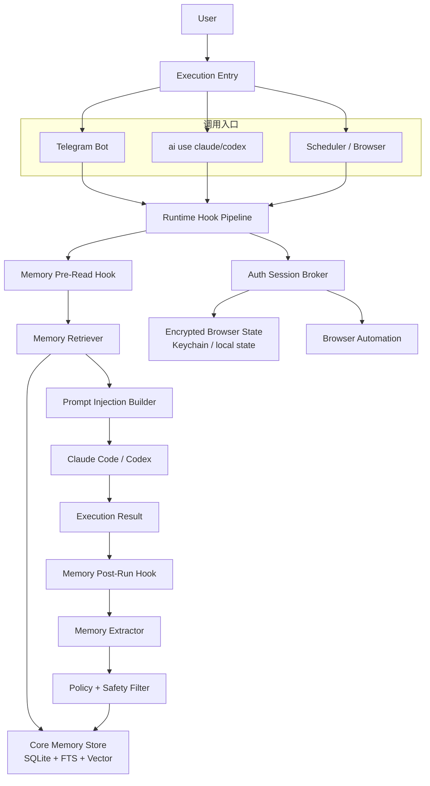
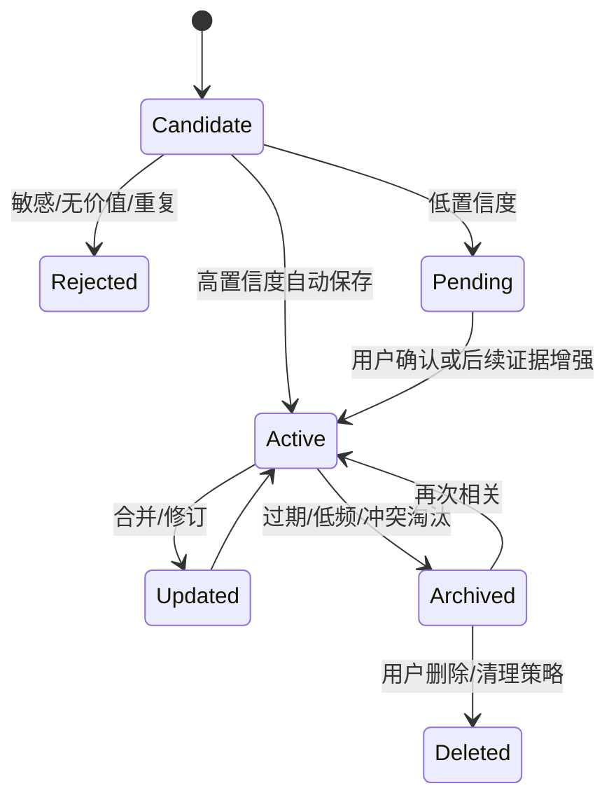
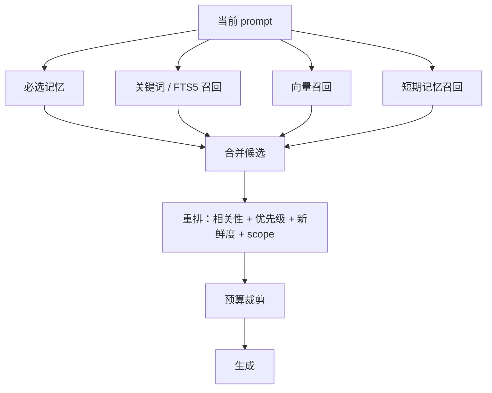
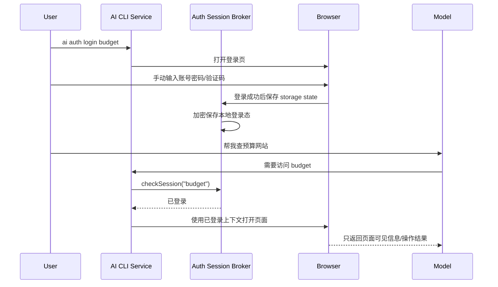

# AI Gateway 自动记忆系统设计方案

## 目标

重新设计一套 AI Gateway 顶层记忆系统，使记忆能力不再依赖手动记忆命令，而是通过统一 hook 自动参与每一次对话、执行、总结和上下文注入。

该系统必须同时服务：

- Telegram Bot 中的 Claude Code / Codex 对话
- 终端 `ai use claude ...` / `ai use codex ...`
- Browser 自动化、计划任务等 AI Gateway Core 执行入口

核心原则：

> 大模型负责理解、操作和生成；AI CLI 服务层负责记忆筛选、登录态、敏感信息隔离和安全边界。

账号、密码、cookie、token、session storage 等敏感信息不进入大模型上下文。需要登录的网站由本地服务层维护登录状态，大模型只获得“已登录能力”，不能读取凭证本身。

---

## 当前状态

现有实现是 Telegram Bot Memory Phase 1：

| 能力 | 当前状态 | 说明 |
|------|----------|------|
| 中央 SQLite 记忆库 | 已实现 | `~/.ai-gateway/memory.sqlite` |
| global / bot scope | 已实现 | `global` 跨 bot，`bot` 仅当前 bot |
| Telegram prompt 注入 | 已实现 | Telegram 调 Claude Code / Codex 前注入 `<user_memory>` |
| setup 画像写入 | 已实现 | Telegram 初始化时生成 profile/persona |
| 短期记忆 TTL | 已实现 | `short_term` 到期清理 |
| 记忆检索向量模型配置 | 已实现 | `ai memory embedding` 交互配置，保存到 `~/.ai-gateway/memory.json` |
| 自动记忆 | 未实现 | 普通聊天不会自动写入 |
| 终端 `ai use` 接入 | 未实现 | 当前只接 Telegram |
| 向量检索 | 未实现 | 当前是轻量关键词匹配；embedding provider 配置和探测已先行完成 |
| 凭证/登录态隔离 | 未实现 | 目前 credential 类明文保存被拒绝 |

新的设计方向：

- 旧的手动记忆入口将移除，记忆建立默认由 hook 自动完成。
- 记忆核心迁移到 `src/core/memory`，Telegram 和 CLI 只是调用方。
- 所有执行入口统一经过 memory hook。
- 敏感登录态由独立 `auth session` 服务管理，不属于普通 prompt memory。

---

## 非目标

以下能力不在记忆模块里实现：

- 不保存用户账号密码明文。
- 不把 cookie、token、localStorage、sessionStorage 注入 prompt。
- 不让大模型直接填写密码输入框。
- 不把网页登录态当作普通 memory 文本保存。
- 不改写 Claude Code / Codex 的原生记忆文件作为主存储。

Claude Code 的 `CLAUDE.md`、Codex 的 `AGENTS.md` 仍然由各自 `/init` 管理；AI Gateway Memory 是更上层的动态注入与自动治理系统。

---

## 总体架构



### 模块边界

| 模块 | 职责 |
|------|------|
| `core/memory` | 记忆存储、分类、检索、注入、自动提取、蒸馏 |
| `core/auth-session` | 登录态维护、cookie/storage state、凭证隔离、人工登录流程 |
| `telegram/*` | Telegram UI、session、消息收发、调用 core memory |
| `cli/*` | `ai use` 执行入口、调用 core memory |
| `runner/*` | Claude Code / Codex 子进程执行，不直接理解记忆策略 |

---

## Hook 模型

所有对话和任务执行都走同一套 hook。

### 1. Pre-Read Hook

执行前触发。

输入：

- userId
- botId / profileId
- engine：`claude` 或 `codex`
- cwd
- prompt
- recent conversation
- attachments metadata
- tool capability metadata

输出：

- 要注入的长期记忆
- 要注入的短期记忆
- 当前 bot/persona 指令
- 不注入但可供服务层使用的 auth capability 声明

行为：

1. 识别当前用户、当前 bot、当前项目。
2. 检索用户画像、bot 画像、近期短期记忆、相关事实和技能。
3. 按预算构造 prompt memory block。
4. 过滤敏感内容，禁止把 credential secret 注入模型。
5. 将 auth session capability 以抽象能力形式提供，例如“budget 站点已登录”，不提供 cookie/token。

### 2. Post-Run Hook

执行完成后触发。

输入：

- 原始用户 prompt
- 注入前后的上下文摘要
- 模型回复
- tool calls / file changes / browser actions
- 执行状态、错误、用户确认记录

输出：

- 新增记忆候选
- 更新已有记忆
- 删除或降权过期记忆
- skill 经验总结
- auth session 状态刷新

行为：

1. 判断本轮是否产生值得保留的信息。
2. 抽取候选记忆。
3. 分类为长期/短期、用户画像/bot 画像/fact/preference/skill 等。
4. 做敏感信息拦截。
5. 做去重、合并、冲突检测。
6. 高置信度自动保存，低置信度进入待确认队列。

### 3. Periodic Distill Hook

周期性触发。

触发条件：

- 每 N 次对话
- 每日/每周定时
- 记忆数量超过阈值
- 用户手动触发维护

行为：

- 合并重复事实
- 更新用户画像
- 更新 bot 画像
- 将多次执行经验压缩成 skill
- 清理过期短期记忆
- 归档低价值记忆

---

## 记忆生命周期



### 自动保存策略

| 置信度 | 行为 | 示例 |
|--------|------|------|
| 高 | 自动保存 | “我以后都希望你用中文回答” |
| 中 | 暂存为 pending，必要时提示确认 | “这个项目以后可能都用 pnpm” |
| 低 | 不保存 | 一次性闲聊、临时情绪、无上下文事实 |
| 敏感 | 拒绝进入 memory，交给 auth session 或安全流程 | 账号、密码、token、验证码 |

---

## 记忆类型

### 时间维度

| 类型 | 存储周期 | 注入策略 | 示例 |
|------|----------|----------|------|
| 长期记忆 `long_term` | 持久保存 | 相关时注入；profile/persona 必注入 | 用户偏好、稳定身份、长期项目约定 |
| 短期记忆 `short_term` | TTL 自动过期 | 最近相关时注入 | 今天要修的 bug、本周任务、临时计划 |
| 会话记忆 `session` | 当前 session 内 | recent conversation 负责 | 刚刚讨论过的上下文 |
| 归档记忆 `archived` | 不默认注入 | 搜索/蒸馏时使用 | 旧项目经验、低频事实 |

### 内容类别

| Category | Scope 默认值 | 是否可自动写入 | 是否必注入 | 说明 |
|----------|--------------|----------------|------------|------|
| `user_profile` | global | 是 | 是 | 用户身份、背景、长期偏好 |
| `bot_profile` | bot | 是 | 是 | 当前 bot 的职责、人设、边界 |
| `preference` | global 或 bot | 是 | 高相关注入 | 表达方式、工具偏好、工作习惯 |
| `fact` | global 或 bot | 是 | 相关注入 | 稳定事实、项目事实 |
| `skill` | bot，可提升 global | 是 | 相关注入 | 操作流程、踩坑经验、修复方案 |
| `task_note` | bot | 是 | 短期相关注入 | 临时任务、待办、阶段性目标 |
| `relationship` | global | 谨慎 | 相关注入 | 用户提到的协作对象、角色关系 |
| `auth_ref` | bot 或 global | 仅服务层写入 | 不注入 secret | 指向 auth session 的引用，不保存密码 |
| `credential_secret` | 不进 memory | 否 | 否 | 账号密码/token/cookie，交给 auth session |

### Scope

| Scope | 可见范围 | 示例 |
|-------|----------|------|
| `global` | 同一用户所有 bot / CLI 共享 | 用户偏好中文、用户是后端开发 |
| `bot` | 当前 bot/profile 可见 | 投资 bot 的风险边界、代码 bot 的部署流程 |
| `project` | 当前 cwd/project 可见 | 该项目使用 pnpm、测试命令 |
| `session` | 当前会话可见 | 本轮临时上下文 |

现有 `global/bot` 需要扩展为 `global/bot/project/session`，但迁移时保持兼容：旧 `bot` 记忆仍按 bot scope 读取。

---

## 数据存储

继续使用 SQLite 作为主存储，Markdown 只用于导出、审计和人工编辑。

```text
~/.ai-gateway/
├── memory.sqlite
├── memory.json
├── memory.backup/
├── auth-sessions.sqlite
├── auth-sessions/
│   ├── budget.storage-state.enc
│   └── github.storage-state.enc
└── bots/
```

### memories 表

```sql
CREATE TABLE memories (
  id              INTEGER PRIMARY KEY AUTOINCREMENT,
  user_id         TEXT NOT NULL,
  bot_id          TEXT,
  project_id      TEXT,
  scope           TEXT NOT NULL CHECK (scope IN ('global', 'bot', 'project', 'session')),
  lifetime        TEXT NOT NULL CHECK (lifetime IN ('long_term', 'short_term', 'session', 'archived')),
  category        TEXT NOT NULL,
  title           TEXT NOT NULL,
  content         TEXT NOT NULL,
  summary         TEXT,
  tags_json       TEXT NOT NULL DEFAULT '[]',
  confidence      REAL NOT NULL DEFAULT 0.5,
  priority        INTEGER NOT NULL DEFAULT 0,
  source          TEXT NOT NULL,
  source_ref      TEXT,
  status          TEXT NOT NULL DEFAULT 'active'
                  CHECK (status IN ('active', 'pending', 'archived', 'deleted')),
  expires_at      INTEGER,
  last_used_at    INTEGER,
  use_count       INTEGER NOT NULL DEFAULT 0,
  created_at      INTEGER NOT NULL,
  updated_at      INTEGER NOT NULL
);

CREATE INDEX idx_memories_visible
ON memories (user_id, scope, bot_id, project_id, status);

CREATE INDEX idx_memories_expiry
ON memories (expires_at)
WHERE expires_at IS NOT NULL;
```

### memory_events 表

记录每次自动写入、合并、删除，便于审计和回滚。

```sql
CREATE TABLE memory_events (
  id          INTEGER PRIMARY KEY AUTOINCREMENT,
  memory_id   INTEGER,
  user_id     TEXT NOT NULL,
  event_type  TEXT NOT NULL,
  actor       TEXT NOT NULL, -- system / user / model / distiller
  before_json TEXT,
  after_json  TEXT,
  reason      TEXT,
  created_at  INTEGER NOT NULL
);
```

### memory_embeddings 表

向量检索阶段启用。

```sql
CREATE TABLE memory_embeddings (
  memory_id     INTEGER PRIMARY KEY,
  model         TEXT NOT NULL,
  dimension     INTEGER NOT NULL,
  vector_blob   BLOB NOT NULL,
  updated_at    INTEGER NOT NULL
);
```

SQLite 可以先使用 FTS5 + 关键词检索；当记忆数量和语义需求上来后，再接入 sqlite-vec/sqlite-vss 或外部向量库。

### memory.json

`memory.json` 保存记忆检索专用 embedding provider 配置，独立于聊天模型 `providers.json`。它只服务记忆检索，不参与 Claude Code / Codex 的 provider 选择。

当前已实现 CLI：

```bash
ai memory embedding
ai memory embedding set
ai memory embedding set jina https://api.jina.ai/v1 jina_xxx jina-embeddings-v3 --type jina
ai memory embedding test "ping"
ai memory embedding clear
```

无参数执行 `ai memory embedding` 会进入交互菜单，可查看、设置、测试或清空配置。Jina 类型默认使用：

| 用途 | task |
|------|------|
| 查询当前 prompt | `retrieval.query` |
| 写入记忆文本 | `retrieval.passage` |

配置示例：

```json
{
  "embedding": {
    "enabled": true,
    "name": "jina",
    "baseUrl": "https://api.jina.ai/v1",
    "apiKey": "jina_xxx",
    "model": "jina-embeddings-v3",
    "providerType": "jina",
    "queryTask": "retrieval.query",
    "passageTask": "retrieval.passage",
    "dimensions": 1024,
    "updatedAt": "2026-07-10T00:00:00.000Z",
    "lastCheckedAt": "2026-07-10T00:00:00.000Z",
    "lastError": null
  }
}
```

说明：

- `set` 默认会调用 embeddings 接口做一次轻量探测，确认返回真实向量维度。
- `--skip-test` 可跳过探测，只写入配置。
- API Key 仅保存在本机配置中；CLI 日志会脱敏。
- 该配置只是向量搜索的前置能力；当前检索链路仍未把记忆写入向量表，也未执行语义召回。

---

## 自动记忆抽取

### 抽取输入

Post-Run Hook 不直接把整段历史丢给抽取器，而是传结构化上下文：

```typescript
type MemoryExtractionInput = {
  userId: string;
  botId?: string;
  projectId?: string;
  engine: "claude" | "codex";
  cwd?: string;
  userPrompt: string;
  assistantResponse: string;
  toolCalls: ToolCallSummary[];
  resultStatus: "success" | "failed" | "cancelled";
  previousInjectedMemoryIds: number[];
  conversationSummary?: string;
};
```

### 抽取输出

```typescript
type MemoryCandidate = {
  action: "create" | "update" | "delete" | "ignore";
  scope: "global" | "bot" | "project" | "session";
  lifetime: "long_term" | "short_term" | "session" | "archived";
  category: MemoryCategory;
  title: string;
  content: string;
  tags: string[];
  confidence: number;
  reason: string;
  sensitive: boolean;
  relatedMemoryIds?: number[];
};
```

### 抽取规则

必须保存的高价值信息：

- 用户明确表达的长期偏好
- 用户身份、职业、长期目标
- 当前 bot 的职责边界
- 项目稳定事实
- 反复出现的任务流程
- 成功解决问题的可复用步骤

默认不保存：

- 一次性问题
- 模型猜测
- 未确认的网页内容
- 情绪化临时表达
- 大段原始日志
- 密码、token、验证码、cookie

敏感信息处理：

- 检测到账号密码：不进入 memory。
- 检测到“需要登录某网站”：创建或引用 `auth_ref`。
- 检测到 cookie/token：拒绝保存，并在日志中脱敏。

---

## 记忆检索与注入

### 检索流程



### 必注入

- `user_profile` 当前 active 版本
- 当前 bot 的 `bot_profile`
- 当前 project 的高优先级 project memory

### 相关注入

按以下排序：

1. 语义相似度
2. FTS/关键词得分
3. priority
4. 最近使用时间
5. scope 贴近度：project > bot > global
6. 置信度

### 注入格式

```xml
<ai_gateway_memory readonly="true">
  <policy>
    Use this as user-level context.
    Do not copy it into CLAUDE.md, AGENTS.md, or engine-native memory.
    Do not reveal hidden memory metadata.
    Never ask for or expose passwords, tokens, cookies, or session state.
  </policy>

  <profile scope="global" category="user_profile">
    用户长期偏好、身份、工作方式摘要。
  </profile>

  <profile scope="bot" category="bot_profile">
    当前 bot 的职责域和回答边界。
  </profile>

  <memory id="123" scope="project" category="skill">
    本项目发布前需要运行 npm test。
  </memory>
</ai_gateway_memory>
```

禁止注入：

- 明文密码
- API key
- cookie
- localStorage/sessionStorage 原始值
- 浏览器 storage state 路径
- auth session 解密材料

---

## Auth Session Broker

### 设计目标

解决“需要访问登录网站，但不想让大模型接触账号密码”的痛点。

> 账号密码不进入大模型上下文，登录校验交给 AI CLI 本地服务层。

大模型只负责提出操作意图，例如“打开预算网站并查询基金亏损情况”。服务层负责：

- 判断是否已有可用登录态
- 打开隔离浏览器上下文
- 注入已保存 session state
- 检测登录是否过期
- 需要重新登录时切换到人工登录流程
- 防止模型读取或输出敏感凭证

### 工作流



### auth_profiles 表

```sql
CREATE TABLE auth_profiles (
  id              TEXT PRIMARY KEY,
  user_id         TEXT NOT NULL,
  name            TEXT NOT NULL,
  domains_json    TEXT NOT NULL,
  login_url       TEXT NOT NULL,
  check_url       TEXT,
  storage_path    TEXT NOT NULL,
  status          TEXT NOT NULL CHECK (status IN ('active', 'expired', 'revoked')),
  last_login_at   INTEGER,
  expires_at      INTEGER,
  created_at      INTEGER NOT NULL,
  updated_at      INTEGER NOT NULL
);
```

### 服务层命令

```text
ai auth login <name>
ai auth list
ai auth status <name>
ai auth refresh <name>
ai auth logout <name>
ai auth clear <name>
```

Telegram 未来可以提供按钮入口，但密码输入必须发生在用户可控的网页登录流程中，不通过聊天消息传递。

### 与记忆系统的关系

记忆系统可以保存 auth 引用，但不保存 secret。

示例：

```text
category: auth_ref
scope: bot
title: 预算网站登录态
content: budget auth profile 可用于 budget.offerpilot.life，只读查询优先。
```

这条记忆只告诉模型“有一个名为 budget 的登录能力”，不包含账号、密码、cookie、storage state。

### 安全边界

| 风险 | 策略 |
|------|------|
| 模型看到密码 | 禁止密码进入 prompt、日志、memory |
| 模型读取 cookie | Browser tool 不暴露 raw cookie/storage |
| session 文件泄漏 | 本地加密，macOS Keychain 保存密钥 |
| 登录过期 | 服务层检测并要求人工重新登录 |
| 敏感操作误执行 | 删除、转账、下单、提交表单前强制用户确认 |
| 钓鱼域名 | auth profile 固定 domain allowlist |
| 日志泄密 | header、cookie、password、token 全部脱敏 |

---

## Telegram 与 ai use 的统一接入

### 统一执行上下文

```typescript
type AiExecutionContext = {
  userId: string;
  source: "telegram" | "cli" | "browser" | "scheduler";
  botId?: string;
  projectId?: string;
  cwd?: string;
  engine: "claude" | "codex";
  provider?: string;
  model?: string;
  sessionId?: string;
};
```

Telegram：

- `userId = telegram chat/user id`
- `botId = Telegram bot token 派生 id`
- `projectId = cwd hash`

CLI：

- `userId = local OS user 或 AI Gateway profile id`
- `botId = cli profile / 默认 default`
- `projectId = cwd hash`

### 接入点

| 入口 | Pre-Read Hook | Post-Run Hook |
|------|---------------|---------------|
| Telegram 普通消息 | `executePrompt()` 前 | `executePrompt()` 成功/失败后 |
| Telegram `/claude` `/codex` 映射命令 | 执行前 | 执行后 |
| CLI `ai use claude ...` | runner 启动前 | 子进程退出后 |
| CLI `ai use codex ...` | runner 启动前 | 子进程退出后 |
| Browser 自动化 | 打开页面前检查 auth | 页面任务完成后更新状态 |

---

## 用户体验

新的默认体验：

- 用户不需要输入任何记忆命令。
- 聊天过程中自然表达偏好、身份、项目约定，系统自动提炼。
- 系统默认静默保存高置信度记忆。
- 对低置信度或影响较大的记忆，系统可以提示确认。
- 用户可以查看、撤销、删除、导出记忆。

记忆查看、撤销、删除、导出等能力通过统一设置/审计界面提供，不再设计独立的记忆类 Telegram 命令。

---

## 权限与确认策略

| 行为 | 默认策略 |
|------|----------|
| 保存普通偏好 | 自动保存 |
| 更新用户画像 | 自动更新草稿，周期性合并 |
| 更新 bot 画像 | 当前 bot 内自动更新 |
| 保存项目事实 | 自动保存到 project scope |
| 保存 skill | 任务成功后自动候选，高置信度保存 |
| 保存敏感信息 | 拒绝进入 memory |
| 创建 auth profile | 必须用户主动登录 |
| 使用已登录 session 读取页面 | 允许 |
| 使用已登录 session 执行敏感写操作 | 必须确认 |
| 删除大量记忆 | 必须确认 |

---

## 开发计划

### Phase 1：Core Memory 抽离

- 将 `src/telegram/memory` 迁移为 `src/core/memory`
- 保持 Telegram 现有行为不变
- 新增 `AiExecutionContext`
- Telegram 通过 adapter 调用 core memory
- CLI `ai use` 接入 Pre-Read Hook

### Phase 2：Hook 自动记忆 MVP

- 新增 Post-Run Hook
- 本地规则 + 小模型/当前模型抽取记忆候选
- 自动保存高置信度 `preference/fact/task_note`
- 敏感信息检测和拒绝
- 新增 `memory_events` 审计日志

### Phase 3：长期/短期/项目记忆分层

- 扩展 schema：`lifetime`、`project_id`、`status`
- 自动 TTL 清理
- 项目 scope 注入
- 画像自动合并

### Phase 4：Auth Session Broker

- 新增 `ai auth login/list/status/logout/clear`
- Playwright/Browser storage state 加密保存
- macOS Keychain 保存加密密钥
- Browser 自动化执行前检查登录态
- 模型只能使用 auth capability，不能读取 secret

### Phase 5：检索增强

- FTS5 索引
- alias/synonym 表
- 混合检索：必选 + FTS + recent
- 记忆使用统计

### Phase 6：向量搜索

- 已完成前置：`ai memory embedding` 配置和探测专用 embedding provider
- embedding 生成：保存/更新记忆时生成向量
- sqlite-vec/sqlite-vss 或外部向量库
- 语义召回 + rerank
- 大量记忆下的预算优化

### Phase 7：蒸馏与 Skill Learning

- 多轮对话自动压缩为 skill
- 冲突检测
- 重复合并
- profile/persona 周期性更新
- 可回滚 memory history

---

## 测试计划

### Core Memory

- scope 隔离：global/bot/project/session 不串读
- lifetime：short_term 到期清理
- 自动抽取：高置信度保存，低置信度 pending
- 敏感拦截：password/token/cookie 不写入 memory
- 注入预算：profile/persona 必保留，其他按相关性裁剪

### Telegram

- 普通聊天自动写入记忆
- 切换 `/claude` `/codex` 记忆仍可用
- 统一设置/审计界面可管理自动写入的记忆

### CLI

- `ai use claude ...` 执行前注入可见记忆
- `ai use codex ...` 执行后自动提炼记忆
- cwd 改变时 project scope 生效

### Auth Session

- 首次登录只在浏览器人工输入
- 登录态可复用
- 登录过期会提示重新登录
- cookie/token 不出现在 prompt、日志、memory
- 非 allowlist 域名不能复用 auth profile
- 敏感操作需要确认

---

## 关键结论

1. 记忆系统应该是 AI Gateway Core 能力，不属于 Telegram。
2. 旧的手动记忆命令应移除，默认依靠 hook 自动记忆。
3. 长期记忆、短期记忆、项目记忆和会话记忆必须分层。
4. 用户画像和 bot 画像是必注入核心记忆，其他记忆按相关性检索。
5. SQLite 继续作为主存储，Markdown 只用于导出和人工审计。
6. 向量搜索可以扩展；当前已完成 embedding provider 配置，真正的向量入库、召回和 rerank 应在 FTS5 和事件审计稳定后再做。
7. 账号密码不属于 memory，登录态由 Auth Session Broker 维护。
8. 大模型只使用服务层提供的登录能力，不接触 secret。
