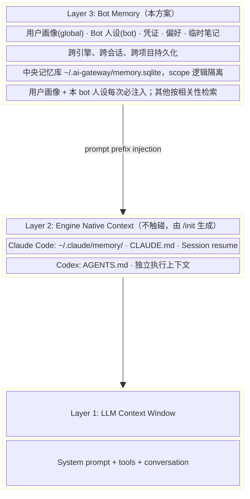
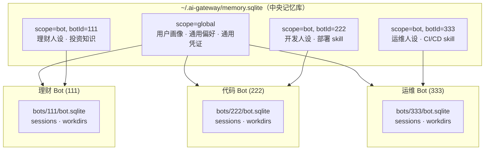
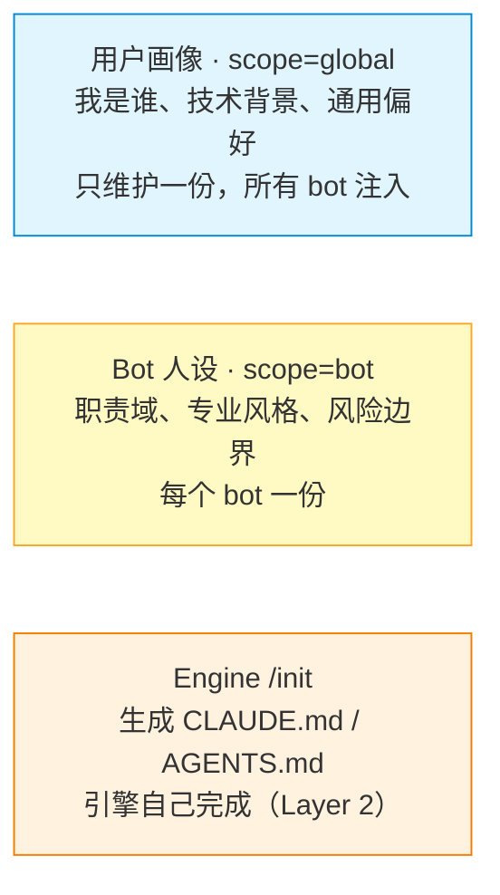
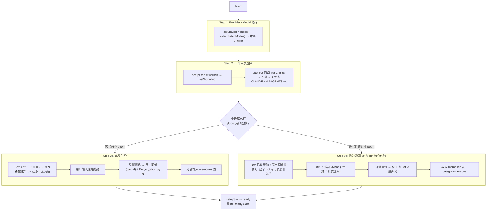
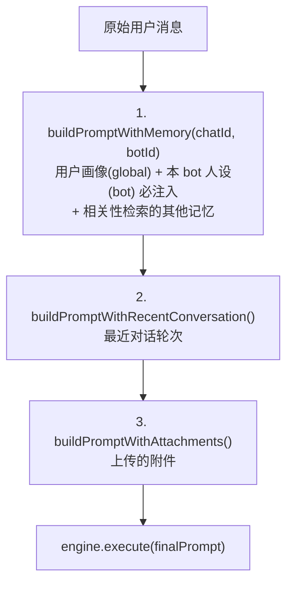
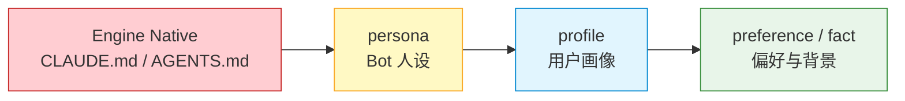
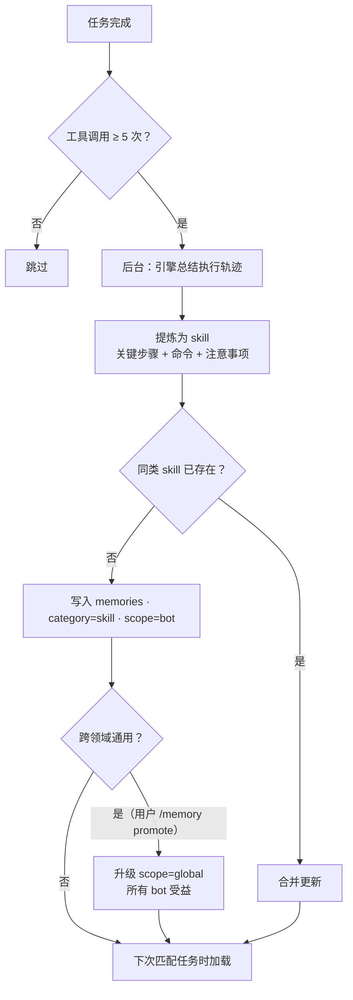
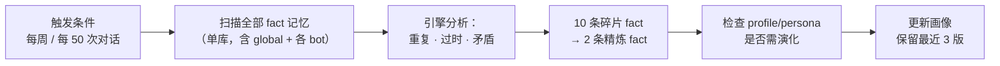

# Telegram Bot 记忆系统设计方案（中央记忆库 + Scope 分级）

## 概述

为 Telegram Bot 新增**用户层独立记忆系统**，使用户能够跨引擎（Claude Code / Codex）、跨会话、跨项目目录持久保存个人信息、偏好、常用资源等。该系统定位为引擎之上的顶层记忆，与 Claude Code 和 Codex 各自的原生记忆/上下文机制完全隔离、互不干扰。

## 当前实现状态（2026-07-10）

当前代码已完成 **Phase 1 MVP**，但还不是“自动记忆系统”。

| 状态 | 能力 | 说明 |
|------|------|------|
| 已完成 | 中央记忆库 | `~/.ai-gateway/memory.sqlite`，包含 `memories` / `memory_keys` 表；WAL + `busy_timeout` |
| 已完成 | scope 隔离 | `global` 记忆按 `chatId` 跨 bot 可见；`bot` 记忆按 `chatId + botId` 仅当前 bot 可见 |
| 已完成 | Telegram 内跨 CLI 注入 | Telegram Bot 调 Claude Code 或 Codex 前都会注入同一套 Bot Memory；切 `/claude` / `/codex` 不会丢记忆 |
| 已完成 | 手动记忆命令 | `/remember` `/forget` `/memories` `/memory promote` `/memory clear bot/global confirm` |
| 已完成 | 引导画像写入 | `/reset` setup 的“介绍一下我和你”会生成并保存 global 用户画像与当前 bot 人设 |
| 已完成 | Prompt 注入 | `bot-memory` middleware 将 `<user_memory>` 放在 prompt 最前，位于 recent conversation 和 attachments 之前 |
| 已完成 | 短期记忆过期 | `/remember temp ...` 写入 short_term，启动时清理过期项 |
| 部分完成 | 备份 | Bot 启动时按日期备份 `memory.sqlite`，保留最近 7 份；尚未做常驻定时任务 |
| 未完成 | 自动记忆 | 日常聊天不会自动写入记忆；只会读取并注入已有记忆 |
| 未完成 | 凭证加密 | `credential`/`pin` 相关命令目前拒绝明文保存，PIN/AES-256-GCM 待 Phase 2 |
| 未完成 | 导入导出 | `/memory export` / `/memory import` 目前只提示后续阶段启用 |
| 未完成 | 智能检索/蒸馏 | 目前是关键词匹配 + 字符预算；FTS5、向量、自动蒸馏、Skill Learning 均未实现 |
| 未覆盖 | 终端 `ai use` | 当前 Memory 只接入 Telegram Bot 执行链；直接在终端执行 `ai use claude/codex` 不会自动注入 |

### 记忆写入边界

现在只有两类写入入口：

1. 用户明确执行 `/remember ...`、`/forget ...`、`/memory ...`
2. 用户在 `/reset` 引导流程的画像步骤输入描述

普通聊天只会读取并注入记忆，不会自动保存新事实、偏好、账号、网页内容或执行经验。自动记忆、自动建议记忆、任务结束后提炼 skill 都属于 Phase 4/5。

**核心架构决策**（区别于早期 per-bot 隔离方案）：

> **运行态 per-bot 物理隔离，知识态中央存储 + scope 逻辑隔离。**

用户会长期运行多个专业 bot（如投资理财 bot、写代码 bot、CI/CD 运维 bot），因此：

- **sessions / workdirs**（运行态）：继续存放在 `bots/{botId}/bot.sqlite`，每个 bot 物理隔离
- **memories**（知识态）：统一存放在 `~/.ai-gateway/memory.sqlite` 中央记忆库，通过 `scope` 字段做逻辑隔离：
  - `scope='global'` — 跨所有 bot 共享（用户画像、语言偏好、通用凭证）
  - `scope='bot'` — 仅本 bot 可见（bot 人设、领域知识、领域 skill）
- **画像双层拆分**：全局「用户画像」（一份，所有 bot 注入）+ 每 bot「Bot 人设」（职责域、专业风格、风险边界）

这样新建一个专业 bot 时，用户身份、偏好、凭证零成本继承，只需定义该 bot 的人设。

---

## 架构定位：三层上下文模型



### 多 bot 视角下的数据流



注入到理财 Bot 的记忆 = `global` 记忆 + `botId=111` 的 bot 记忆；其他 bot 的领域记忆对它完全不可见。

### chatId 跨 bot 稳定性（关键前提）

Telegram **私聊**场景下 `chat.id === 用户的 Telegram user id`，同一用户与任意 bot 私聊的 chatId 相同。因此 `chatId` 可以直接作为中央记忆库的用户主键（owner key），global scope 天然跨 bot 生效。

> 群聊场景 chatId ≠ userId，MVP 阶段记忆功能仅在私聊启用；群聊支持属于未来扩展（届时 owner key 改用 `message.from.id`）。

---

## 方案对比（为何选中央记忆库）

| 维度 | A. 中央库 + scope（本方案） | B. per-bot 库 + 全局库合并 | C. 完全 per-bot 隔离 |
|------|:---|:---|:---|
| 新建 bot 成本 | 零成本继承画像/偏好/凭证 | 部分继承，需双库逻辑 | 每次从零录入 |
| 检索 | 一次 SQL 覆盖两层 scope | 每次查 2 库再合并 | 单库但知识不通 |
| FTS5 / 向量索引 | 只建一份 | N+1 份，跨库归并 | N 份，永不互通 |
| 记忆蒸馏 | 单库单事务 | 跨库蒸馏复杂 | 同一事实无法合并 |
| Skill 复用 | bot skill 可升级 global | 手动搬库 | 每个 bot 重新踩坑 |
| 隔离性 | 逻辑隔离（store 层收口） | 物理隔离 | 物理隔离 |
| 实现复杂度 | 一套 store + scope 字段 | 双库连接/路由/合并 | 最简单 |

B 是"用物理隔离解决逻辑问题"，代价在 FTS、蒸馏、skill 复用等每个后续 Phase 持续付出；C 与多专业 bot 的规划直接矛盾。A 的两个弱点（逻辑隔离靠代码约束、单文件故障半径）分别用 **store 层强制 scope 收口** 和 **WAL + 定期备份** 化解。

---

## 解决的问题

| 问题 | 根因 | 本方案如何解决 |
|------|------|------|
| 换会话/重启后 AI 忘记用户信息 | 引擎上下文随 session 消亡 | Memory 绑定 chatId，每次调用重新注入 |
| Claude ↔ Codex 切换丢失偏好 | 两引擎记忆系统完全独立 | Memory 对两者统一注入 |
| 换 cwd 后 AI 不认识用户了 | CLAUDE.md/auto memory 是 per-project | Memory 与 cwd 无关 |
| **新建专业 bot 要重新自我介绍** | per-bot 记忆完全隔离 | global scope 记忆自动被所有 bot 注入 |
| **改一次偏好要在 N 个 bot 里各改一遍** | 用户信息在多 bot 画像中重复 | 用户画像只存一份（global），人设 per-bot |
| **理财知识污染代码 bot 的上下文** | 无领域边界 | bot scope 记忆仅本 bot 注入 |
| 密码/凭证无安全存储 | 引擎 memory 明文无加密 | AES-256-GCM 加密 + PIN |
| 临时信息无法自动清理 | 引擎无 TTL 机制 | 短期记忆 + 过期清理 |
| 用户不知道 AI 记了什么 | 引擎 auto memory 是黑盒 | 完整 CRUD 命令，用户全权控制 |

---

## 存在的问题与对策

| 问题 | 影响 | 对策 |
|------|------|------|
| **Token 开销** — 每次多注入 ~1000 tokens | 增加成本、压缩有效上下文 | 严格控制上限 3000 字符；高相关才注入 |
| **检索召回率** — 关键词匹配无法处理同义词 | "管钱的网站" 匹配不到 tag "理财" | Phase 3 引入别名表 + 两阶段召回 |
| **scope 泄漏风险** — bug 导致 A bot 读到 B bot 记忆 | 领域记忆串台 | store 层唯一的 scope 过滤函数收口，所有读路径强制经过；单测覆盖 |
| **中央库单点故障** — 文件损坏影响所有 bot | 记忆全丢 | `PRAGMA journal_mode=WAL` + 按日期备份 `memory.sqlite` 到 `memory.backup/`；当前实现为 bot 启动时执行一次 |
| **多进程并发写** — 多个 bot 进程写同一 SQLite | SQLITE_BUSY | WAL 模式 + `PRAGMA busy_timeout=5000`；单机单用户写频率极低，足够 |
| **引擎可能忽略注入** | Compaction 时记忆可能被截断 | Memory 是 prompt 最前部，compaction 通常保留开头 |
| **与引擎原生配置冲突** | Memory 偏好与 CLAUDE.md/AGENTS.md 矛盾 | 注入时明确标注优先级：引擎原生配置 > Memory |
| **加密 PIN 体验** | 重启要重新 unlock | Phase 2 考虑长 session TTL |
| **无冲突检测** | 记两条互相矛盾的内容 | 写入时检查同 scope + title/tag 是否已有条目，提示覆盖 |

---

## 数据存放位置与 Schema

### 数据拓扑

```
~/.ai-gateway/
├── telegram.json              ← 全局配置（默认 bot token、全局设置）
├── memory.sqlite              ← ★ 中央记忆库（所有 bot 共享，本方案新增）
│   ├── memories 表            ← 全部记忆条目（scope 逻辑隔离）
│   └── memory_keys 表         ← per-chatId 加密 PIN（跨 bot 一份）
├── memory.backup/             ← 中央库按日期备份（当前启动时执行一次，保留最近 7 份）
└── bots/
    ├── {botId-1}/             ← Bot 实例 1（运行态，物理隔离）
    │   ├── config.json        ← 该 bot 的专属配置覆盖
    │   ├── bot.sqlite         ← sessions 表 · workdirs 表（不含记忆）
    │   ├── bot.log
    │   └── bot.pid
    ├── {botId-2}/
    └── ...

${cwd}/
├── CLAUDE.md                  ← Claude Code 原生（/init 自动生成）
└── AGENTS.md                  ← Codex 原生（/init 自动生成）
```

### memories 表

```sql
CREATE TABLE IF NOT EXISTS memories (
  id          INTEGER PRIMARY KEY AUTOINCREMENT,
  chatId      TEXT    NOT NULL,                 -- owner key（私聊下 = Telegram user id，跨 bot 稳定）
  scope       TEXT    NOT NULL DEFAULT 'bot'
              CHECK (scope IN ('global', 'bot')),
  botId       TEXT,                             -- scope='bot' 时必填；scope='global' 时为 NULL
  category    TEXT    NOT NULL
              CHECK (category IN ('profile', 'persona', 'credential', 'fact', 'preference', 'note', 'skill')),
  title       TEXT    NOT NULL,
  content     TEXT    NOT NULL,                 -- credential 加密后为密文（base64）
  tags        TEXT    NOT NULL DEFAULT '[]',    -- JSON array
  priority    INTEGER NOT NULL DEFAULT 0,       -- 1 = 每次必注入
  duration    TEXT    NOT NULL DEFAULT 'permanent'
              CHECK (duration IN ('permanent', 'short_term')),
  encrypted   INTEGER NOT NULL DEFAULT 0,
  expiresAt   INTEGER,                          -- short_term 到期时间（epoch ms）
  createdAt   INTEGER NOT NULL,
  updatedAt   INTEGER NOT NULL,
  CHECK (scope = 'global' OR botId IS NOT NULL)
);

CREATE INDEX IF NOT EXISTS idx_memories_owner ON memories (chatId, scope, botId);
CREATE INDEX IF NOT EXISTS idx_memories_expiry ON memories (expiresAt) WHERE expiresAt IS NOT NULL;

CREATE TABLE IF NOT EXISTS memory_keys (
  chatId     TEXT PRIMARY KEY,                  -- PIN 跨 bot 一份（用户级）
  salt       TEXT NOT NULL,
  verifier   TEXT NOT NULL,                     -- 用于校验 PIN 正确性
  failCount  INTEGER NOT NULL DEFAULT 0,
  lockedUntil INTEGER,
  createdAt  INTEGER NOT NULL,
  updatedAt  INTEGER NOT NULL
);
```

### 数据库初始化约定

```typescript
// core/config/paths.ts 新增
export function getMemoryDbPath(): string {
  return path.join(getConfigRoot(), "memory.sqlite");
}

// memory-store.ts 打开数据库时必须执行
db.pragma("journal_mode = WAL");
db.pragma("busy_timeout = 5000");
```

### scope 收口（安全关键）

**store 层所有读查询必须经过唯一的 scope 过滤构造函数**，禁止任何调用方手写 scope 条件：

```typescript
// memory-store.ts — 唯一的可见性过滤器，所有 SELECT 强制拼接
function visibilityClause(): string {
  return `chatId = :chatId AND (scope = 'global' OR (scope = 'bot' AND botId = :botId))`;
}
```

单测必须覆盖：botId=A 的查询不返回 botId=B 的 bot scope 条目。

### 运行态数据的向后兼容（沿用现有策略）

现有 `~/.ai-gateway/telegram.sqlite`（sessions/workdirs）作为默认 bot 的数据库迁移到 `bots/{botId}/bot.sqlite`：

```typescript
function resolveBotDbPath(config: TelegramConfig): string {
  const botDir = getBotDataDir(config.token);
  const newPath = path.join(botDir, "bot.sqlite");
  if (fs.existsSync(newPath)) return newPath;
  const legacyPath = path.join(getConfigRoot(), "telegram.sqlite");
  if (fs.existsSync(legacyPath)) {
    fs.mkdirSync(botDir, { recursive: true });
    fs.renameSync(legacyPath, newPath);
    return newPath;
  }
  fs.mkdirSync(botDir, { recursive: true });
  return newPath;
}

function getBotId(token: string): string {
  // Telegram bot token 格式: "123456789:ABCdefGHIjklMNO"，前半段是 bot 的 Telegram user ID
  return token.split(":")[0];
}
```

记忆库不从旧 `BOT.md` / `PROMPT.md` 自动迁移：首次启用时直接按新 schema 建库。已有 bot 的旧文件如需进入中央库，需要通过 `/remember` 或专门迁移脚本写入。

### 共享与隔离边界总表

| 数据 | 位置 | 隔离级别 | 说明 |
|------|------|----------|------|
| sessions / workdirs | `bots/{id}/bot.sqlite` | per-bot 物理隔离 | 运行态，不共享 |
| memories (global) | `memory.sqlite` | per-chatId | 所有 bot 注入 |
| memories (bot) | `memory.sqlite` | per-chatId + per-botId | 仅本 bot 注入 |
| memory_keys (PIN) | `memory.sqlite` | per-chatId | 一个 PIN 管所有 bot 的加密记忆 |
| CLAUDE.md / AGENTS.md | `${cwd}` | per-cwd（共享） | 引擎原生，由 `/init` 生成 |
| telegram.json | `~/.ai-gateway/` | 全局 | 默认 token 和全局设置 |
| bots/{id}/config.json | per-bot | per-bot | 覆盖全局设置 |

---

## 记忆分类与 Scope 默认值

### 永久记忆 (permanent)

| 分类 | 用途 | 默认 scope | 加密 | 必注入 | 示例 |
|------|------|-----------|------|------|------|
| `profile` | **用户画像**（我是谁） | `global`（强制） | 否 | ✅ priority=1 | 引导时生成的结构化用户画像 |
| `persona` | **Bot 人设**（这个 bot 是谁） | `bot`（强制） | 否 | ✅ priority=1 | "投资理财顾问，风险提示必带" |
| `preference` | AI 行为偏好 | `global` | 否 | 否 | "回复用中文，代码不加注释" |
| `fact` | 个人背景 | `global` | 可选 | 否 | "我是后端开发，主用 Go" |
| `credential` | 账号密码、Key | `bot`（最小权限） | 强制 | 否 | "理财网站 money.app，密码 Abc123" |
| `skill` | 任务经验（Phase 4） | `bot` | 否 | 否 | "部署 staging 的完整步骤" |

### 短期记忆 (short_term)

| 分类 | 默认 scope | 默认 TTL | 示例 |
|------|-----------|----------|------|
| `note` | `bot` | 72h | "明天下午3点开需求评审" |

### scope 规则

- `profile` 强制 global、`persona` 强制 bot，service 层写入时校验，不允许覆盖
- 其他分类有默认值，用户可通过命令显式指定（`/remember global <内容>` / `/remember bot <内容>`）
- 自动分类时宁可判 `bot` 不判 `global`（误判 bot 只是少共享，误判 global 会污染所有 bot）
- `/memory promote <id>` 可将 bot 记忆升级为 global（如某个 skill 值得全局复用）

---

## 双层画像：用户画像 + Bot 人设

### 设计原则



| | 用户画像 (profile) | Bot 人设 (persona) |
|---|---|---|
| 回答的问题 | 我是谁、我的背景、我通用的工作偏好 | 这个 bot 负责什么、以什么专业角色和风格工作 |
| scope | global（跨 bot 唯一） | bot（每 bot 一份） |
| 示例 | "后端开发，Go+TS，回复用中文，简洁直接" | "投资理财顾问，关注 A 股/美股/基金，任何建议必附风险提示，不替用户做最终决策" |
| 更新频率 | 低（身份很少变） | 每个新 bot 创建时定义一次 |

### 引导交互流程（setup）

与当前代码 setup 流程一致（`setup.ts` + `message.ts`），Step 3 按是否已有全局用户画像分流：



**关键时序**：
- `/init` 在 workdir 选择后立即触发（`afterSet` 回调），不等画像完成
- 画像步骤是 setup 最后一步；当前 `completeAgentProfile()` 已保存原始描述，并调用当前 engine 生成用户画像/人设

### 画像/人设生成 prompt

```typescript
// 首个 bot：从一段描述中同时提炼用户画像与 bot 人设
function buildFullProfilePrompt(rawDescription: string): string {
  return [
    "根据以下用户的自我描述，生成两份内容，用分隔符 '=====PERSONA=====' 分开。",
    "",
    "<user_description>",
    rawDescription,
    "</user_description>",
    "",
    "第一部分【用户画像】（跨所有助手共享，只描述用户本人）：",
    "- 用户身份、技术背景、通用偏好、通用工作方式",
    "- 不要包含任何特定助手的角色定位",
    "- 500 字符以内",
    "",
    "建议结构：",
    "## 用户背景",
    "## 通用偏好",
    "",
    "第二部分【Bot 人设】（仅本助手使用）：",
    "- 本助手的职责域、专业风格、风险边界",
    "- 400 字符以内",
    "",
    "建议结构：",
    "## 角色与职责",
    "## 工作风格",
    "## 风险边界",
    "",
    "通用要求：输出纯文本；中文输入就使用中文；只输出内容本身，不要多余说明。"
  ].join("\n");
}

// 新建专业 bot 快速通道：只生成人设
function buildPersonaPrompt(rawDescription: string, existingProfile: string): string {
  return [
    "已知用户画像如下（勿修改、勿重复其中内容）：",
    "<existing_profile>",
    existingProfile,
    "</existing_profile>",
    "",
    "用户希望本助手承担的职责描述：",
    "<bot_description>",
    rawDescription,
    "</bot_description>",
    "",
    "生成本助手的 Bot 人设，要求：",
    "- 只描述本助手的职责域、专业风格、风险边界",
    "- 400 字符以内；中文输入就使用中文",
    "",
    "建议结构：",
    "## 角色与职责",
    "## 工作风格",
    "## 风险边界",
    "",
    "只输出人设内容，不要多余说明。"
  ].join("\n");
}
```

### completeAgentProfile 当前实现逻辑

```typescript
async function completeAgentProfile(ctx, deps, description, options): Promise<TelegramSession | null> {
  const session = deps.sessionManager.getOrCreate(chatId);

  if (description?.trim() && deps.memoryService) {
    // 0. 保存原始描述（素材，不注入）
    memoryService.saveRawDescription(chatId, description);

    const existingProfile = memoryService.getProfile(chatId); // scope=global, category=profile

    if (existingProfile) {
      // 快速通道：只生成人设
      const prompt = buildPersonaPrompt(description, existingProfile.content);
      const generated = await generateProfileText(ctx, deps, session, prompt);
      memoryService.savePersona(chatId, generated || description);
    } else {
      // 完整引导：画像 + 人设
      const prompt = buildFullProfilePrompt(description);
      const generated = await generateProfileText(ctx, deps, session, prompt);
      if (generated) {
        const { profile, persona } = splitProfileAndPersona(generated);
        memoryService.saveProfile(chatId, profile || description);
        if (persona) memoryService.savePersona(chatId, persona);
      } else {
        // 引擎提炼失败：原始描述直接作为画像，人设留空
        memoryService.saveProfile(chatId, description);
      }
    }
  }

  const next = deps.sessionManager.update(session.id, { setupStep: "ready" });
  return next;
}
```

### 画像/人设更新

| 触发方式 | 行为 |
|------|------|
| Setup 中再次发送描述 | 走上面的分流逻辑，覆盖对应条目 |
| `/remember profile <内容>` | 覆盖 global 用户画像 |
| `/remember persona <内容>` | 覆盖本 bot 人设 |
| `/forget profile` / `/forget persona` | 清除对应条目 |
| `/memories` | 查看当前画像与人设内容 |

### 与旧流程（BOT.md 文件）的对比

| 维度 | 旧流程（BOT.md 文件） | 新流程（中央 Bot Memory） |
|------|------|------|
| 存储位置 | `${cwd}/BOT.md` 文件 | `memory.sqlite` memories 表 |
| 生命周期 | 跟 cwd 走，换目录丢失 | 跟 chatId 走，永久保留 |
| 跨项目 | ❌ 每个项目独立 | ✅ 所有项目共享 |
| 跨引擎 | ❌ 仅当前引擎读取 | ✅ Claude Code / Codex 均注入 |
| 跨 bot | ❌ | ✅ 用户画像跨 bot；人设 per-bot |
| 更新方式 | 重新生成文件 | `/remember` 或重新描述 |
| 项目级配置 | 混在 BOT.md 中 | 完全分离：由引擎 `/init` 生成 |

---

## 工作目录选择与引擎初始化

### 设计思路

用户选择工作目录后，自动通过引擎执行 `/init` 命令，让引擎为该目录生成原生配置文件（CLAUDE.md / AGENTS.md）。这遵循隔离原则 —— Bot 不直接写入引擎文件，而是让引擎自己完成初始化。

### 当前实现（`setWorkdir` + `afterSet` 回调）

```typescript
// message.ts — workdir 选择后的 afterSet 回调
await setWorkdir(ctx, deps, text, {
  fromCustomInput: true,
  afterSet: (next) => runCliInit(ctx, deps, next.engine)
});

// message.ts — runCliInit 执行引擎 /init
async function runCliInit(ctx, deps, engine): Promise<void> {
  await executePrompt(ctx, deps, "/init", engine, {
    silentSuccess: true,
    suppressFailureReply: true,
    includeAgentContext: false,
    skipSetupReminder: true,
    timeoutMs: CLI_INIT_TIMEOUT_MS
  });
}
```

### 触发时机

| 场景 | 是否触发 /init | 代码路径 |
|------|------|------|
| Setup 流程中选择工作目录 | ✅ | `setWorkdir({ afterSet: runCliInit })` |
| Setup 流程中输入自定义路径 | ✅ | `setWorkdir({ fromCustomInput: true, afterSet: runCliInit })` |
| Ready 状态下切换工作目录 | ✅ | `setWorkdir({ returnToReady: true, afterSet: runCliInit })` |
| `/cwd`（不带参数，查看当前目录） | ❌ | 仅显示当前 cwd |

### 与隔离原则的关系

Bot 始终通过引擎 SDK/CLI 间接执行 `/init`，不直接 `fs.writeFileSync` 写入引擎配置文件。这确保：
- 生成的文件格式由引擎决定
- 引擎的 hooks、插件在 `/init` 时正常触发
- Bot 层不需要了解引擎配置文件的内部结构

---

## 注入顺序与优先级

每次 `executePrompt` 调用时的 prompt 构建链：



**冲突优先级规则**（注入 prompt 中明确告知引擎）：



> 人设优先于用户画像：领域专用规则（如"理财建议必附风险提示"）应覆盖通用偏好中的冲突项。

---

## 核心隔离原则

| 规则 | 说明 |
|------|------|
| **不直接写引擎文件** | 绝不通过 `fs.writeFile` 写入 `~/.claude/memory/`、`CLAUDE.md`、`AGENTS.md` |
| **不改引擎参数** | `--resume`、`--permission-mode` 等参数不受 Memory 影响 |
| **只通过 prompt 注入** | 对引擎来说，Memory 就是用户消息的一部分 |
| **指示不要重复存储** | 注入中标注 "Do NOT store this in your own memory systems" |
| **引擎原生优先** | 若 Memory 与 CLAUDE.md/引擎记忆冲突，以引擎为准 |
| **scope 强制收口** | 所有记忆读取必须经过 store 层唯一的 `visibilityClause()`，禁止手写 scope 条件 |

---

## 注入格式

```xml
<user_memory scope="global persistent knowledge, cross-engine cross-session" readonly="true">
Treat as ground truth. If anything here conflicts with engine native config (CLAUDE.md/AGENTS.md), engine config wins.
Within this block, bot persona overrides user profile on conflicts.
Do NOT store this information in your own memory systems (~/.claude/memory/, CLAUDE.md, AGENTS.md).

<entry category="persona" title="Bot 人设" scope="bot" priority="1">
## 角色与职责
投资理财顾问，关注 A 股、美股、基金定投。

## 工作风格
先给结论，再列关键依据；数据来源注明日期。

## 风险边界
任何投资建议必须附带风险提示，不替用户做最终决策。
</entry>
<entry category="profile" title="用户画像" scope="global" priority="1">
## 用户背景
后端开发，主力语言 Go + TypeScript。

## 通用偏好
回复保持简洁、直接、可执行，优先使用中文。
</entry>
<entry category="fact" title="技术背景" scope="global">
常用 Gin/Next.js，部署在 AWS
</entry>
<entry category="credential" title="理财网站" scope="bot" status="unlocked">
网站: https://money.app
账号: test@mail.com
密码: MyP@ss123
</entry>
<entry category="note" title="本周计划" scope="bot" expires="2026-07-12">
周四部署 v2.1 到 staging，周五推生产
</entry>
</user_memory>
```

加密未解锁时：
```xml
<entry category="credential" title="理财网站密码" scope="bot" status="locked">
(encrypted — user needs to /memory unlock to access)
</entry>
```

---

## 用户命令

| 命令 | 当前状态 | 说明 |
|------|------|------|
| `/remember <内容>` | 已实现 | 快速记忆，本地规则分类 + 默认 scope |
| `/remember global <内容>` | 已实现 | 强制存为跨 bot 共享记忆 |
| `/remember bot <内容>` | 已实现 | 强制存为仅本 bot 记忆 |
| `/remember profile <内容>` | 已实现 | 覆盖 global 用户画像 |
| `/remember persona <内容>` | 已实现 | 覆盖当前 bot 人设 |
| `/remember temp <内容>` | 已实现 | 短期记忆，默认 TTL 72h |
| `/remember temp 2h <内容>` / `/remember temp 3d <内容>` | 已实现 | 指定小时/天级 TTL |
| `/forget <编号或关键词>` | 已实现 | 删除当前可见记忆；编号精确删除，关键词模糊删除 |
| `/forget profile` / `/forget persona` | 已实现 | 删除对应画像/人设 |
| `/memories` | 已实现 | 列出当前 chat 可见记忆 |
| `/memories search <词>` | 已实现 | 按关键词过滤可见记忆 |
| `/memory promote <编号>` | 已实现 | 将当前 bot 记忆升级为 global；persona 不允许升级 |
| `/memory clear bot confirm` | 已实现 | 清空当前 bot scope 记忆 |
| `/memory clear global confirm` | 已实现 | 清空当前用户 global scope 记忆 |
| `/remember pin <内容>` | 占位 | 当前返回“加密记忆尚未启用”，不会明文保存 |
| `/memory pin set <pin>` | 未实现 | Phase 2：设置加密 PIN |
| `/memory unlock <pin>` | 未实现 | Phase 2：解锁加密记忆 |
| `/memory lock` | 未实现 | Phase 2：锁定加密记忆 |
| `/memory export` | 未实现 | Phase 3：导出 JSON |
| `/memory import` | 未实现 | Phase 3：导入 JSON |

---

## 加密方案

```
PIN → PBKDF2(pin, salt, 100k, 32B, sha256) → DEK
DEK + AES-256-GCM → encrypt/decrypt
DEK 仅在 unlock 后驻留进程内存，重启清除
```

安全措施：
- credential 类强制加密
- PIN 是用户级（memory_keys 按 chatId 一份），一个 PIN 管理所有 bot 的加密记忆；unlock 状态是**进程级**的（每个 bot 进程各自 unlock）
- 连续 PIN 错误 3 次锁定 5 分钟（failCount / lockedUntil 落库，跨进程生效）
- PIN 通过 Telegram 发送后立即提示用户删除该消息
- 注入 prompt 时标注 "do not echo credentials in plain text"

---

## 检索策略

```
1. 必注入集：本 chatId 下 priority=1 且可见的条目
   （global profile + 本 bot persona，一次查询）
2. 对 prompt 做分词提取关键词
3. 在可见集（visibilityClause 过滤）内做 tags + title 关键词匹配评分
4. Top-8 候选 + 必注入集去重
5. 按字符预算（默认 3000 字符）筛选，优先保留 profile/persona 与高相关记忆，
   persona 与 profile 永不截断
6. 格式化为 XML 注入（persona 在最前）
```

可见性过滤（所有步骤共用）：

```sql
WHERE chatId = :chatId
  AND (scope = 'global' OR (scope = 'bot' AND botId = :botId))
  AND (expiresAt IS NULL OR expiresAt > :now)
```

---

## 代码变更清单

| 文件/目录 | 变更 | 说明 |
|------|------|------|
| `src/telegram/memory/types.ts` | 新增 | MemoryEntry / MemoryScope / MemoryCategory / MemoryDuration 类型定义 |
| `src/telegram/memory/memory-store.ts` | 新增 | 打开 `getMemoryDbPath()` 中央库（WAL + busy_timeout）、建表、CRUD、`visibilityClause()` 收口 |
| `src/telegram/memory/memory-service.ts` | 新增 | 业务逻辑：`save()` / `saveProfile()`（global 覆盖写）/ `savePersona(botId)`（bot 覆盖写）/ `getProfile()` / `promote()` / 检索 / TTL 清理 / `/remember` 写入时本地分类 |
| `src/telegram/memory/memory-inject.ts` | 新增 | `buildPromptWithMemory(memoryService, chatId, prompt)` — XML 注入，profile+persona 必注入 |
| `src/telegram/memory/memory-crypto.ts` | 未实现（Phase 2） | PBKDF2 + AES-256-GCM |
| `src/core/config/paths.ts` | 修改 | 新增 `getMemoryDbPath()`、`getMemoryBackupDir()` |
| `src/telegram/interaction/prompt-middleware.ts` | 修改 | 注册 `bot-memory` middleware；最终 prompt 顺序为 memory → recent conversation → user prompt/attachments |
| `src/telegram/handlers/message.ts` | 修改 | 调用 `applyPromptMiddlewares()`，不再读取 `BOT.md` 注入旧画像 |
| `src/telegram/handlers/command.ts` | 扩展 | 注册 /remember /forget /memories /memory |
| `src/telegram/handlers/memory.ts` | 新增 | Memory 命令处理；加密和 import/export 当前为占位提示 |
| `src/telegram/handlers/callback.ts` | 未扩展 | 暂无记忆相关 inline button |
| `src/telegram/handlers/setup.ts` | 修改 | `completeAgentProfile` 实现双层画像分流（见上）；移除 `BOT_PROFILE_FILENAME`、`PROMPT_PROFILE_FILENAME` 及相关文件读写函数 |
| `src/telegram/bot.ts` | 修改 | 初始化 MemoryService（注入 botId），启动时清理过期记忆并执行一次日期备份 |
| `src/telegram/config.ts` | 未扩展 | Memory 预算和 TTL 当前由 MemoryService 默认值控制，尚未暴露为 Telegram config |

**关键行为变更：**
- `completeAgentProfile()` — 不再写 `PROMPT.md` + `BOT.md` 文件，改为写入中央记忆库；已有 global 画像时走"仅人设"快速通道
- `buildPromptWithAgentContext()` — 整个移除；画像、人设和用户记忆统一由 `buildPromptWithMemory()` 注入
- MemoryService 构造时持有 `botId`，调用方无需每次传递

**不动的（引擎相关）：**
- `src/telegram/engine/*` — 引擎调用逻辑不变
- `src/telegram/session/manager.ts` / `store.ts` — 会话管理不变（memories 相关表**不再**建在 bot.sqlite）
- `~/.claude/` 下任何文件
- `CLAUDE.md` / `AGENTS.md` — Bot 不直接写入，通过引擎 `/init` 间接生成

---

## 记忆演进方向

当前 MVP 方案依赖 prompt 前缀注入，存在 token 预算上限（3000 字符）和检索精度不足的问题。参考 [Hermes Agent](https://get-hermes.ai/) 的自改进架构，规划以下演进方向。中央记忆库让每个方向都只需在**一个库**上实现。

### 方向一：Skill Learning — 从经验中提炼可复用技能

任务完成后自动将执行轨迹总结为 skill 记忆，下次遇到类似任务时按需加载。



**scope 带来的增益**：运维 bot 学会的"部署 staging"skill，promote 后代码 bot 直接可用 —— 这是 per-bot 隔离方案做不到的。

效果：
- 第一次部署摸索 15 分钟 → 第二次加载 skill 后 3 分钟完成
- Token 开销：仅在匹配时注入对应 skill（~300 字符），不匹配时为 0

### 方向二：分层存储 — Hot / Warm / Cold

| 层 | 内容 | 注入策略 | 预算 |
|----|------|----------|------|
| Hot | profile 画像 + persona 人设 + 活跃 preference | 每次必注入 | ~500 tokens |
| Warm | facts · skills · 解锁的 credentials | 关键词 / FTS5 匹配后注入 | 0-500 tokens |
| Cold | 锁定态 credentials · 归档 notes · 历史 skills · 原始执行轨迹 | 从不注入 | 0 |

Token 节省效果：
| 方案 | 平均注入 | 最大注入 |
|------|----------|----------|
| MVP（全量注入） | ~1000 tokens | ~1500 tokens |
| 分层存储 | ~500-700 tokens | ~1000 tokens |

### 方向三：记忆蒸馏 — 压缩而非堆积



蒸馏规则：
- **合并**：多条描述同一事实的记忆合并为一条；**跨 scope 去重**（bot 记忆与 global 重复时删 bot 侧）
- **淘汰**：与当前事实矛盾的旧记忆归档（移入 Cold 层）
- **演化**：profile 根据累积的 global fact/preference 自动更新；persona 根据该 bot 的领域记忆演化
- **可追溯**：每次蒸馏保留变更日志，`/memory history` 可查

中央库优势：蒸馏是单库单事务操作；per-bot 分库方案需要跨库对账，复杂度不可控。

### 与 Hermes 的差异

| 维度 | Hermes Agent | Bot Memory |
|------|-------------|------------|
| 部署形态 | Self-hosted daemon | Telegram Bot + 引擎后端 |
| 模型依赖 | 任意 LLM（含本地） | Claude / Codex |
| Skill 存储 | 文件系统 Markdown | 中央 SQLite memories 表 |
| 记忆检索 | SQLite FTS5 | Phase 1 关键词 → Phase 3 FTS5 |
| 蒸馏执行 | 后台 LLM 进程 | 复用引擎 `executePrompt` |
| 优势 | 完全自主、本地运行 | 利用引擎原生能力，无需额外后台 LLM |

---

## 实现计划与进度

### Phase 1 — MVP（中央库 + scope + 双层画像 + 引擎初始化）
1. ✅ `core/config/paths.ts` — `getMemoryDbPath()` / `getMemoryBackupDir()`
2. ✅ `memory/types.ts` — 含 scope、profile/persona 分类定义
3. ✅ `memory/memory-store.ts` — 中央库建表（WAL）+ CRUD + `visibilityClause()` 收口 + scope 隔离单测
4. ✅ `memory/memory-service.ts` — 业务逻辑 + 检索 + `saveProfile()` / `savePersona()` / `getProfile()`
5. ✅ `memory/memory-inject.ts` — prompt 注入，profile + persona 必注入
6. ✅ 集成到 `executePrompt` 的 Prompt middleware 构建链
7. ✅ 画像构建流程：分流逻辑（首个 bot 完整引导 / 新 bot 仅人设快速通道）
8. ✅ `/cwd` / setup 工作目录选择后触发引擎 `/init`
9. ✅ 移除旧 `BOT.md` / `PROMPT.md` 文件写入与普通对话注入逻辑
10. ✅ `/remember`（含 global/bot/profile/persona/temp 子命令）`/forget` `/memories` `/memory promote/clear` 命令
11. ✅ `/remember` 写入时本地规则分类（含默认 scope 映射）+ 短期记忆 TTL 清理
12. ◐ 启动时备份 `memory.sqlite` → `memory.backup/`（保留 7 份）；常驻每日定时备份未实现
13. ❌ 旧 `BOT.md` / `PROMPT.md` 自动迁移未实现，需要专门迁移命令或脚本

### Phase 2 — 加密
14. `memory/memory-crypto.ts`
15. `/memory pin` + `/memory unlock` + `/memory lock`（PIN 用户级，unlock 进程级）
16. credential 强制加密流程
17. 锁定/解锁态的不同注入策略

### Phase 3 — 智能检索
18. SQLite FTS5 全文搜索替换关键词匹配（单库一份索引）
19. 同义词/别名表优化召回率
20. 两阶段召回（FTS5 候选 → 引擎筛选相关性）
21. 冲突检测（同 scope + title/tag 提示覆盖）
22. `/memory export` / `/memory import`
23. ✅ `/memory promote`（bot → global）已在 Phase 1 提前实现

### Phase 4 — Skill Learning（越用越聪明）
24. 任务完成后自动判定是否触发 skill 提炼（工具调用 ≥ 5 次）
25. 引擎总结执行轨迹 → 写入 skill 记忆（scope=bot）
26. 同类 skill 去重合并
27. 任务匹配时按需加载 skill 注入 prompt
28. skill 升级 global 的 promote 流程

### Phase 5 — 记忆蒸馏与分层存储
29. Hot / Warm / Cold 三层存储策略
30. 周期蒸馏：碎片 fact 合并、跨 scope 去重、过时记忆归档
31. profile / persona 自动演化（保留最近 3 版，支持回滚）
32. 记忆使用统计 + `/memory history` 变更日志
33. AI 自动建议记忆（分析引擎回复）

### Phase 6 — 向量检索（Future · 按需扩展）

> 当前 FTS5 + 别名表 + 两阶段召回足以覆盖单用户几百条记忆的检索需求。
> 满足以下任一条件时再引入，避免过早增加架构复杂度：
> - 单用户记忆 >500 条，关键词召回噪声过大
> - Skill 记忆积累量大，语义匹配需求强（"怎么部署" vs "上线流程" vs "发布到生产"）
> - 多 bot 全局 skill 库规模化，需要语义级检索

**推荐方案**：sqlite-vec 扩展（SQLite 原生向量搜索，保持单文件中央库架构 —— 只需建一份向量索引）

34. 评估 sqlite-vec vs sqlite-vss 扩展选型
35. 记忆写入时通过 embedding API 计算向量并存储
36. 检索时 query embedding + 余弦相似度 top-K（在 visibilityClause 过滤后的可见集内）
37. 混合检索：FTS5 关键词 + 向量语义 加权融合排序
38. embedding 缓存策略（避免重复计算，控制 API 调用成本）
