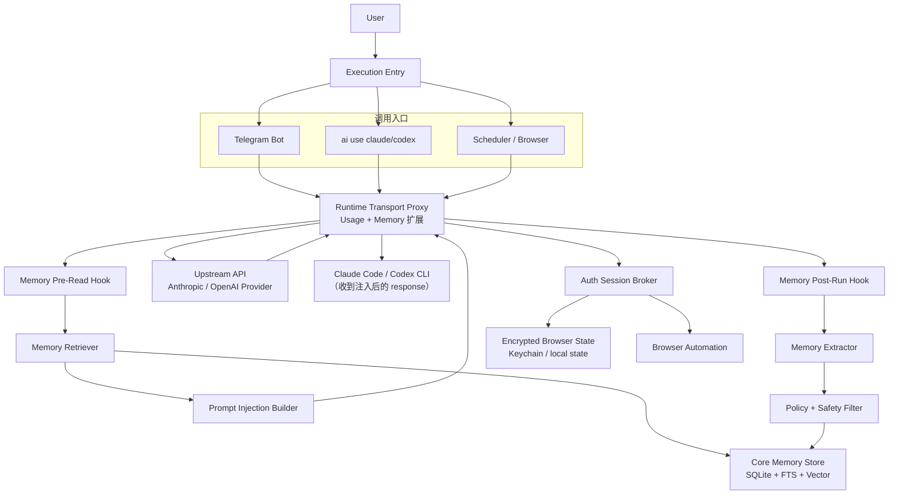
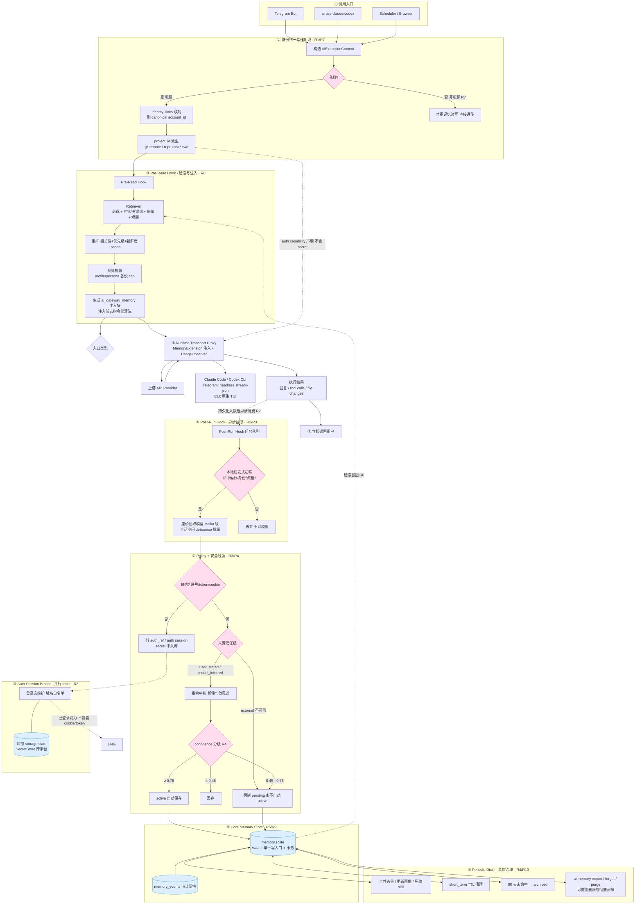

# ② Orchestration 编排层

> 遵循 doc_2.0 统一模块模板。语言中英混合，标识符英文原样。术语见 [../glossary.md](../glossary.md)。

## 1. 定位（一句话）

归一化 identity / tenant / project / session / trace / policy 上下文，跑生命周期钩子，发 append-only `RuntimeEvent`——所有 surface 共用同一条编排生命周期。

## 2. 单一职责边界（高内聚）

**拥有**：`ExecutionContext` 构造、tenant/scope 解析入口、session 生命周期、lifecycle hook 链、`RuntimeEvent` 发射、Working Memory（thread 级 checkpoint）。

**禁止拥有**：
- **禁止**执行工具或选 provider（属 ④/③）。
- **禁止**做记忆抽取/学习决策（属 ⑥/⑦）。
- **禁止**把 Working Memory 与跨执行 Memory 账本混同——两者**必须**分离。

## 3. 内部构件与各自单一职责

| 构件 | 单一职责 |
|---|---|
| `context` | 经 `IdentityDirectoryPort` 解析 `PrincipalRef`/membership，组装 `ExecutionContext` 与 `ScopeRef` |
| `session` | 会话生命周期、并发串行化 |
| `hooks` | pre/post lifecycle 钩子链编排 |
| `events` | `RuntimeEvent` append-only 发射 |
| `working-memory` | thread 级可恢复 checkpoint |

## 4. 对外/消费端口（可插拔点）

- 暴露：Orchestration facade（Surfaces 的唯一入口）。
- 消费：`IdentityDirectoryPort`、`OrganizationPolicySnapshot`、`WorkflowCheckpointBackend`（Working Memory 的可替换后端）、`ExecutionContext` / `RuntimeEvent` 契约。
- Working Memory 后端可换（本地 / LangGraph 风格），上层零改动。

## 5. 依赖（低耦合）

只 import `L0 Contracts`。调用 ③/④ 经契约与事件，**禁止** import 其具体实现。Security 与 Policy 作为横切在此**之前/之中**被调用以解析 scope。

## 6. 数据所有权

**独占** session 状态与 Working Memory checkpoint（thread 作用域）。这份数据**不是**跨执行真相源——跨执行事实归 ⑥ Memory 账本。checkpoint 丢失只损失 thread 续跑能力，**禁**影响账本真相。

## 7. 降级 / kill switch

`WorkflowCheckpointBackend` 不可用 → 降级为无 checkpoint 的单轮执行，**禁**因此丢失或伪造账本证据。hook 链单个非关键 hook 失败**应当** fail-open 并记事件；身份相关 hook 失败 fail-closed。

## 8. 产品化就绪度

❌ **不独立成产品**——编排是 Runtime 闭环的中枢，价值在整体性。Working Memory 后端本身可采纳成熟实现（LangGraph checkpointer 风格），但那是"采纳"而非"抽取本模块"。判据见 [../extraction-readiness.md](../extraction-readiness.md)。

## 9. 现状映射

`src/core/context/`、`src/core/sessions/` 是雏形，**应当**合并上移为本层；Telegram 的 `runExclusive()` 并发串行化模式**应当**抽象为通用 session 生命周期。`events`、`hooks`、`working-memory` 待建。

## 10. 验收标准

- CLI 与 Telegram 走**同一条**编排生命周期，不各自直连执行。
- tenant/scope 在 retrieval 与 execution **之前**完成解析。
- OIDC/SAML/SCIM 等外部 identity 必须先经 `IdentityDirectoryPort` 映射到 canonical `PrincipalRef`；外部 subject 或 group id 禁止成为 Runtime 权威外键。
- 每次 execution 固定绑定 `directoryRevision` 与 `OrganizationPolicySnapshot.snapshotId`；执行中目录变化不静默扩权，新 privileged grant 在 identity/policy 不确定时 fail-closed。
- Working Memory 可回滚 thread 状态，且与账本真相**物理分离**。

## 11. 相关文档

- 整体架构：[../00-overview.md](../00-overview.md)｜记忆账本：[06-memory.md](06-memory.md)
- 权威边界（英文）：[../AI_RUNTIME_ARCHITECTURE.md](../AI_RUNTIME_ARCHITECTURE.md) §2 Runtime Orchestration

---

# 附：执行流程与端到端时序（从 memory-system-spec 迁入）

> **Appendix Status: SUPPORTING SPEC** — 时序补充正文；identifier/event/error 必须使用 `contracts.md` closed catalog。
>
> 从 `memory-system-spec.md` 迁入，聚焦**执行入口如何经编排生命周期驱动记忆/学习子系统**。描述终局架构（Phase 13）；当前代码只落地到 Telegram Memory Phase 1。分层俯瞰图见 [../00-overview.md](../00-overview.md) 附录 D/E。规范性强制条款（R*）见 [../enforcement-decisions.md](../enforcement-decisions.md)（R1–R36）。标识符英文原样。

## A. 执行流程图（请求时序）

本图与 [../00-overview.md](../00-overview.md) 附录的"分层总架构图"互补：那张看**分层与治理**，这张看**请求时序**。



> 所有入口都通过 spawn CLI + 单一 Runtime Transport Proxy 执行。现有 OpenAI Usage Proxy 按职责拆分：稳定 API 成为兼容 facade，转发与兼容能力进入 Transport，计量状态进入唯一 UsageObserver；Memory Proxy 是同一数据平面内的 MemoryExtension，不再启动第二层 HTTP 代理。Telegram bot 使用 `--output-format stream-json` headless 模式 spawn CLI，CLI 入口使用原生 TUI 模式 spawn CLI，两者共用同一条传输链路。

## B. 目标目录结构

```text
src/core/
├── execution/
│   ├── execution-context.ts      # AiExecutionContext 与 capability
│   └── execution-orchestrator.ts # spawn CLI + proxy 生命周期 + durable Post-Run
├── memory/
│   ├── memory-service.ts         # 唯一公开 facade
│   ├── memory-store.ts           # SQL 与短事务
│   ├── memory-policy.ts          # category automata/confidence/safety/状态迁移
│   ├── memory-authority.ts       # origin authority/taint/独立证据判定
│   ├── memory-derivation.ts      # Evidence DAG/结构化确认/影响面重算
│   ├── memory-query-planner.ts   # 意图/实体/时态/类型检索计划
│   ├── memory-retriever.ts       # required/FTS/vector/recent/graph/episode
│   ├── memory-ranker.ts          # 分数归一与融合
│   ├── memory-context-compiler.ts# profile/memory/skill/constraint 上下文编译
│   ├── memory-extractor.ts       # 模型适配与输出校验
│   ├── memory-verifier.ts        # claim/evidence/NLI/tool outcome 验证
│   ├── memory-worker.ts          # jobs lease/retry/dead-letter
│   ├── memory-learning-governor.ts # 学习目标/候选选择/预算/确定性决策
│   ├── memory-uncertainty.ts     # 覆盖/冲突/适用性不确定性与动作选择
│   ├── memory-attribution.ts     # retrieved->used->decision->outcome 因果归因
│   ├── memory-distiller.ts       # episode -> semantic/skill
│   ├── memory-consolidator.ts    # 多粒度抽象/冷热迁移/profile 编译
│   ├── memory-capability-graph.ts# Goal/Claim/Skill/Capability 依赖与收益
│   ├── memory-integrity.ts       # event hash chain/checkpoint/校验
│   ├── memory-shadow.ts          # replay/shadow policy 实验
│   ├── memory-simulation.ts      # 长期虚拟用户/多设备/演化仿真
│   ├── memory-replication.ts     # 签名 event envelope/materializer
│   ├── adapters/
│   │   ├── candidate-extractor.ts # Mem0-style add-only extractor contract
│   │   ├── retrieval-backend.ts   # FTS/entity/reranker provider contract
│   │   ├── vector-retrieval.ts    # 授权过滤内置的 vector provider contract
│   │   ├── temporal-graph.ts      # Graphiti-compatible rebuildable projection
│   │   ├── workflow-checkpoint.ts # LangGraph-compatible checkpoint semantics
│   │   ├── durable-job.ts          # queue lease/retry/dead-letter contract
│   │   ├── protected-payload.ts    # audited AEAD + SecretStore/KMS envelope
│   │   ├── procedure-miner.ts      # mature sequence mining -> add-only candidate
│   │   ├── context-block.ts       # Letta-style block import/export projection
│   │   ├── policy-engine.ts       # OPA/Cedar-compatible deterministic evaluator
│   │   └── evaluation-harness.ts  # LoCoMo/LongMemEval/BEAM + domain suites
│   ├── artifact-store.ts         # 加密 content-addressed artifact
│   ├── project-identity.ts       # project_id 规范化
│   ├── identity-service.ts       # canonical account/link/unlink
│   ├── migrations/               # 001...NNN，单向、可重入
│   └── types.ts
├── auth-session/                 # 独立 RFC/模块，通过 capability 接口接入
├── transport-proxy/
│   ├── runtime-transport-proxy.ts # 单一 listener 与 public facade
│   ├── transport-forwarder.ts     # 最小数据平面/上游连接/立即流式转发
│   ├── transport-supervisor.ts    # worker 健康、重启、route lease、终态协调
│   ├── transform-coordinator.ts   # 唯一请求变换点/patch allowlist/manifest
│   ├── protocol-adapter.ts        # Anthropic/OpenAI 解析与 canonical AST
│   ├── protocol-exchange.ts       # retry/continuation/compaction 状态机
│   ├── turn-correlator.ts         # execution/protocol/content 指纹关联
│   ├── adapter-registry.ts        # protocol/provider/CLI compatibility profile
│   ├── compatibility-transform.ts # 保留现有 Responses↔Chat 兼容转换
│   ├── usage-observer.ts          # 只读 usage/cost/metrics 扩展
│   ├── memory-extension.ts        # Pre-Read patch + Post-Run capture 请求
│   ├── redaction-gateway.ts       # ephemeral capture -> sanitized envelope
│   ├── extension-worker.ts        # 隔离解析/observer，不持有 listener
│   ├── fixtures/                  # 脱敏协议 request/stream/replay corpus
│   └── types.ts
└── runner/
    └── openai-usage-proxy.ts      # 现有 public facade，迁移期委托统一数据平面
```

`telegram/memory` 在 Phase 1 仅保留兼容 adapter，禁止出现第二套 Policy、Retriever 或 schema。

## C. 端到端完整流程

下面这张图把身份归一、检索注入、异步抽取、安全过滤、生命周期、蒸馏和 Auth Broker 串成一条端到端主线；圈号是阶段编号，括注 `R*` 表示该阶段落实的「风险与强制实施决策」条目（见 [../enforcement-decisions.md](../enforcement-decisions.md)）。



图例：实线是主数据流；虚线是检索召回反哺、异步抽取、auth 能力声明等旁路。菱形节点是策略判定关口，`R*` 指向 [../enforcement-decisions.md](../enforcement-decisions.md) 对应条目。
