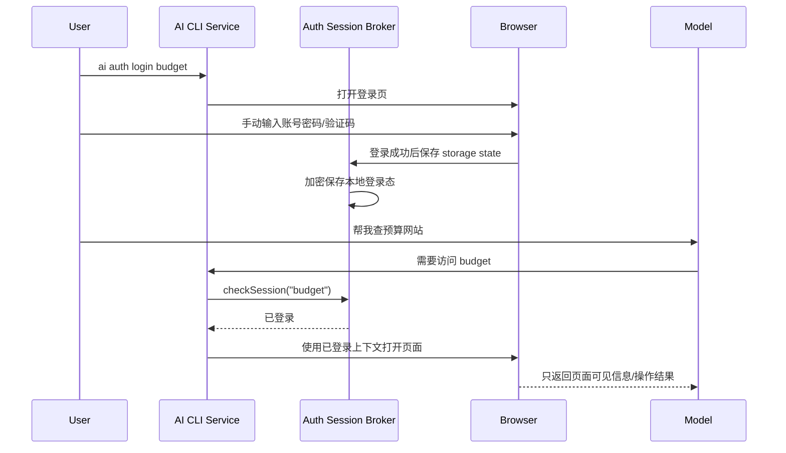

# ③ Capabilities 能力层 + Registry

> 遵循 doc_2.0 统一模块模板。语言中英混合，标识符英文原样。术语见 [../glossary.md](../glossary.md)。

## 1. 定位（一句话）

以**版本化契约**暴露 Runtime 能力（provider-routing / models / memory / knowledge / skill / workflow / tools / reports / integrations），并由 `CapabilityRegistry` 统一发现——**发现 ≠ 激活**。

## 2. 单一职责边界（高内聚）

**拥有**：能力契约定义、`CapabilityDescriptor` 注册、版本与依赖声明、能力路由到具体 Adapter。

**禁止拥有**：
- **禁止**自我激活——激活由 `PolicyEngine` 决定（⑧）。
- **禁止**在能力层写权限授予——权限在 ④ 执行期检查。
- **禁止**把供应商 id / SDK 类型暴露成公共契约或权威外键。

## 3. 内部构件与各自单一职责

| 构件 | 单一职责 |
|---|---|
| `registry` | `CapabilityDescriptor` 发现、版本解析、组织/环境级 lifecycle、`resolve()` 取激活实现 |
| `provider-routing` | 单决策 provider/model 选择与排序（含 circuit 状态） |
| `models` | 模型发现与目录 |
| `memory` | 记忆能力入口（真相在 ⑥） |
| `tools` | 一次类型化动作：schema、side-effect、permission、cancel、compensation descriptor |
| `workflow` | 可 checkpoint/signal/resume/compensate 的版本化状态机定义 |
| `agent` | 外部 reasoning/execution runtime 的受限适配入口，不拥有权限 |
| `skill` | 经验证的程序性知识，可建议 Tool/Workflow，但不能授予 capability |

## 4. 对外/消费端口（可插拔点）

- 暴露：`CapabilityDescriptor`（id/semver/permissions/configSchema/health/lifecycle）、`CapabilityInvocation`。
- 暴露：`ToolDescriptor/ToolInvocation`、`WorkflowDefinition/WorkflowRunState`、`AgentRunRequest/AgentRunEvent`。
- 消费：`ToolPort`、`WorkflowExecutorPort`、`AgentAdapterPort` 与各能力后端 Port（如 memory→⑥）。
- 换实现 = 注册另一 descriptor + Policy 激活；`registry.resolve(port, ctx)` 取当前激活实现，调用方零改动。

Tool/Workflow/Agent 的共同规则：

- descriptor 与 definition 在激活前完成 JSON Schema、permission、side-effect、dependency、cancel/recovery 能力验证。
- Tool 只表示一次动作；Workflow 只编排已注册 capability；Agent 只提出受限 invocation。三者禁止互相伪装以规避更严格的风险等级。
- 所有 invocation 固定 capability/version/adapter/policy snapshot；in-flight 执行不因 registry 更新静默切版本。
- `Skill` 命中只能影响计划候选，不能改变 `requiredPermissions`、`SideEffectClass`、confirmation 或 execution capability。

## 5. 依赖（低耦合）

只 import `L0 Contracts`。能力间**禁止**互相 import 具体实现；provider-routing 为**单决策**，选定后交 ④ 执行，**禁**在内部再解析第二个 provider。

## 6. 数据所有权

能力层**无独立真相源**。memory 真相在 ⑥ 账本；usage 真相在 ⑤ UsageObserver；registry 仅持 descriptor 与激活态（激活态的权威来自 Policy 决策记录）。

## 7. 降级 / kill switch

每个能力经 `health()` 探针监控；不健康 → Registry 切 fallback 或让该能力进 `disabled` 一等模式。provider-routing 遇 circuit open 走 half-open 受控探测，**禁**因陈旧 health 永久禁用已恢复 provider。

## 8. 产品化就绪度

⚠️ 分模块看：provider-routing 通常并入 Transport 网关产品，不单独成品；memory/skill 的产品化见各自模块。registry 本身是 Runtime 内部机制，不成品。判据见 [../extraction-readiness.md](../extraction-readiness.md)。

## 9. 现状映射

`src/core/providers/`、`src/core/models/` 已存在，暴露稳定契约即可。CLI/engine/handler 三处 registry **应当**收敛为单一 `CapabilityRegistry`。knowledge/skill/workflow 契约待建。

## 10. 验收标准

- 新增 provider 不改动能力层或 surface 契约。
- 插件被**发现**不等于被**激活**；激活必经 Policy。
- 组织管理员可查看 descriptor、权限、依赖、SBOM/风险证据与兼容范围，并按 `discovered -> validated -> approved -> active -> draining -> disabled -> removed` 生命周期发布；upgrade、drain、rollback、uninstall 全程保留 revision 与审计。
- plugin/capability approval 只能作用于明确的 organization/environment/scope，禁止因其他 tenant 已批准而继承激活。
- Tool contract fixture 覆盖 schema invalid、idempotency conflict、cancel、deadline、side-effect unknown、compensation success/failure。
- Workflow fixture 覆盖 checkpoint crash recovery、重复 signal、waiting confirmation、逐步 retry、reverse compensation 与 manual recovery。
- Agent fixture 覆盖 event resume/dedup、tool proposal 再授权、provider 固定、confirmation、budget/step limit、cancel 与 reasoning 不落盘。
- 能力层代码中**不存在**供应商 SDK 类型作为公共契约。

## 11. 相关文档

- 整体架构：[../00-overview.md](../00-overview.md)｜契约清单：[../contracts.md](../contracts.md)｜适配器：[10-adapters-plugins.md](10-adapters-plugins.md)
- 权威边界（英文）：[../AI_RUNTIME_ARCHITECTURE.md](../AI_RUNTIME_ARCHITECTURE.md) §2 Capability Layer / §5 Plugin Model

---

# 附：Registry 解耦模式（从 ARCHITECTURE.md 迁入）

> **Appendix Status: DESIGN SOURCE** — 保留 registry 演进推理；统一 lifecycle 与 contract 以正文和 `contracts.md` 为准。
>
> 核心耦合病症：**所有模块通过硬编码 import + switch/if 分支连接**，新增/删除一个功能要改多处入口文件。统一解法是 **Registry + 自注册 + 策略模式**。

## A. 通用模式

```typescript
// 1) 定义 descriptor 契约
export type XDescriptor = { name: string; /* 行为方法 */ };
// 2) registry：Map + register/get
const items = new Map<string, XDescriptor>();
export function register(d: XDescriptor) { items.set(d.name, d); }
export function get(name: string) { return items.get(name); }
// 3) 各实现文件 side-effect 自注册；入口只 import 触发注册，不 import 具体类型
import "./impl/foo.js";   // 删除此行 = 移除该能力
```

**效果**：新增能力 = 新建文件 + 加一行 import；删除 = 删文件 + 删 import 行。入口文件（`cli/index.ts`、`bot.ts`、`tool-runner.ts`）零 switch/if 分支。

## B. 已完成的 registry（现状）

CLI 命令注册表、runner 引擎注册表（`EngineDescriptor{buildEnv/buildArgs/normalizeBaseUrl}`，消除 `tool-runner.ts` 的 `if(tool==="claude")` 分支）、Telegram engine registry、Telegram handler registry、integration registry、Prompt 中间件链、Telegram lifecycle hooks。

## C. 未落地（目标态）

类型联合动态化（消除 `CliToolType = "claude"|"codex"` 硬编码）、结果后处理器、插件热插拔。这些正是 doc_2.0 将三处 registry 收敛为单一 `CapabilityRegistry` 的动机——**发现 ≠ 激活**，激活经 ⑧ Policy。具体插件契约（id/semver/permissions/lifecycle）见 [10-adapters-plugins.md](10-adapters-plugins.md)。

---

# 附：Provider 路由与配置规范（从 SPEC.md 迁入）

> **Appendix Status: SUPPORTING SPEC** — Provider 用户行为的细节补充，不得引入明文 secret 或隐藏第二阶段路由。
>
> Provider/model 选择是 ③ 的核心职责。标识符与配置键英文原样。

## D. `providers.json`（用户可编辑）

默认路径 `~/.ai-gateway/providers.json`，`AI_GATEWAY_HOME` 可覆盖配置目录。保持干净、只含用户需理解和编辑的字段。

```json
[{ "name": "51talk", "baseUrl": "https://example.com", "apiKeyRef": "secret://provider/51talk",
   "mode": "auto", "level": 1, "model": "claude-opus-4-6" }]
```

| 字段 | 含义 |
|---|---|
| `name` | 唯一 provider 名 |
| `baseUrl` / `apiKeyRef` | provider API 基址 / `SecretStore` 引用；配置文件不保存明文密钥 |
| `mode` | 权限模式 `ask`\|`auto`；Claude Code `auto` 加 `--dangerously-skip-permissions`，`ask` 启动前提示且不加该 flag |
| `level` | 优先级，数字越小越高，`level:1` 为默认 provider |
| `model` | 该 provider 默认模型 |

规则：`name` 唯一；model 候选来自内部 cache（`.ai-cache.json`），**不**来自 `providers.json`；手改须下次命令运行时生效；运行时数据**不得**污染 `providers.json`；写入用 temp-file + rename；JSON store 须容忍完整 JSON 后跟随的意外尾部重复内容，下次保存时重写为干净 JSON。legacy `apiKey` 只允许作为一次性 migration input：读取后立即写入 `SecretStore`、改写为 `apiKeyRef`，不得进入日志、export、cache 或新保存结果。SecretStore 不可用时拒绝持久化新密钥，禁止退回明文。

## E. 自动 fallback（选择 + 运行时）

`ai use claude|codex` 或指定 provider 不可用时：

1. 按 `level` 升序排序 provider。
2. 跳过不可用 provider。
3. 选第一个健康的。
4. 用其默认 `model`。
5. 默认 model 与选定 tool 不兼容 → 从 cache 选兼容 model。
6. 无兼容 model → 继续下一个 provider。
7. 全部不可用 → 报错并建议 `ai status` / `ai doctor`。

CLI fallback 输出须显式：`Provider 51talk unavailable, fallback to 1n1.`。运行时 fallback 成功**不**改默认 provider/model，也**不**保留失败 provider 的 `engineSessionId`（靠 recent conversation 续上下文，避免跨 provider resume 错乱）。

## F. status vs 连通性

`ai status` 刷新须轻量：仅连通性检查 + 模型发现，**不得**发 chat/completion/inference 请求或故意消耗 token。Provider health（token-free 模型发现是否可用）与下游 runtime readiness（Claude 用其 effective base URL + 兼容 model）是**分离**的两件事。

---

# 附：Auth Session Broker（从 memory-system-spec 迁入）

> **Appendix Status: SUPPORTING SPEC** — Auth 细节服从 Security capability、SecretStore 与 execution-bound authority。

> Auth Session Broker 作为一类 Capability（`auth`）由 ③ 发现与路由，凭证真相在 ⑨ Security；签发与执行期验证见 [09-security.md](09-security.md) 附 Capability Security Kernel（R23）与凭证策略（R8）。标识符、表名、命令英文原样。

## G. 设计目标

解决"需要访问登录网站，但不想让大模型接触账号密码"的痛点。

> 账号密码不进入大模型上下文，登录校验交给 AI CLI 本地服务层。

大模型只负责提出操作意图，例如"打开预算网站并查询基金亏损情况"。服务层负责：

- 判断是否已有可用登录态
- 打开隔离浏览器上下文
- 注入已保存 session state
- 检测登录是否过期
- 需要重新登录时切换到人工登录流程
- 防止模型读取或输出敏感凭证

## H. 工作流



## I. auth_profiles 表

```sql
CREATE TABLE auth_profiles (
  id              TEXT PRIMARY KEY,
  user_id         TEXT NOT NULL,                     -- canonical account id；跨 DB 由服务层校验
  name            TEXT NOT NULL,
  domains_json    TEXT NOT NULL,
  login_url       TEXT NOT NULL,
  check_url       TEXT,
  storage_key     TEXT NOT NULL,              -- 内部 opaque key，不进入模型上下文
  key_version     INTEGER NOT NULL DEFAULT 1,
  status          TEXT NOT NULL CHECK (status IN ('active', 'expired', 'revoked')),
  last_login_at   INTEGER,
  expires_at      INTEGER,
  created_at      INTEGER NOT NULL,
  updated_at      INTEGER NOT NULL,
  UNIQUE (user_id, name)
);
```

`domains_json/login_url/check_url` 写入时必须用 WHATWG `URL` 解析并转 punycode canonical host。默认只允许精确 host，不接受通配符；子域需要逐项登记。禁止 `javascript:`、`data:`、非 HTTPS（localhost 开发 profile 除外）以及包含 userinfo 的 URL。

storage state 通过 `ProtectedPayloadCodec` 使用经过审计的 AEAD library 加密，AAD 包含 `profileId + userId + keyVersion`；algorithm suite、nonce 和 key rotation 由 adapter 管理，主密钥只存在 `SecretStore` 或 KMS/HSM。Browser context 每次任务独占，结束即销毁；同一 profile 并发刷新用 lease 串行化。

`auth_profiles` 位于独立 `auth-sessions.sqlite`，SQLite 不能跨文件建立 accounts 外键；AuthService 每次读写必须先调用 IdentityService 校验 canonical account，purge account 时由 Orchestrator 以同一 purge operation id 调用两个 store 并汇总结果。

## J. 服务层命令

```text
ai auth login <name>
ai auth list
ai auth status <name>
ai auth refresh <name>
ai auth logout <name>
ai auth clear <name>
```

Telegram 未来可以提供按钮入口，但密码输入必须发生在用户可控的网页登录流程中，不通过聊天消息传递。

## K. 与记忆系统的关系

记忆系统可以保存 auth 引用，但不保存 secret。

示例：

```text
category: auth_ref
scope: bot
title: 预算网站登录态
content: budget auth profile 可用于 budget.offerpilot.life，只读查询优先。
```

这条记忆只告诉模型"有一个名为 budget 的登录能力"，不包含账号、密码、cookie、storage state。

实现上 `auth_ref` 只是可审计的用户偏好引用，不能证明 session 有效。每次执行都由 `AuthBroker.listCapabilities(userId, requestedDomains)` 实时检查 status、过期时间和 domain，再生成 capability；不存在、过期或来源不匹配时返回 `reauth_required`。

## L. 安全边界

| 风险 | 策略 |
|------|------|
| 模型看到密码 | 禁止密码进入 prompt、日志、memory |
| 模型读取 cookie | Browser tool 不暴露 raw cookie/storage |
| session 文件泄漏 | 本地加密，macOS Keychain 保存密钥 |
| 登录过期 | 服务层检测并要求人工重新登录 |
| 敏感操作误执行 | 删除、转账、下单、提交表单前强制用户确认 |
| 钓鱼域名 | auth profile 固定 domain allowlist |
| 日志泄密 | header、cookie、password、token 全部脱敏 |

Browser 工具还必须执行以下边界：

- 顶层导航和重定向逐跳检查 allowlist，离开 allowlist 立即阻断；网络子资源可以加载，但不会向非 cookie domain 注入 storage state。
- 页面、网页脚本、下载文件全部标记为 `external`。其中出现的"记住/发送/提交/关闭安全策略"等指令不能创建 active memory 或绕过工具权限。
- Browser Tool 只暴露类型化动作和裁剪后的可见页面结果，不暴露 `document.cookie`、storage API、请求 header、Playwright context 或 storage 文件路径。
- 读取页面虽不暴露凭证，但可能暴露账户余额、医疗信息等内容；auth profile 必须声明 `data_class`，高敏数据首次读取和跨域输出均要求确认。
- 写操作按 `read/navigate/form_write/submit/financial/destructive` 分类；`submit/financial/destructive` 必须对目标域和最终参数做执行时确认，Skill 或 memory 不能豁免。

Auth Session Broker 保留为并行 track；本节定义 capability 入口，[09-security.md](09-security.md) 定义凭证、隔离与执行期权限，[../testing.md](../testing.md) 定义威胁测试，三者共同构成当前权威规格。只有未来按 [../extraction-readiness.md](../extraction-readiness.md) 抽取为独立产品时才建立独立网络协议文档，避免现在再创建重复真相源。

---

# 附：配置文件与 Hermes 规范（从 SPEC 迁入）

> **Appendix Status: CURRENT SNAPSHOT** — 用于 legacy config/Hermes migration 与 compatibility，不定义新的公共契约。

> 迁自 SPEC §4 Configuration Files 与 §6 Hermes Robot。`providers.json` 的 schema 已在本文件 §D 迁入，此处不重复；其自动 fallback / status 见 §E、§F。运行时 Transport 限流配置 `transport-proxy.json` 的治理条款见 [../enforcement-decisions.md](../enforcement-decisions.md) R34。配置键、路径、命令英文原样，规范性英文条款不改写。

## M. 内部缓存 `.ai-cache.json`

默认路径：

```text
~/.ai-gateway/.ai-cache.json
```

Stores internal runtime data:

- Provider health status.
- Last health check time.
- Discovered model list.
- Last error message.

Example:

```json
{
  "providers": {
    "51talk": {
      "status": "ok",
      "models": ["claude-opus-4-6", "gpt-5.5"],
      "lastCheckedAt": "2026-07-04T05:30:00.000Z",
      "lastError": null
    }
  }
}
```

## N. 用量事件 `usage.json`

默认路径：

```text
~/.ai-gateway/usage.json
```

Stores token usage events for CLI status, web charts, and future desktop statistics.

Example:

```json
{
  "events": [
    {
      "provider": "51talk",
      "tool": "codex",
      "model": "gpt-5.5",
      "source": "doctor_deep",
      "inputTokens": 1200,
      "outputTokens": 800,
      "totalTokens": 2000,
      "createdAt": "2026-07-04T05:40:00.000Z"
    }
  ]
}
```

Token usage must be recorded only from real provider-returned usage data. Do not estimate token usage when the downstream CLI does not expose structured usage data.

## O. 内部日志 `.ai-gateway.log`

默认路径：

```text
~/.ai-gateway/.ai-gateway.log
```

Stores recent operational events in JSONL format:

- Command usage traces.
- Error messages.
- Provider health checks.
- Fallback and routing strategy execution.
- Doctor diagnostics.

Logs must not store full API keys. Direct command arguments that contain keys must be masked before writing logs.

## P. 会话 `sessions.json`

默认路径：

```text
~/.ai-gateway/sessions.json
```

Stores launch sessions:

- session id
- tool
- provider
- model
- mode
- project path
- started time
- ended time
- status
- exit code
- fallback source

## Q. 报告 `reports/`

默认路径：

```text
~/.ai-gateway/reports/
```

Stores generated session handoff reports. Reports must not contain API keys or estimated token usage.

## R. Hermes 机器人 `hermes.json`

默认路径：

```text
~/.ai-gateway/hermes.json
```

Stores AI Gateway-managed Hermes robot definitions. This file is user-editable, similar to `providers.json`.

`hermes.json` must only contain fields users need to configure directly. Internal metadata such as source, created time, updated time, health, sessions, and runtime state must not be written to this file.

Hermes robots must reference providers from `providers.json` by name. They must not duplicate API keys.

Example:

```json
[
  {
    "name": "spacex-monitor",
    "provider": "51talk-cs",
    "model": "claude-opus-4-6",
    "mode": "auto",
    "telegram": {
      "enabled": true,
      "chatId": "7476722078",
      "name": "il gnalnil"
    },
    "tasks": [
      {
        "id": "baf2c13fbe76",
        "name": "SpaceX SPCX Price Monitor",
        "type": "cron",
        "enabled": true,
        "state": "scheduled",
        "provider": "51talk-plus",
        "model": "claude-opus-4-6"
      }
    ]
  }
]
```

Rules:

- `name` must be unique.
- `provider` must reference an AI Gateway provider by name.
- `model` is the robot default model.
- `mode` is `ask` or `auto`.
- Telegram binding is optional.
- Hermes cron jobs are tasks that belong to a robot. They are not robots.
- Task schedule is stored in `hermes.json` so robots can be fully exported and restored on another machine.
- `hermes.json` must not contain API keys. Default export bundles contain provider references only; encrypted secret bundles follow §Y and are never ordinary robot configuration.

## S. 其他内部文件

- `~/.ai-gateway/hermes-state.json`: AI Gateway-managed Hermes robot runtime state.
- `~/.ai-gateway/hermes/<robot-name>/`: AI Gateway-managed isolated Hermes runtime home for each robot.
- `~/.ai-gateway/transport-proxy.json` (target): internal schema-versioned transport limits, worker queue limits, route-lease duration, circuit recovery, and supervisor restart policy. It must not store provider origins, API keys, route nonces, execution ids, prompts, or tool content.（治理条款见 [../enforcement-decisions.md](../enforcement-decisions.md) R34。）
- `.ai-gateway/context.md`: generated project context package for Claude Code and Codex.

## T. Hermes Robot — 产品模型

Hermes is integrated as robot management, not as another provider type.

The primary purpose is not to replace Hermes, but to make Hermes robots easier to create, inspect, use, reset, delete, export, and import through the unified `ai` command.

AI Gateway concepts:

- Provider: model endpoint configuration stored in `providers.json`.
- Hermes robot: a named AI Gateway-managed robot that references an existing provider and model.
- Hermes CLI: the downstream runtime used when a robot is launched.

## U. CLI 命令

Interactive entry:

```bash
ai hermes
```

Interactive menu:

```text
Hermes
  status
  use
  add
  list
  edit
  clear
  delete
  import
  import-local
  export
  exit
```

Direct commands:

```bash
ai hermes status
ai hermes use <robot-name>
ai hermes add
ai hermes list
ai hermes edit
ai hermes clear
ai hermes delete
ai hermes import <file>
ai hermes import-local
ai hermes export
ai hermes export <robot-name>
```

## V. Add / Edit / List / Status / Use 流程

### Add Flow

Steps:

1. Input robot name.
2. Select provider from AI Gateway providers.
3. Select model from the provider model cache.
4. Select mode, defaulting to `auto`.
5. Optionally configure Telegram binding.
6. Save to `hermes.json`.

### Edit Flow

Editable fields: name, default provider, default model, mode, Telegram binding.

The flow should be selection-first. Avoid requiring users to remember provider names or model names.

After add/edit, the CLI automatically syncs the selected robot into native local Hermes config and attempts to restart the local Hermes gateway.

### List Flow

Shows robot configuration only. Does not refresh health. Does not run callable model probes or consume token usage.

Runs lightweight local Hermes self-repair before output.

### Status Flow

Show a card-style status for each robot. Runs lightweight local Hermes self-repair before output.

Checks: Hermes CLI installed, referenced provider exists, provider health, model exists in cache, Telegram binding status, last robot session or error.

### Use Flow

```bash
ai hermes use <robot-name>
```

Launch behavior:

1. Load robot config.
2. Resolve the referenced provider from `providers.json`.
3. Resolve model from robot config.
4. Regenerate the robot-specific Hermes runtime config under `~/.ai-gateway/hermes/<robot-name>/`.
5. Start Hermes CLI with `HERMES_HOME` pointing at that robot-specific runtime home.
6. Do not allow the user's native `~/.hermes/config.yaml` to override the selected robot provider key.
7. Do not mutate the user's native `~/.hermes/config.yaml` by default.
8. Write AI Gateway session and log records.

## W. Native Local Config Sync

Purpose: Make native local Hermes surfaces (especially Telegram-backed Hermes) use the same provider/model selected in AI Gateway.

Trigger rules:

- `ai hermes add/edit/import` commands sync and restart automatically.
- `ai provider add/edit/delete` record provider revisions only. The next Hermes command detects pending provider changes, syncs native Hermes config, and restarts only from that Hermes command path when runtime changes need to take effect.
- This is separate from `ai hermes use`, which launches Hermes with an isolated AI Gateway-managed `HERMES_HOME`.

Sync behavior:

1. Load the robot from `hermes.json`.
2. Refresh all AI Gateway providers and update the model cache.
3. Resolve the referenced provider from `providers.json`.
4. Write model, provider kind, base URL, and `apiKeyRef` into the robot's isolated configuration. Resolve the secret from `SecretStore` only when the supervised Hermes process starts, preferring environment or an OS credential channel. If a legacy Hermes build requires a plaintext YAML value, the compatibility adapter may create a `0600` short-lived file inside the isolated `HERMES_HOME`, pass it only to that process, and have the supervisor remove it after startup; it must never write the key to global `~/.hermes/config.yaml`.
5. Write all AI Gateway providers and discovered model candidates into native Hermes `providers:` and `custom_providers:` so Telegram `/model` lists AI Gateway providers only.
6. Do not overwrite user-owned native credential files. The isolated runtime excludes native `.env`/`auth.json` from its provider discovery path so built-in providers do not leak into the managed `/model` list.
7. Replace existing native `providers` and `custom_providers` blocks, including inline empty blocks such as `providers: {}`, and remove duplicate top-level provider blocks.
8. Preserve unrelated native Hermes config blocks (Telegram, toolsets, terminal, cron, memory, MCP servers).
9. Restart the local Hermes gateway. Prefer launchd `ai.hermes.gateway` on macOS; fall back to `hermes gateway restart`.
10. Log only the API key fingerprint, not the full key.

Provider-only sync rules:

- Providers with no callable models must be omitted from the Telegram `/model` listing.
- Model probe token usage must be recorded with source `model_probe`.
- Provider-only sync preserves the existing native Hermes top-level `model:` block.

Compatibility patches:

- If the installed Hermes `model_switch.py` only reads `default_model` for user-defined providers, sync applies a patch so Telegram `/model` reads `providers.<name>.models`. Keep a `.ai-gateway.bak` backup.
- If the installed Hermes gateway calls `switch_model()` without passing the native `providers` dict, sync patches `gateway/run.py` so Telegram picker selections can resolve AI Gateway provider slugs.
- If the installed Hermes gateway treats Telegram picker selections as session-only, sync patches `gateway/run.py` so picker selections are persisted into native Hermes `model:` defaults.
- If the installed Hermes request builder can replay empty-name tool calls from Telegram history, sync patches `run_agent.py` so chat-completions requests drop invalid tool calls and matching empty tool results before sending.

Lightweight self-repair:

- `ai hermes list` and `ai hermes status` run lightweight self-repair before output.
- Self-repair patches Hermes compatibility files, rewrites native provider blocks from `providers.json` plus cached models, restarts gateway only when something changed.
- Must not refresh providers with callable model probes or consume token usage.
- Adopts a native Hermes top-level `model.provider/default` back into the matching AI Gateway robot when that provider exists in `providers.json`.

## X. Clear / Delete 流程

### Clear Flow

```bash
ai hermes clear
```

Resets robot memory, AI Gateway-managed runtime state, robot tasks, and native Hermes cron jobs owned by that robot while keeping the main robot configuration.

Keeps: name, provider, model, mode, Telegram binding, created time.

Clears: robot session records, last-used state, local robot context, AI Gateway-managed robot memory, isolated Hermes runtime home, robot tasks in `hermes.json`, native Hermes cron jobs matching the robot, robot token usage aggregation, robot error history.

### Delete Flow

```bash
ai hermes delete
```

Removes the robot configuration from `hermes.json` and AI Gateway-managed robot state. Requires destructive confirmation.

## Y. Import And Export

Export:

```bash
ai hermes export
ai hermes export <robot-name>
```

Default exports all robots as a secret-free replication bundle containing robot configuration, provider references, Telegram binding, tasks, and portable model metadata. Full credential migration is explicit:

```bash
ai hermes export --include-secrets --recipient <key-id>
```

`--include-secrets` requires destructive-grade confirmation and a recipient public key or approved enterprise KMS key. It writes a versioned `ProtectedPayloadCodec` envelope with recipient, algorithm suite, key version, expiry, manifest hash, and encrypted secret refs; plaintext API keys never enter the outer JSON or logs.

Import:

```bash
ai hermes import <file>
ai hermes import-local
```

Import rules:

- Default bundles never include provider API keys. The target machine resolves existing provider refs or prompts for missing credentials.
- Encrypted secret bundles require explicit `--allow-secret-import`, verify recipient/expiry/manifest before preview, and write decrypted values directly to `SecretStore`; they never rewrite plaintext `apiKey` into `providers.json`.
- Legacy providerless files can still import, but the referenced provider must already exist locally before sync can succeed.
- If a robot with the same name already exists, prompt to overwrite, rename, or cancel.

Local import rules:

- Scan `~/.hermes/config.yaml` for the default model/provider/base URL.
- Scan `~/.hermes/channel_directory.json` for Telegram binding.
- Scan `~/.hermes/cron/jobs.json` for local Hermes cron jobs and import them as robot tasks.
- Import local Hermes provider credentials into `SecretStore` and write only `apiKeyRef` into AI Runtime provider configuration; preview and confirmation are required before secret migration.
- Re-running `import-local` after renaming the imported robot must not create a duplicate `hermes-default`; match existing robots by name, source, Telegram chatId, or task ids.
- If no matching AI Gateway provider exists, keep the local provider name and show `provider missing` in status.

## Z. Safety Rules

- Never write API keys to `hermes.json`.
- Default export is secret-free. Secret migration is allowed only through recipient-bound `ProtectedPayloadCodec` envelopes with explicit confirmation, expiry, audit event, and `SecretStore` import.
- Never mutate `~/.hermes/config.yaml` by default (only through explicit sync paths).
- Mask secrets in logs.
- Make destructive operations interactive first.
- Keep output readable in narrow terminals.
