# ⑩ Adapters / Plugins 适配器与插件

> 遵循 doc_2.0 统一模块模板。语言中英混合，标识符英文原样。术语见 [../glossary.md](../glossary.md)。

## 1. 定位（一句话）

以可替换适配器承载供应商细节：provider/model、tool/MCP、workflow executor、retrieval backend、evaluator、policy module、user surface——实现 Port 契约，绝不重定义核心策略。

## 2. 单一职责边界（高内聚）

**拥有**：供应商 SDK 调用、协议/格式转换到 Port 契约、供应商侧超时/circuit 行为。

**禁止拥有**：
- **禁止**重定义核心策略（provider adapter 只执行，不选择）。
- **禁止**把供应商 id/SDK 类型/存储 schema 暴露成公共契约或权威外键。
- **禁止**自我激活——发现 ≠ 激活，激活由 ⑧ Policy。

## 3. 内部构件与各自单一职责

| 构件 | 单一职责 |
|---|---|
| provider/model adapter | 执行选定的 provider/model 调用 |
| tool/MCP adapter | 工具与 MCP 集成 |
| agent adapter | 启动 Claude Code/Codex/Hermes 等外部 Agent runtime，并把进程/SDK event 规范化为 `AgentRunEvent` |
| workflow executor | 工作流执行适配 |
| backend adapter | 实现检索/向量/图/队列/存储/Observability Port |
| evaluator/policy module | 评测器、策略模块插件 |

## 4. 对外/消费端口（可插拔点）

- 实现 [contracts.md](../contracts.md) 第 4 节全部 Port。
- 每个插件**必须**声明 id/semver/API 兼容/permissions/configSchema/dependencies/health/lifecycle。
- 发现**不**蕴含激活；Policy 按组织与环境控制激活。

## 5. 依赖（低耦合）

只 import `L0 Contracts`。适配器之间**禁**互相依赖；供应商细节封在各自适配器内，**禁**外泄。

## 6. 数据所有权

适配器**无核心真相所有权**。供应商侧数据经 Port 转成 Runtime 契约后，真相归对应核心层（memory→⑥、usage→⑤）。供应商 id 不得成为权威外键。

## 7. 降级 / kill switch

每个插件独立 kill switch。禁用某插件或高级学习特性 → Runtime **必须**回到稳定 baseline。可选 provider 丢失只降该能力（graph→时序 SQL、vector→FTS），**禁**绕过 scope 或关掉显式控制。

## 8. 产品化就绪度

🔄 **多为采纳而非抽取**——适配器背后多是既有产品（Postgres/Qdrant/OPA/Mem0）。本层是"接入成熟产品"的边界，不产出独立产品。判据见 [../extraction-readiness.md](../extraction-readiness.md)。

## 9. 现状映射

`src/core/hermes/`、`src/core/integrations/` 已存在，**应当**移到 integration/workflow 契约后成为标准适配器。`plugins/` 目录待建。

Claude Code/Codex 的具体 CLI 封装目标态属于本层：`ClaudeCodeCliAgentAdapter` / `CodexCliAgentAdapter` 实现 `AgentAdapterPort`。它们拥有二进制发现、启动参数、临时 vendor 配置、进程生命周期、stream event parsing、session cursor 和 vendor error mapping；不拥有 Agent capability 激活、provider/model 选择、tool permission、retry policy、Memory、Usage 或 Learning。当前 CLI runner 对 `ai use codex` 使用 process-scoped `model_provider` override，把 `env_key` 固定为本次子进程的 `OPENAI_API_KEY`，禁止回落到用户全局 Codex credential；该 override 不写入全局 `auth.json` 或 `config.toml`。Telegram `Engine` wrapper 是 ① 的兼容 facade，不是另一个 Agent Adapter 权威入口。

## 10. 验收标准

- 成熟能力 provider 可替换而**不改**公共契约、权威 id、scope/authority 决策、audit/purge 可达、显式用户控制。
- 外部 extractor/vector/graph/block/checkpoint/policy/evaluation provider **不能**直接改激活/scope/permission/删除态。
- 每个依赖具备 ADR/pinned version/SBOM/license 审查/契约 fixtures/kill switch/替换路径。
- `ToolPort/WorkflowExecutorPort/AgentAdapterPort` 至少各有 local reference adapter 与一个替换 adapter，通过相同 schema/error/cancel/idempotency/recovery fixture。
- Workflow/Agent provider 的 checkpoint、event cursor、SDK error 与 provider run id 只在 adapter 内部存在，对外转换为 Runtime canonical state/event/error。
- Adapter 声称 cancel/compensation/resume 时必须有故障注入证明；不支持时 descriptor 明确声明，Registry/Policy 禁止把它用于要求该能力的 workflow。
- Claude Code/Codex adapter fixture 覆盖 CLI version fingerprint、spawn failure、event sequence/dedup、tool proposal、confirmation round-trip、resume/cancel、unknown terminal、provider route 固定和 secret/reasoning 不落盘；无法拦截的 native tool mode 必须在 descriptor 中显式降级。
- 本地 profile 无托管服务仍可用；每个可选 provider 有独立测试的 fallback。
- JSONL、OpenTelemetry 与企业 OTLP/APM Adapter 消费同一 `CapabilityObservation`；Adapter 可采样、聚合、脱敏和导出，但不得发明第二套 action、把 telemetry 变成审计真相或把 exporter 故障传播到 Runtime 主链。

## 11. 相关文档

- 契约清单：[../contracts.md](../contracts.md)｜存储：[11-storage.md](11-storage.md)
- 权威边界（英文）：[../AI_RUNTIME_ARCHITECTURE.md](../AI_RUNTIME_ARCHITECTURE.md) §4 Mature Capability Reuse / §5 Plugin Model

---

## 附：成熟方案复用与可替换契约（从 memory-system-spec 迁入）

> **Appendix Status: DESIGN SOURCE** — 用于 Build/Adopt/Adapt ADR；具体 Port、error、lifecycle 以正文和 `contracts.md` 为准。
>
> 本附录保留 legacy `memory-system-spec.md` 的成熟方案材料作为设计来源，不承诺旧代码块继续逐字节有效。Port 名称与生命周期以 [../contracts.md](../contracts.md) 为准，复用治理以 [../enforcement-decisions.md](../enforcement-decisions.md) R35 为准。

### 成熟方案复用与自研边界

本项目不以“全部自行实现”为目标。产品差异化是统一 Runtime、Evidence/Authority、确定性治理、可逆学习和组织能力积累；通用的抽取、索引、图计算、工作流持久化、策略求值、加密和可观测算法应优先复用成熟实现，并通过稳定 adapter 接入。

复用遵循三类决策：

- **Build（必须自有）**：决定产品身份、权限和真相的控制面，包括 canonical Runtime 契约、Claim/Evidence 权威账本、origin-bound authority、Learning Governor、Capability Security Kernel、Context Compiler、scope/purpose policy、审计/purge、组织级 promotion，以及 Runtime Transport 与 MemoryExtension 的组合边界。
- **Adopt（直接采用）**：已有成熟标准或库且不改变产品语义的基础能力，例如 SQLite/FTS5、sqlite-vec/pgvector/Qdrant 类向量索引、BM25/RRF、成熟 embedding/rerank provider、OpenTelemetry、JSON Schema、Argon2id、OS Keychain/libsecret/DPAPI、成熟队列和对象存储。
- **Adapt（通过适配器吸收）**：成熟方案的上层算法或数据结构，例如 Mem0 风格候选抽取与多信号召回、Graphiti 风格时序 Context Graph、Letta 风格 Memory Block、LangGraph 风格 Checkpointer/Store。它们的输出必须重新绑定本项目 identity、scope、Evidence、policy 和审计，不得直接成为 active truth。

### 成熟方案设计映射

以下映射基于 2026-07-13 的公开官方设计。它是设计来源和兼容方向，不构成对单一厂商、托管服务或特定数据库的强依赖。

| 成熟方案 | 吸收的优秀设计 | 在本项目中的调整 | 不直接照搬 |
|----------|----------------|------------------|------------|
| Mem0 | ADD-only 候选抽取；user/session/agent 多级记忆；semantic + BM25 + entity 多信号融合；entity linking；time-aware retrieval；公开长期记忆 benchmark | `CandidateExtractor` 只追加不可变 Candidate/Evidence，不直接 UPDATE/DELETE Claim；检索融合进入 `RetrievalBackend`，仍执行 scope/authority/temporal 硬过滤 | 不让第三方 memory record 成为真相源；不把托管平台设为必需；不以 benchmark 宣传值替代本项目复测 |
| Graphiti / Zep | Episode provenance；entity/fact/relationship；validity window；双时态事实；增量图构建；prescribed + learned ontology；semantic + BM25 + graph traversal | `TemporalGraphProjection` 作为可重建投影；每条 node/edge 回指 Claim/Evidence；Graphiti sidecar 或兼容实现可替换；SQLite 保留权威数据 | 不把原始 Episode 正文无条件发送给外部服务；图的自动 invalidation 不能越过本项目 authority/conflict policy |
| Letta | stateful agent；持久化 messages/reasoning/tool state；in-context Memory Block；可共享 block；context eviction 后仍可检索 | `ContextCompiler` 输出版本化、只读、audience-bound block；shared block 映射为受 policy 管理的 project/team projection；agent edit 转为 candidate proposal | 不允许 Agent 工具直接改 active Claim、scope、权限或系统策略；不把完整 reasoning 当作长期 memory |
| LangGraph | thread Checkpointer 与 cross-thread Store 分离；checkpoint、interrupt、time travel、fault tolerance；可替换持久化后端 | `WorkflowCheckpointBackend` 保存可恢复 execution state，`MemoryStore` 保存跨 execution 权威记忆；两者共享 trace/idempotency 但生命周期独立 | 不把 graph checkpoint 当作长期知识，不要求所有入口改造成 LangGraph workflow |
| OPA / Cedar 类策略引擎 | 声明式、版本化、确定性 policy evaluation；decision input/output 可审计 | `PolicyEngine` 接收受限类型化输入，返回 `allow/deny/require_confirmation/constrain` 与 matched rule ids；本地 profile 可使用嵌入式/WASM evaluator | 不自行发明通用脚本语言；policy 不能执行网络、数据库写入或模型调用 |
| OpenTelemetry | trace/span/metric/log 关联、W3C Trace Context 和 vendor-neutral exporter | RuntimeEvent、Transport、Memory job、retrieval、model/evaluator 统一传播 trace（跨层规则见 [contracts.md §6](../contracts.md#6-运行时可观测性契约跨层observability)）；敏感正文永不进入 attribute | 不把 telemetry backend 当权威审计账本，不向 exporter 发送 prompt、secret 或 raw Evidence |

官方参考：

- [Mem0](https://github.com/mem0ai/mem0)
- [Graphiti](https://github.com/getzep/graphiti)
- [Letta stateful agents](https://docs.letta.com/guides/core-concepts/stateful-agents/)
- [LangGraph persistence](https://docs.langchain.com/oss/javascript/langgraph/persistence)
- [Open Policy Agent](https://www.openpolicyagent.org/)
- [Cedar Policy](https://www.cedarpolicy.com/)
- [OpenTelemetry](https://opentelemetry.io/)

### 可替换能力契约

业务代码只能依赖以下能力接口，不得依赖外部产品的表结构、全局 singleton 或专有 id：

```typescript
interface CandidateExtractor {
  extract(input: SanitizedExtractionInput): Promise<AddOnlyCandidateBatch>;
}

interface RetrievalBackend {
  search(input: ScopedRetrievalQuery): Promise<RetrievalHit[]>;
}

interface VectorRetrievalBackend {
  upsert(records: AuthorizedVectorRecord[]): Promise<void>;
  remove(input: AuthorizedVectorRemoval): Promise<void>;
  search(input: AuthorizedVectorQuery): Promise<VectorRetrievalHit[]>;
  health(): Promise<CapabilityHealth>;
}

interface TemporalGraphProjection {
  apply(events: AuthorizedProjectionEvent[]): Promise<ProjectionReceipt>;
  search(input: ScopedTemporalGraphQuery): Promise<GraphPathCandidate[]>;
  rebuild(input: ProjectionRebuildInput): Promise<ProjectionGeneration>;
}

interface WorkflowCheckpointBackend {
  save(checkpoint: ExecutionCheckpoint): Promise<void>;
  load(threadId: string, checkpointId?: string): Promise<ExecutionCheckpoint | null>;
  prune(policy: CheckpointRetentionPolicy): Promise<PruneReport>;
}

interface DurableJobBackend {
  enqueue(job: DurableJob): Promise<EnqueueReceipt>;
  lease(input: JobLeaseRequest): Promise<LeasedJob[]>;
  complete(input: JobCompletion): Promise<void>;
  fail(input: JobFailure): Promise<RetryOrDeadLetterReceipt>;
  health(): Promise<CapabilityHealth>;
}

interface ProtectedPayloadCodec {
  seal(input: ProtectedPayloadInput): Promise<ProtectedPayloadEnvelope>;
  open(envelope: ProtectedPayloadEnvelope): Promise<Uint8Array>;
  rewrap(input: PayloadRewrapInput): Promise<ProtectedPayloadEnvelope>;
}

interface ProcedureMiner {
  mine(input: AuthorizedEpisodeSignatures): Promise<ProcedurePatternCandidate[]>;
}

interface PolicyEngine {
  evaluate(input: PolicyEvaluationInput): Promise<PolicyDecision>;
}

interface EvaluationHarness {
  run(input: EvaluationRunInput): Promise<VersionedEvaluationResult>;
}
```

适配器输出必须通过本项目 schema validation、identity/scope binding、provenance propagation、secret scanning 和 PolicyEngine。外部 extractor、graph、vector、reranker、procedure miner 或 workflow engine 永远不能直接写 `active/superseded/deleted`、最终 confidence、capability、scope promotion 或 permission state。`VectorRetrievalBackend` 必须在查询内执行 Runtime 提供的授权过滤条件；不支持该条件的 provider 不能进入 production。`DurableJobBackend` 只实现投递、lease、重试和 dead-letter，不决定学习语义。`ProtectedPayloadCodec` 只封装经过审计的密码库、系统密钥库或 KMS/HSM，业务代码禁止生成 nonce、实现 AEAD/KDF 或管理裸主密钥。`ProcedureMiner` 只消费脱敏 action signature 并返回可回源模式候选，不能激活 Skill 或扩展 capability。

### 部署 Profile

| Profile | 默认成熟组件组合 | 目标 |
|---------|------------------|------|
| `local` | SQLite + FTS5/trigram + sqlite-vec；本地/Provider embedding；进程内 RRF；SQLite durable jobs；OS Keychain/libsecret/DPAPI；OpenTelemetry file/console exporter | 单机、离线优先、低运维；没有外部服务时仍保留完整显式记忆和 FTS baseline |
| `team` | PostgreSQL + pgvector 或 Qdrant；成熟 reranker；Redis/BullMQ、pg-boss 或等价队列；对象存储；OPA/Cedar evaluator；OTLP | 多进程、可水平扩展、集中策略和运维 |
| `enterprise` | `team` profile + Graphiti-compatible temporal projection on Neo4j/FalkorDB/Neptune；KMS/HSM；DLP adapter；append-only audit sink；租户级 network/process isolation | 多租户、组织知识、时序图、合规和灾备 |

Profile 只替换 backend，不改变 `MemoryService`、Claim/Evidence、PolicyDecision、事件语义或用户控制。任何外部组件不可用时必须按能力独立降级，例如 graph→temporal SQL、vector→FTS、remote reranker→RRF；不得跨 scope 回退，也不得关闭显式 `pin/correct/forget/purge/export`。

### 依赖准入与退出

引入成熟组件前必须记录 ADR，至少包括：能力契约、数据分类与出境、开源许可证、维护活跃度、已知 CVE、资源占用、锁定版本、升级/回滚、离线能力、托管与自托管差异、替换 fixture 和数据导出格式。CI 生成 SBOM 并执行依赖与许可证扫描。

每个 adapter 必须提供：

1. contract test 和固定 golden fixture；
2. 与稳定 baseline 的质量、延迟、成本和安全对比；
3. provider/backend 替换测试，权威 id 不随外部 id 改变；
4. kill switch、超时、熔断和确定性 fallback；
5. 删除/purge 传播与重建验证；
6. 托管服务数据不可导出或语义不透明时的退出方案。

禁止为了“使用成熟方案”形成新的产品耦合：外部组件是可替换 Runtime capability，不是新的真相源、权限源或不可绕过的数据面。

---

# 附：插件化注册表重构方案（从 ARCHITECTURE §5.5 迁入）

> **Appendix Status: DESIGN SOURCE** — 重构建议不能覆盖统一 `CapabilityDescriptor` lifecycle、organization approval 或 adapter fixture。

> 本附录保留 legacy `ARCHITECTURE.md` §5.5 的重构素材，属于 supporting material。插件 Port、descriptor 和 lifecycle 以 [../contracts.md](../contracts.md) 为准；旧代码示例不得覆盖当前契约。

**当前状态：部分完成 / 继续小步推进。** 当前已完成 CLI 命令注册表、runner 引擎注册表、Telegram engine registry、Telegram handler registry、integration registry、Prompt 中间件链、Telegram lifecycle hooks 和 Bot Memory Phase 1；类型联合动态化、结果后处理器和插件热插拔仍未落地。

当前代码的核心耦合问题是**所有模块通过硬编码 import + switch/if 分支连接**，新增或删除一个功能需要修改多处入口文件。以下是系统性解耦方案：

## A. 问题 1：CLI 命令硬编码（`cli/index.ts`）

**现状**：每新增一个命令需要修改 3 处 — import 语句、switch case、interactive 菜单列表。删除 hermes 也需要同时改这 3 处。

**方案：命令注册表**

```typescript
// cli/registry.ts
export type CliCommand = {
  name: string;
  aliases?: string[];
  description: string;
  interactive?: boolean;  // 是否出现在交互式菜单中
  run(args: string[]): Promise<void>;
};

const commands = new Map<string, CliCommand>();

export function registerCommand(cmd: CliCommand): void {
  commands.set(cmd.name, cmd);
  cmd.aliases?.forEach(alias => commands.set(alias, cmd));
}

export function getCommand(name: string): CliCommand | undefined {
  return commands.get(name);
}

export function getInteractiveCommands(): CliCommand[] {
  return [...new Set(commands.values())].filter(c => c.interactive !== false);
}
```

```typescript
// cli/commands/hermes.ts — 自注册
import { registerCommand } from "../registry.js";
registerCommand({
  name: "hermes",
  description: "Hermes 集成管理",
  async run(args) { /* ... */ }
});
```

```typescript
// cli/index.ts — 不再 import 具体命令
import "./commands/add.js";       // side-effect: 自注册
import "./commands/hermes.js";    // 删除此行 = 移除 hermes 命令
// ...
const cmd = getCommand(command);
if (cmd) await cmd.run(args);
```

效果：新增命令 = 新建文件 + 加一行 import；删除命令 = 删文件 + 删 import 行。

## B. 问题 2：Engine 硬编码（`bot.ts` + `tool-runner.ts`）

**现状**：
- `bot.ts` 硬编码 `new ClaudeEngine()` + `new CodexEngine()`，`TelegramRuntime.engines` 类型写死两个引擎
- `tool-runner.ts` 中 `if (tool === "claude")` / `if (tool === "codex")` 分支构建不同的环境变量和参数
- `types.ts` 中 `CliToolType = "claude" | "codex"` 硬编码

**方案：引擎注册表 + 策略模式**

```typescript
// core/runner/engine-registry.ts
export type EngineDescriptor = {
  name: string;
  buildEnv(provider: Provider, model: string): Record<string, string>;
  buildArgs(provider: Provider, model: string, settingsPath?: string): string[];
  normalizeBaseUrl(baseUrl: string): string;
};

const engines = new Map<string, EngineDescriptor>();

export function registerEngine(desc: EngineDescriptor): void {
  engines.set(desc.name, desc);
}

export function getEngine(name: string): EngineDescriptor {
  const engine = engines.get(name);
  if (!engine) throw new Error(`Unknown engine: ${name}`);
  return engine;
}
```

```typescript
// core/runner/engines/claude.ts — 自注册
registerEngine({
  name: "claude",
  buildEnv: (provider, model) => ({
    ANTHROPIC_API_KEY: await secretStore.get(provider.apiKeyRef),
    ANTHROPIC_BASE_URL: provider.baseUrl.replace(/\/v1$/i, ""),
    ANTHROPIC_MODEL: model
  }),
  buildArgs: (provider, model, settingsPath) => {
    const args = ["--model", model];
    if (settingsPath) args.push("--settings", settingsPath);
    if (provider.mode === "auto") args.push("--dangerously-skip-permissions");
    return args;
  },
  normalizeBaseUrl: (url) => url.replace(/\/+$/, "").replace(/\/v1$/i, "")
});
```

```typescript
// tool-runner.ts — 不再有 if/else 分支
const engine = getEngine(tool);
const env = { ...process.env, ...engine.buildEnv(provider, model) };
const args = engine.buildArgs(provider, model, settingsPath);
```

效果：新增引擎 = 新建文件自注册；`tool-runner.ts` 零修改。

## C. 问题 3：Telegram Handler 硬编码（`bot.ts`）

**已完成**：`bot.ts` 不再手动调用 4 个 `registerXxxHandler()`，而是通过 `src/telegram/handler-registry.ts` 安装已注册 handler。

**当前实现：Handler 注册表**

```typescript
// telegram/handler-registry.ts
export type HandlerRegistrar = (bot: Bot, deps: TelegramDeps) => void;

const handlers = new Map<string, HandlerRegistrar>();

export function registerTelegramHandler(name: string, registrar: HandlerRegistrar): void {
  handlers.set(name, registrar);
}

export function installTelegramHandlers(bot: Bot, deps: TelegramDeps): void {
  for (const registrar of handlers.values()) registrar(bot, deps);
}
```

```typescript
// telegram/bot.ts
registerTelegramHandler("commands", registerCommands);
registerTelegramHandler("callbacks", registerCallbackHandler);
registerTelegramHandler("documents", registerDocumentHandler);
registerTelegramHandler("messages", registerMessageHandler);
installTelegramHandlers(bot, deps);
```

效果：新增 handler 只需要注册到 registry；安装顺序可测试，`bot.ts` 不再直接编排每个 handler 的安装细节。

## D. 问题 4：集成状态硬编码（`integration-state.ts`）

**已完成**：`IntegrationState` 新增通用 `integrations` map，同时保留 `hermes` 字段作为向后兼容镜像。

**当前实现：通用集成状态注册**

```typescript
// core/integrations/integration-state.ts
export type IntegrationRegistration = {
  name: string;
};

const registeredIntegrations = new Set<string>(["hermes"]);

export function registerIntegration(registration: IntegrationRegistration): void {
  registeredIntegrations.add(registration.name);
}

export type IntegrationState = {
  providerRevision: number;
  hermes: IntegrationProviderSyncState; // backward-compatible mirror
  integrations: Record<string, {
    syncedProviderRevision: number;
    pendingProviderChanges: ProviderChange[];
  }>;
};
```

效果：Provider 变更会写入已注册集成的 pending changes；Hermes 继续通过兼容 wrapper 工作，新集成不需要再修改状态文件结构。

## E. 问题 5：类型联合硬编码（`types.ts`）

**现状**：
```typescript
export type CliToolType = "claude" | "codex";                         // 硬编码引擎
export type RunToolType = CliToolType | "hermes" | "telegram";        // 硬编码所有工具
```

**方案**：改为 string + 运行时注册校验，或使用 branded string

```typescript
export type CliToolType = string & { readonly __brand?: "CliTool" };
// 注册时校验：
const validTools = new Set<string>();
export function registerToolType(name: string): void { validTools.add(name); }
export function isValidTool(name: string): boolean { return validTools.has(name); }
```

## F. 问题 6：Bot Memory 已接入 Prompt 中间件

Bot Memory 系统（见 [06-memory.md](06-memory.md)）已完成 Phase 1 接入：中央 SQLite store 负责 scope 隔离，Telegram setup 写入画像/人设，Prompt middleware 在每次普通对话前注入可见记忆。

**当前接口设计**：

```typescript
// telegram/middleware-registry.ts — prompt 中间件链
export type PromptMiddleware = {
  name: string;
  priority: number;  // 数字越小越先执行
  transform(ctx: PromptContext): Promise<string>;
};

export type PromptContext = {
  chatId: number;
  prompt: string;
  session: TelegramSession;
  engine: TelegramEngineName;
};

const middlewares: PromptMiddleware[] = [];

export function registerPromptMiddleware(mw: PromptMiddleware): void {
  middlewares.push(mw);
  middlewares.sort((a, b) => a.priority - b.priority);
}

export async function applyPromptMiddlewares(ctx: PromptContext): Promise<string> {
  let prompt = ctx.prompt;
  // 低 priority 表示最终 prompt 的更外层前缀；因此运行时反向应用。
  for (const mw of [...middlewares].reverse()) {
    prompt = await mw.transform({ ...ctx, prompt });
  }
  return prompt;
}
```

```typescript
// telegram/memory/memory-inject.ts
registerPromptMiddleware({
  name: "bot-memory",
  priority: 10,  // 在 recentConversation(20) 和 attachments(30) 之前
  async transform(ctx) {
    const memories = await memoryService.retrieve(ctx.chatId, ctx.prompt);
    return buildMemoryPrefix(memories) + "\n" + ctx.prompt;
  }
});
```

```typescript
// recent conversation 和 attachments 也已改为中间件
registerPromptMiddleware({
  name: "recent-conversation",
  priority: 20,
  async transform(ctx) {
    return buildPromptWithRecentConversation(ctx.prompt, ctx.session, ctx.resume, ctx.includeAgentContext);
  }
});

registerPromptMiddleware({
  name: "attachments",
  priority: 30,
  async transform(ctx) {
    return buildPromptWithAttachments(ctx.prompt, ctx.session);
  }
});
```

```typescript
// message.ts — executePrompt 中已替换硬编码构建链
const finalPrompt = await applyPromptMiddlewares({
  chatId,
  prompt: text,
  session,
  engine,
  resume,
  includeAgentContext: options.includeAgentContext !== false
});
```

**同时保留的扩展点**：

| 扩展点 | 接口 | 当前状态 / 未来用途 |
|--------|------|----------|
| Prompt 中间件 | `PromptMiddleware` | 已用于 Bot Memory、recent conversation、attachments；未来可加载 Skill |
| Session 生命周期钩子 | `TelegramTaskLifecycleHook`（已有） | 未来用于记忆蒸馏触发（每 N 次对话）、usage 统计 |
| Telegram 命令菜单 | `command-menu.ts` | 已加入 `/remember` `/forget` `/memories` `/memory` |
| Handler 注册表 | `HandlerRegistrar`（已有） | 已注册 memory command handler；未来可接入 memory callback |
| 引擎结果后处理 | `ResultPostProcessor` | 未实现；未来用于 Skill Learning 提炼（分析 toolCalls 数量） |

```typescript
// telegram/lifecycle-registry.ts — 已落地的 task 生命周期钩子
export type TelegramTaskLifecycleHook = {
  onTaskCompleted?(event: TelegramTaskCompletedEvent): void | Promise<void>;
  onTaskFailed?(event: TelegramTaskFailedEvent): void | Promise<void>;
};

// 未来 skill learning 自注册（未实现）
registerTelegramTaskLifecycleHook({
  async onTaskCompleted({ session, result }) {
    if ((result.toolCalls?.length ?? 0) >= 5) {
      await skillService.extractSkill(session, result);
    }
  }
});
```

**当前完成边界**：
- 已实现中央记忆库、scope 过滤、画像/人设生成、命令 CRUD、Prompt 注入、短期记忆过期清理和每日备份
- 暂未实现凭证加密解锁、memory 导入导出、FTS5/向量检索、自动蒸馏和 Skill Learning
- 注册表为空时仍应保持零额外注入；无可见记忆时 `bot-memory` middleware 直接返回原 prompt

## G. 总结：注册表模式的统一骨架

```mermaid
graph TD
  subgraph Registry["注册表层（运行时组装）"]
    CR["CLI 命令注册表"]
    ER["引擎注册表"]
    HR["Handler 注册表"]
    IR["集成注册表"]
    PM["Prompt 中间件链"]
    LH["生命周期钩子"]
  end

  subgraph Plugins["插件（自注册模块）"]
    P1["commands/hermes.ts"]
    P2["commands/telegram.ts"]
    P3["engines/claude.ts"]
    P4["engines/codex.ts"]
    P5["handlers/command.ts"]
    P6["handlers/memory.ts ⬡"]
    P7["integrations/hermes.ts"]
    P8["memory/memory-inject.ts ⬡"]
    P9["memory/skill-learning.ts ⬡"]
  end

  subgraph Core["核心（不知道插件存在）"]
    CLI["cli/index.ts"]
    Bot["telegram/bot.ts"]
    Runner["core/runner/tool-runner.ts"]
    IntState["core/integrations/state.ts"]
    Exec["executePrompt()"]
  end

  P1 --> CR
  P2 --> CR
  P3 --> ER
  P4 --> ER
  P5 --> HR
  P6 --> HR
  P7 --> IR
  P8 --> PM
  P9 --> LH

  CLI --> CR
  Bot --> HR
  Runner --> ER
  IntState --> IR
  Exec --> PM
  Exec --> LH

  style Registry fill:#e1f5fe,stroke:#0288d1
  style Plugins fill:#e8f5e9,stroke:#388e3c
  style Core fill:#fff3e0,stroke:#f57c00
```



## H. 实施优先级

| 优先级 | 改造项 | 状态 | 影响范围 | 工作量 |
|--------|--------|------|----------|--------|
| P0 | CLI 命令注册表 | 已完成 | `cli/index.ts` + `src/cli/registry.ts` | 中（纯重构，无功能变更） |
| P0 | 引擎注册表 | 已完成 | `tool-runner.ts` + `bot.ts` + `core/runner/engine-registry.ts` + `telegram/engine/registry.ts` | 中 |
| P1 | Handler 注册表 | 已完成 | `bot.ts` + `telegram/handler-registry.ts` + handlers/ | 小 |
| P1 | 集成注册表 | 已完成 | `integration-state.ts` + hermes/ | 小 |
| P1 | Prompt 中间件链 | 已完成 | `message.ts` executePrompt + `telegram/interaction/prompt-middleware.ts` | 小（将现有 buildPromptWithXxx 改为中间件） |
| P1 | 生命周期钩子 | 已完成 | `message.ts` + `telegram/lifecycle-registry.ts` | 小 |
| P1 | Bot Memory Phase 1 | 已完成 | `telegram/memory/` + `handlers/memory.ts` + setup/prompt middleware | 中 |
| P2 | 类型联合改造 | 未完成 | `types.ts` + 全局引用 | 小（但需全量回归测试） |
| P2 | 共享 util 抽取 | 已完成 | `isRecord` 等重复函数 | 小 |

> Bot Memory 仍未完成的部分集中在 Phase 2+：凭证加密、导入导出、语义检索、记忆蒸馏和 Skill Learning。

---

# 附：架构优化建议（从 ARCHITECTURE §5.1–5.4 迁入）

> **Appendix Status: DESIGN SOURCE** — 保留历史优化思路，编码前必须通过当前 ownership/contract/roadmap 审查。

> 本附录保留 legacy `ARCHITECTURE.md` §5.1–§5.4 的优化素材，属于 supporting material；其中状态只用于迁移跟踪，不是目标架构或公共契约的权威来源。

## A. 架构层面

**P0 - 高优先级**

| 状态 | 项目 | 当前结果 | 剩余事项 |
|------|------|----------|----------|
| 已完成 | 配置并发安全 | `json-store.ts` 已新增 `withJsonFileLock()`、`updateJsonFile()`；公共写入走文件锁 + atomic rename；providers/cache/usage/session/integration/telegram config/pricing/hermes state 等更新路径已迁移 | 未把所有配置迁移到 SQLite；当前仍保持 JSON 文件方案 |
| 已完成 | CLI 运行时 provider fallback | `ai use` 已改为候选列表执行；子进程非 0 退出时尝试下一个 provider；CLI 不存在、用户取消、无候选不 fallback；fallback 事件写结构化日志 | 无 |
| 已完成 | Telegram 运行时 provider fallback | `executePrompt()` 已按当前 engine 获取候选 provider；候选确定后 Engine 精确执行该 provider/model，不再二次隐藏路由；失败后只尝试模型目录明确兼容的下一个 provider；fallback 成功不修改默认 provider/model，并清空跨 provider resume | 无 |
| 已完成 | Provider 健康检查 retry/backoff + 熔断 | `checkProvider()`、`runDeepCheck()`、模型 probe 已对临时错误做 retry/backoff；日志记录 attempts/duration/retryErrors；运行时失败会累计 health score 并在连续失败后打开 circuit breaker；冷却结束后进入 half-open 探测，不会被残留 `status=error` 永久禁用 | 熔断阈值目前是固定常量，后续可配置化 |
| 已完成 | `openai-usage-proxy.ts` 大文件拆分 | 原文件变为 facade；已拆为 `openai-usage-server.ts`、`openai-usage-http.ts`、`openai-usage-responses.ts`、`openai-usage-recording.ts`、`openai-usage-types.ts`；proxy 暴露 `getMetrics()` 统计请求、失败、usage/noUsage、耗时和上游状态码 | 接入 Memory 前必须先在现有 facade 下演进为单一 Runtime Transport Proxy；禁止新增第二 HTTP 代理 |
| 已完成 | Responses/Chat 协议自适应 | 流式请求优先原生 Responses；仅当上游明确不支持 Responses 时转换到 Chat Completions；Cloudflare `52x` 等瞬时错误直接交给 Provider fallback，不再误判为协议错误或来回切换 | 可后续把协议能力缓存为 provider/model compatibility profile，减少首次探测 |
| 已完成 | Codex 上游连接隔离 | 每次 Codex execution 使用独立 Undici dispatcher，并关闭上游 keep-alive 复用；Codex 自身每次重连都会建立新连接；代理不再转发来访的 `content-length`，由 HTTP 客户端按最终 Buffer 计算；代理层不额外重试请求 | 相比复用连接会增加少量 TLS 建连开销，优先保证长流式请求稳定性 |
| 已完成 | Codex 首包超时边界 | 上游 45 秒未返回响应头即结束该次请求；同一 execution 连续两次首包超时后，剩余 Codex 重连立即短路，使 Telegram 能进入下一个 Provider fallback；不会由代理重复模型请求 | 当前 45 秒和两次阈值为内部常量，后续可按 Provider compatibility profile 配置 |
| 已完成 | Telegram 回复网络重试 | 思考状态编辑、最终回复和附件发送遇到网络断开、连接超时或 HTTP 5xx 时执行有限退避重试；HTML 格式等确定性错误不重试；回复重试不会重新调用模型 | 可后续统一接入 Telegram API 指标和告警 |
| 已完成 | `hermes-service.ts` 大文件拆分 | 原文件变为 facade；已拆为 core/yaml/local-files/import-export/provider-sync 等模块，外部导出保持兼容 | 还可以继续把 sync/repair 编排再拆得更细，但 P0 小步重构目标已完成 |
| 已完成 | 共享 `isRecord()` | 已新增 `src/core/utils/is-record.ts`，替换 usage/pricing、runner、Hermes、Telegram config/engine 等重复定义 | 其它通用小工具可后续按需抽取 |
| 已完成 | 回归覆盖 | 已新增 JSON store 并发更新、CLI fallback、Telegram fallback、Hermes provider 解析、Provider retry、Prompt middleware、注册表、Telegram 串行队列、Provider 熔断/half-open、proxy metrics、schema validation、token budget、progress streaming、Responses 原生转发、Cloudflare `524`、Codex 上游连接/首包超时隔离、Telegram 网络重试与双输出错误保留等测试；当前 `npm test` 为 113 项通过 | 可继续补更多异常路径和持久化 metrics 测试 |

**P1 - 中优先级**

5. **已完成：OpenAI Usage Proxy 可观测性基础**
   - 已完成：usage 记录职责拆到 `openai-usage-recording.ts`
   - 已完成：`OpenAiUsageProxy.getMetrics()` 提供请求量、成功/失败量、usage/noUsage、总耗时、平均耗时和上游状态码分布
   - 已完成：usage/no-usage、Responses fallback/translation 继续写结构化日志
   - 后续可选：metrics 持久化、按 provider/model 维度聚合、接入 CLI `ai status` 或 dashboard

5.1 **未完成：统一 Runtime Transport Proxy**
   - 保留 `startOpenAiUsageProxy()`、Responses/Chat translation、records、metrics、usage.json 和现有调用方契约
   - 先完成 usage-only parity，再引入隔离的 UsageObserver/MemoryExtension，整个 execution 只启动一个 listener
   - 增加唯一 TransformCoordinator、route-loop 检测、Ephemeral/Sanitized envelope、worker 故障隔离和 prompt-cache/cost 闸门
   - 在这些门槛通过前，MemoryExtension 只能 shadow，不得 full production

6. **部分完成：命令解析缺少框架**
   - 已完成：`cli/index.ts` 顶层命令路由已改为 `src/cli/registry.ts` 注册表，不再使用 raw `switch`
   - 未完成：子命令参数仍靠手动解析 `args[]`
   - 如果命令继续增长，可继续引入轻量 CLI 框架（如 `citty` 或 `clerc`）

7. **已完成：Telegram Session 并发控制**
   - 已新增 `SessionManager.runExclusive()`，同一 chat 的 `executePrompt()` 会按内存队列串行执行
   - 不同 chat 仍可并行执行
   - `status` 字段继续用于 UI 状态和恢复逻辑，但不再单独承担并发互斥

8. **已完成：Bot Memory Phase 1**
   - `completeAgentProfile()` 已使用用户描述生成 global 用户画像和 bot 人设，并保留原始描述
   - `buildPromptWithMemory()` 已通过 `bot-memory` Prompt middleware 接入执行链，输出 `<user_memory>` 前缀
   - 旧 `BOT.md` 注入/写入逻辑已移除，引擎原生 `/init` 仍由 Claude Code/Codex 自己生成 CLAUDE.md/AGENTS.md
   - 未完成：凭证加密解锁、memory 导入导出、FTS5/向量检索、记忆蒸馏和 Skill Learning

## B. 代码质量

9. **已完成：`isRecord` 辅助函数重复定义**
   - 已抽为 `src/core/utils/is-record.ts`
   - 已替换 `claude-engine.ts`、`codex-engine.ts`、`telegram/config.ts`、`tool-runner.ts`、`hermes-store.ts`、`hermes-service-core.ts`、`pricing.ts` 等重复定义

10. **已完成：类型安全改进（轻量 schema 阶段）**
    - 已完成：新增轻量 `src/core/config/schema.ts`，Provider 配置读取不再用裸 `as Partial<Provider>`，并校验非空 name/baseUrl/apiKey
    - 已完成：Telegram config 字段读取复用 schema helper，同时保留原有宽松归一化行为
    - 已完成：Hermes 导入 bundle 的 robots/providers/providerCache 复用 schema helper 校验，非法 bundle 会明确失败
    - 后续可选：如果需要更严格的错误聚合和 JSON schema 导出，可再引入 `zod` 或 `valibot`

11. **部分完成：测试覆盖**
    - 当前 `test/` 目录在 build 后用 `node --test` 运行
    - 已补：JSON store 并发更新、CLI runtime fallback、Telegram runtime fallback、Hermes provider 解析、Provider retry、Prompt middleware、注册表、Telegram 串行队列、熔断策略、usage proxy metrics、schema validation、token budget
    - 未完成：长期指标持久化、更多异常路径仍可继续补

## C. 性能

12. **已完成：Provider 健康检查串行执行**
    - 普通 `refreshAllProviders` 已并发刷新
    - `verifyCallableModels` 深度检查已从逐个 provider 串行改为有限并发，避免大量 provider 时阻塞过久

13. **部分完成：Usage 文件追加写入**
    - `usage.json` 用 readAll → append → writeAll 模式，事件增多后 I/O 开销线性增长
    - 已完成：写入路径已通过 `updateJsonFile()` 加锁，解决并发覆盖风险
    - 建议改为 append-only JSONL 格式或迁移到 SQLite

14. **未完成：Telegram Bot 启动时同步刷新所有 chat 菜单**
    - `refreshStoredChatCommandMenus` 对大量活跃 session 是 O(n) 的 API 调用，应限流或延迟

15. **已完成：对话上下文注入 token 预算**
    - recent conversation 和 attachments 已迁移到 `prompt-middleware.ts`
    - recent conversation 仍最多取最近 4 轮，并通过 `gpt-tokenizer` 做 token 计数与裁剪，避免长上下文无限膨胀
    - 后续可选：如果需要 Claude 专用精确计数，可在 `token-budget.ts` 增加按 engine/model 选择 tokenizer 的策略

## D. 安全

16. **部分完成：临时 Claude settings 文件权限**
    - 已正确设置 `0o600`，配置文件也做了 `chmod`
    - 但 `os.tmpdir()` 在共享主机环境下仍有被枚举风险，建议用 `mkdtemp` 创建私有目录

17. **未完成：Telegram 鉴权粒度**
    - 当前只支持 userId allowlist 或 allowAll
    - 建议增加命令级别权限控制（如只允许查询不允许执行）

18. **未完成：Telegram Token 明文存储**
    - `telegram.json` 中 token 明文存储，仅靠文件权限 `0o600` 保护
    - Bot Memory 的 credential 加密方案（AES-256-GCM + PIN）可考虑复用于配置文件中的敏感字段
